<p align="center">
  <picture>
    <source media="(prefers-color-scheme: dark)" srcset="docs/readme/hero-dark.svg">
    
  </picture>
</p>

<h3 align="center">Private video calls with an AI note taker that can’t read your meetings.</h3>

<p align="center">
  No bot joins the call. Calls are end-to-end encrypted. The transcript and the notes are written by AI models running in
  hardware enclaves that Alcove verifies first, and Alcove itself runs in confidential compute, so it can’t read them either.
</p>

<p align="center">
  <a href="https://alcove.solutions"></a>
</p>

<p align="center">
  <picture><source media="(prefers-color-scheme: dark)" srcset="docs/readme/badge-tee-dark.svg"></picture>
  <picture><source media="(prefers-color-scheme: dark)" srcset="docs/readme/badge-ai-dark.svg"></picture>
  <picture><source media="(prefers-color-scheme: dark)" srcset="docs/readme/badge-e2ee-dark.svg"></picture>
  <picture><source media="(prefers-color-scheme: dark)" srcset="docs/readme/badge-sigstore-dark.svg"></picture>
</p>

<p align="center">
  <a href="#what-you-can-do"><b>What you can do</b></a> ·
  <a href="#how-it-works"><b>How it works</b></a> ·
  <a href="#run-it-yourself"><b>Run it yourself</b></a> ·
  <a href="docs/README.md"><b>Docs</b></a>
</p>

<br>

<p align="center">
  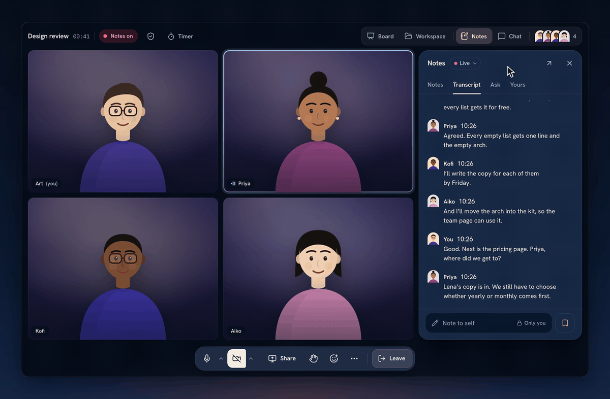
</p>
<p align="center"><sub>A design review in Alcove. Every line lands under who said it, the live notes keep up, and the seal says what’s sealed.</sub></p>

<br>

## Why Alcove

Meeting notes come from one of three places today, and each is wrong for a sensitive conversation:

1. **The platform’s own AI** (Meet, Zoom). Convenient, but the provider reads everything.
2. **A note-taker bot** someone brings in. A third party sits visibly in the call, and its notes push everyone to sign up.
3. **Recording in the background yourself.** Illegal under two-party consent in many places, and awkward for everyone else.

Alcove puts confidential transcription and notes inside an end-to-end encrypted video platform, and backs the promise with
hardware evidence instead of a privacy policy: your browser checks what Alcove’s server runs on, and the server checks what
the AI runs on, before anything is sent.

> [!TIP]
> **Use it now at [alcove.solutions](https://alcove.solutions).** Sign in with Google. Every account starts on Free with
> every feature: unlimited calls of up to 10 hours and 100 people, and about 5 hours of notes every 30 days.

<br>

## What you can do

| In the call | Between calls | Underneath |
| --- | --- | --- |
| [Private notes as you talk](#private-notes-written-as-you-talk) | [Ask every call](#ask-every-call) | [End-to-end encrypted calls](#calls-are-end-to-end-encrypted) |
| [Catch up on what you missed](#catch-up-on-what-you-missed) | [Find a time](#find-a-time) | [Confidential compute](#the-server-runs-in-confidential-compute) |
| [Whiteboards](#whiteboards-inside-the-call) | [Record in the room, offline](#record-in-the-room-even-offline) | [Sealed storage](#everything-stored-is-sealed) |
| [Breakout rooms](#breakout-rooms) | [Your AI agents, over MCP](#your-ai-agents-on-your-terms) | [Verified private AI](#ai-runs-only-on-verified-private-models) |
| [A workspace for every call](#a-workspace-for-every-call) | [Pay with USDC](#pay-with-usdc) | [Verify it yourself](#verify-it-yourself) |
| [Make the call yours](#make-the-call-yours) | | |

### Private notes, written as you talk

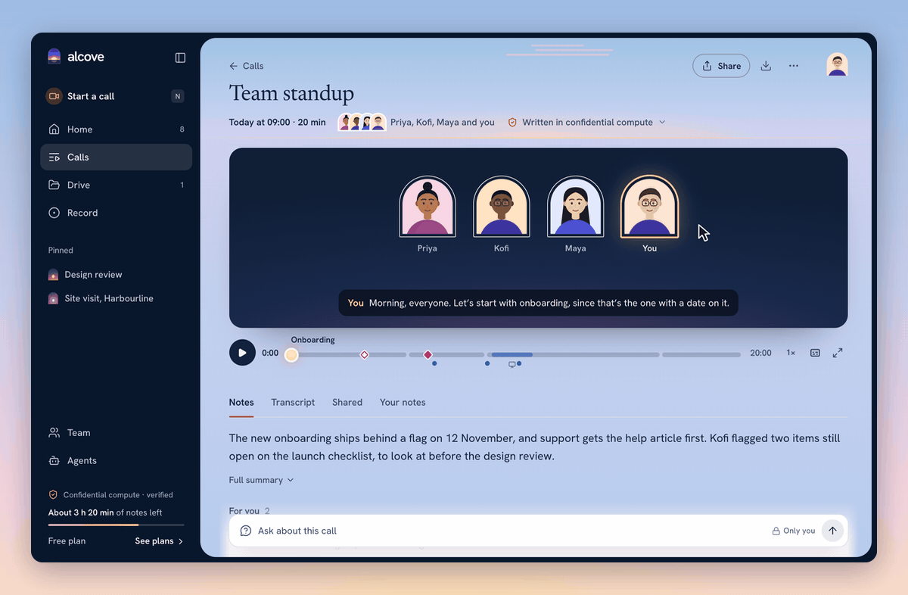

Turn notes on when you schedule a call. While it runs, Alcove writes a live transcript under each speaker and keeps live
notes of what’s decided, suggested and still open. When it ends, everyone invited gets the note: a summary, decisions, open
questions, follow-ups and chapters, each pointing at the moment it was said. Decisions stay proposed until someone confirms
them, and a follow-up is only a suggestion until the person it’s for takes it on.

> **How it works.** The host’s browser sends short speech clips and 5-second audio pieces, sealed on arrival. Before NEAR AI
> gets anything, the API checks the model’s hardware evidence: an Intel TDX quote verified to Intel’s root, the exact
> measurements of the published OS image it booted, NVIDIA’s attestation of its confidential GPUs, and a signature by the
> attested key over the model’s encryption key. Only then is the request sent, sealed with Oblivious HTTP (RFC 9458) to that
> key: Whisper large-v3 transcribes, and the notes model (DeepSeek V4.1 Flash by default) writes. Each note records which
> verified models wrote it and what was checked. [Notes and inference →](docs/engineering/notes-and-inference.md)

### Catch up on what you missed

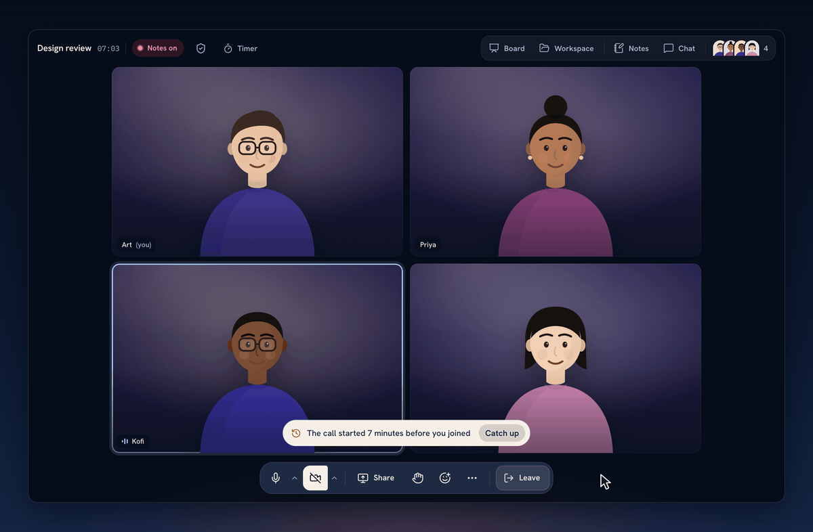

Join late or step away, and **Catch up** tells you, and only you, what you missed: what was decided, suggested, still open
and next, each point with the moments it was said. Ask about any stretch of the call while it’s still going.

> **How it works.** Catch-up reads only the lines you’re allowed to read (your time away, the minutes before you joined, or
> a range you pick) and asks the verified model the same sealed way. Nothing is stored unless you keep an answer in your own
> notes, and a guest who came in by link catches up only on what was said while they were there.

### Whiteboards, inside the call

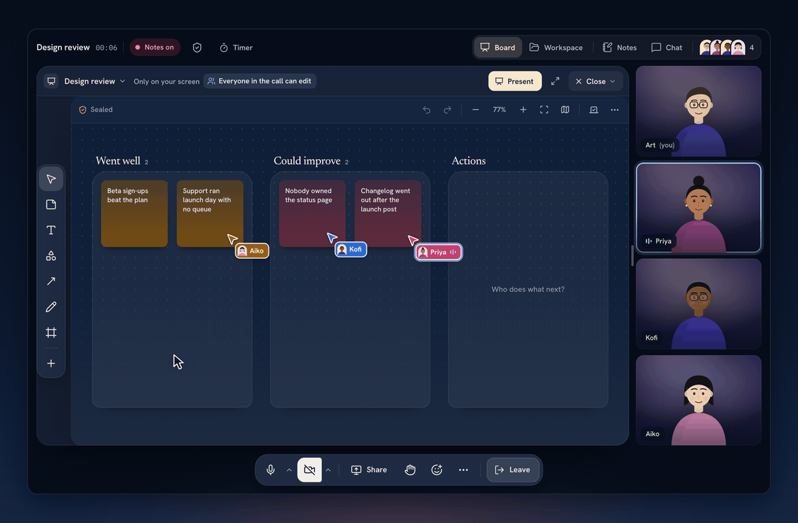

Open a board in the call and everyone works on it at once, guests too: stickies, shapes, connectors, frames, votes and a
timer. It’s only on your screen until you present it; then everyone follows you, and anyone can step away to work
alongside. **Ideas from the call** turns what was just said into stickies, and **Sort into themes** groups them.

> **How it works.** A board is a Yjs document whose shape and rules live in [`packages/board`](packages/board), shared by
> the app and the API. It’s sealed at rest under its workspace’s keys, and the server only ever runs Yjs inside worker
> threads. Pointers and presence travel as awareness. Ideas and themes come from the same verified private model, and an idea
> must quote a line that was actually said, or it’s dropped.

### Breakout rooms

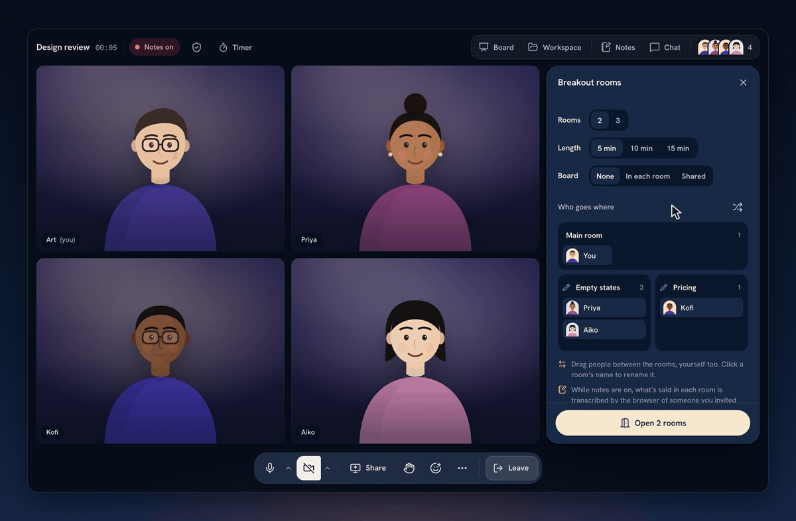

The organizer drags people into rooms, sets how long they last and opens them, and the stage splits into each room with a
countdown. Rooms can each have a board or share one, and when everyone comes back, each room’s talk is its own part of
the notes.

> **How it works.** Each room is its own MLS group, so a room’s media keys and chat belong to the people in it alone. The
> host’s browser makes every room’s group and commits who’s in it. Each room has its own scribe for the transcript, and
> when the rooms close, each room’s board comes back and goes into the note. [Calls and recordings →](docs/engineering/calls-and-recordings.md)

### A workspace for every call

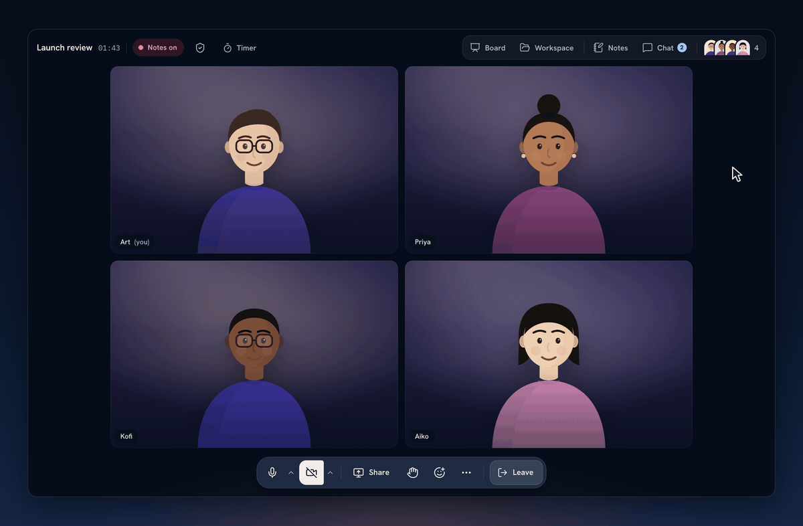

Every call gets a workspace: its notes, follow-ups and transcript land in the call’s folder as live pages, beside documents
your team writes together in real time, with mentions, comments, history and writing offline. In a call it opens just for
you, beside the people, and you can present it so everyone follows along.

> **How it works.** Documents are Yjs documents edited through the API’s live streams, sealed at rest under the workspace’s
> own root key, and opened on the server only in worker threads. What you write offline stays in your browser, sealed under
> a key that can’t leave it, and is sent when you’re back. Find searches every document you can open inside your browser,
> so what you type goes nowhere.

### Make the call yours

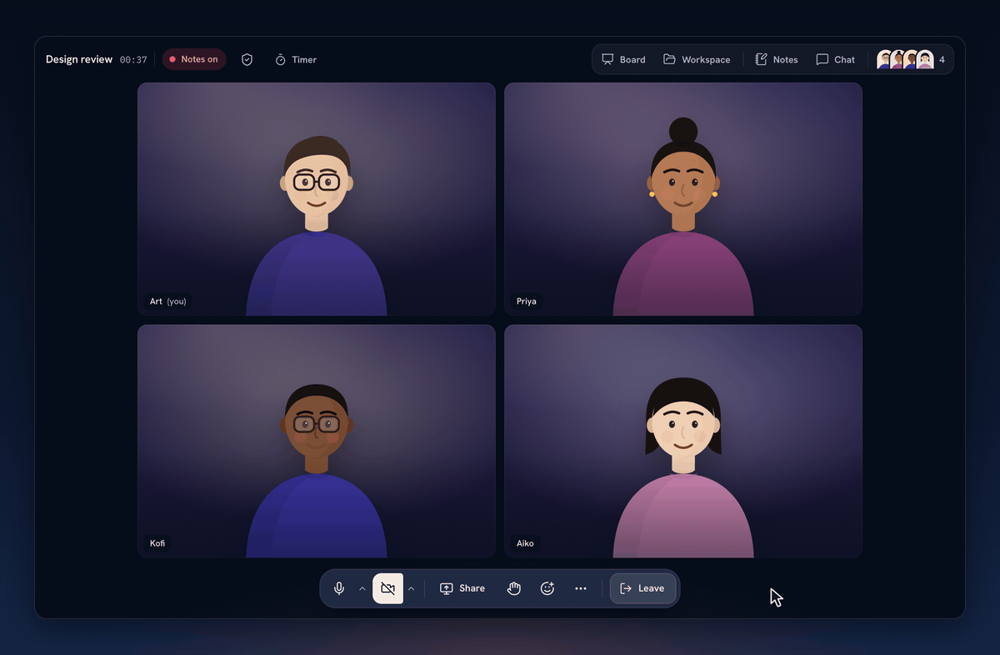

There are no layouts to choose: the stage arranges itself, and you pin people, drag tiles, make one bigger, set your status,
nudge someone quietly, raise your hand, react, or read captions in your own language.

> **How it works.** Hands, questions, votes, nudges and statuses are part of the call’s sealed state, and a nudge reaches
> only the person nudged. Reactions and pointers go between browsers encrypted with keys derived from the call’s MLS
> secrets, so neither Alcove’s server nor the media relay can read them. Your arrangement stays in your browser.

### Ask every call

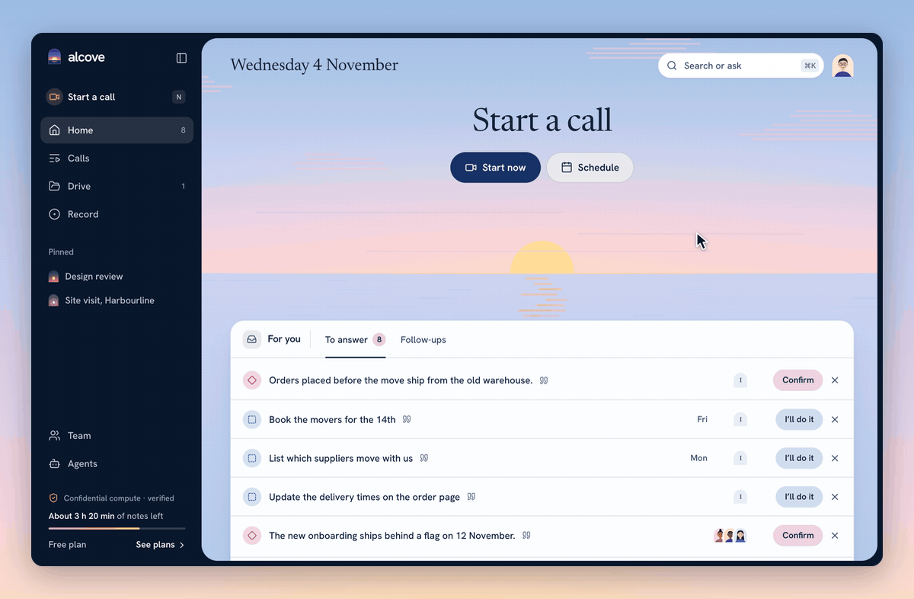

Press <kbd>⌘</kbd> <kbd>K</kbd> to find what anyone said in any call, or ask a question across all of them. The answer
cites the moments it came from; press one and the call opens at that line.

> **How it works.** Questions travel in the request body, never in a URL or a log line. The server opens the notes you
> have, picks the 12 that share the most words with the question (rarer words count for more), sends them sealed to a
> verified model, and checks every citation against what it sent, so a moment the model makes up is dropped. Questions and
> answers are stored nowhere.

### Find a time


Press <kbd>N</kbd> anywhere to start a call now or schedule one. Add people and the week shades when they’re busy and
lights up the times that work for everyone; pick one and Google Calendar sends the invitations. Calls that repeat form a
series, and what one call decided and left open is waiting in the next.

> **How it works.** Busy times come from Google Calendar when you connect it; Alcove keeps the call’s title, guests and
> times as sealed records, and the event on your calendar is what invites people. Notes are set when a call is scheduled, so
> everyone knows before they join.

### Record in the room, even offline

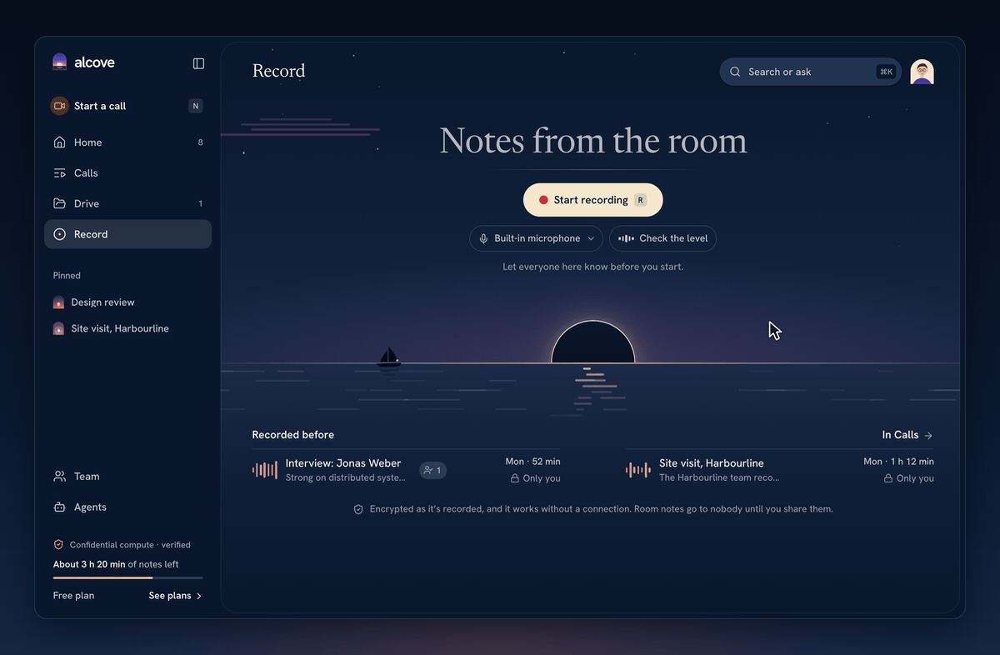

Record an in-person conversation into the same kind of notes. If the connection drops, it keeps recording on your device
and uploads when you’re back.

> **How it works.** The recorder seals audio and speech in the browser with AES-GCM under a key made there that can’t be
> exported (IndexedDB, never sent), holds a lock while it records, and uploads the pieces in order once there’s a
> connection. The server takes them only from the account that recorded them.

### Your AI agents, on your terms

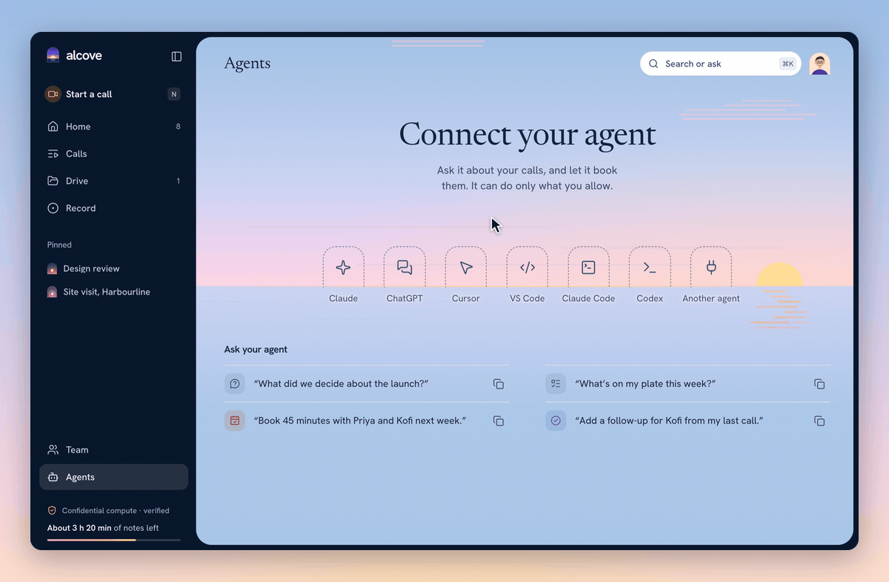

Connect Claude, ChatGPT, Cursor, VS Code, Claude Code or Codex to your meetings. You see exactly what an agent asks for
and can allow less, part by part; every agent stands on the page with what it did, and you can change or disconnect it at
any time.

> **How it works.** Alcove is a remote MCP server at `https://api.alcove.solutions/mcp`, with OAuth (authorization code and
> PKCE) or personal tokens. Permissions are scoped (`notes:read`, `meetings:write`, …), and an agent never gets more than
> you can see yourself. Connections last 30 days unless you keep them longer, refresh tokens rotate (a reused one revokes the
> connection), and every tool call an agent makes is listed for you alone. [Agents and MCP →](docs/engineering/agents-and-mcp.md)

### Pay with USDC

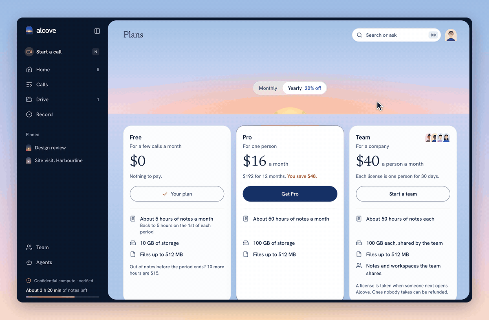

Free has every feature. Pro and team licenses are paid in USDC from the network you choose, with no card on file, and
nothing renews by itself unless you turn it on.

> **How it works.** Checkout opens a one-off deposit address through NEAR Intents 1Click. When the money reaches Alcove’s
> treasury, it’s added to your balance at face value and the purchase is made. If less arrives, the same address waits for
> the rest; if more arrives, the rest stays in your balance. Billing is sealed under a separate service key that can’t open
> anyone’s content. [Plans and usage →](docs/engineering/plans-and-usage.md)

### And so much more

| In the call | With the notes | Everywhere else |
| --- | --- | --- |
| **Chat** with threads, private messages and mentions | **Notes from shared screens**, linked to what was said | **Teams** with licenses and shared workspaces |
| **Screen sharing**, several at once: zoom, freeze, step back | **Series** that carry decisions into the next call | **Google Calendar** invitations, changes kept in step |
| **Pointers and marks** on a share, end-to-end encrypted | **Share notes** by email, with a group, or by a 7-day link | **Google Drive** exports, with your consent |
| **Captions** in your own language | **Your own notes** beside the shared ones | **Notifications** for calls, notes and follow-ups |
| **Raise hand**, questions with votes, spotlight | **Correct the transcript**, then rewrite the notes | **Ringing** your team into a call |
| **A timer** everyone sees, and a **floating call** | **Bookmarks** on a line or a shared screen | **Move a call** to another device with a QR code |

<br>

## How it works

The goal is simple to state: readable content exists only in the browsers of the people it belongs to, and inside Alcove’s
server process while it works on it. Everything else (the database, the object store, the media relay, the logs, the
network) sees ciphertext.

<p align="center">
  <picture>
    <source media="(prefers-color-scheme: dark)" srcset="docs/readme/architecture-dark.svg">
    
  </picture>
</p>

### Calls are end-to-end encrypted

Every browser in a call is an MLS client ([RFC 9420](https://www.rfc-editor.org/rfc/rfc9420), via ts-mls). Keys are made in
the browser and never leave it. Each sender’s media key is exported from the group for every epoch, and frames are
encrypted before they leave the device, so LiveKit relays ciphertext and Alcove’s server only orders and passes on MLS
messages it can’t read. The host’s browser commits who’s in, removes whoever leaves, and rotates the keys every 10 minutes
even when nobody comes or goes.

### The server runs in confidential compute

The API and the web app ship as one container image. CI builds every image, signs it with cosign using a Cloud KMS key,
and logs the signature publicly in [Sigstore’s Rekor](https://docs.sigstore.dev/logging/overview/). It runs in Google
Cloud Confidential Space on Intel TDX, and nowhere else.

- **The master key** is made inside the VM. Cloud KMS releases it only to an attested, CI-signed production image with
  debugging off.
- **TLS ends inside the VM**, with a key only the VM has, and a CAA record pins certificate issuance to the VM’s own ACME
  account.
- **Your browser checks the attestation itself**, against Google’s root and the Rekor proof, before it shows the seal.
  CI checks it again after every deploy, including that the server’s TLS key is the attested one.
- **Nothing is left outside.** The keys from before the move are retired and deleted, the old Cloud Run service is gone,
  and all 28 accounts moved in.

[Alcove in Confidential Space →](infra/confidential-space/README.md)

### Everything stored is sealed

Every account and workspace has its own root key, wrapped under the master and opened per request. Titles, names, guests,
chat, audio, transcripts, notes and files are sealed records (XChaCha20-Poly1305) whose headers bind the owner and the exact
place they’re stored, so a record can’t be moved or replayed somewhere else. Lookups use keyed hashes, logs carry IDs, codes
and counts but never content, and deleting removes rows, receipts and objects for real.
[Privacy, keys and sessions →](docs/engineering/privacy-keys-and-sessions.md)

### AI runs only on verified private models

NEAR AI Cloud runs the models in confidential VMs: Intel TDX with NVIDIA confidential GPUs. Before a model gets anything,
Alcove checks its evidence with a fresh nonce: the TDX quote and Intel’s collateral ([dcap-qvl](https://github.com/Phala-Network/dcap-qvl)),
the boot measurements against a published [dstack](https://github.com/Dstack-TEE/meta-dstack) image, the event log, the
GPUs through NVIDIA’s attestation service, and the model’s encryption key, signed by the attested key. Then each request is
sealed with Oblivious HTTP to that key, so NEAR AI’s gateway and load balancers carry only ciphertext. If anything doesn’t
check out, nothing is sent and the notes wait. An organizer can choose a model that doesn’t run in an enclave; the app
says so wherever that choice is made, and the note records it.

### The life of a note

1. **Notes are on** for the call, set when it was scheduled. Everyone in the call, and anyone about to join, sees what’s
   being captured.
2. **The host’s browser listens** to everyone it hears and sends 5-second audio pieces and short speech clips to the API.
3. **The API seals the audio** under the recording’s own key and sends each clip to Whisper, sealed to its attested key.
   The lines come back, are stored as sealed rows, and stream to everyone in the call.
4. **Live notes keep up** while someone’s watching, refreshed at most every 30 seconds: decided, suggested, still open and
   the follow-ups.
5. **When the call ends**, the notes worker writes the summary, decisions, open questions, follow-ups and chapters, each
   with the moments behind it, and retries if a model is busy.
6. **Everyone invited gets the note**, sealed, with which verified models wrote it and what was checked.

### What each part of the system sees

| Part | What it gets |
| --- | --- |
| Postgres and the object store | Sealed records, opaque IDs, keyed hashes, sizes and times |
| LiveKit, the media relay | Encrypted media frames and who’s connected |
| NEAR AI | Requests sealed to models it runs in enclaves Alcove has just verified |
| Google | Your sign-in, and your calendar if you connect it |
| Logs | Request IDs, codes, counts and durations; never content, keys or session IDs |

### Verify it yourself

Alcove’s own check of the live server runs from a terminal too. It confirms that the TLS key you’re talking to is the
enclave’s, that Google’s attestation token names Alcove’s signed image, and that the image’s signature is in Sigstore’s log
for the commit the server reports:

```console
$ pnpm --filter @alcove/confidential-space exec tsx verify-server.ts \
    https://api.alcove.solutions --web https://alcove.solutions
https://api.alcove.solutions verified: commit 952140e6…, image sha256:532386d4…, TLS key upjxI8W-…
```

<details>
<summary><b>Known limits</b>, stated plainly</summary>
<br>

- The 28 accounts made before the move kept their root keys, wrapped again under the enclave’s master. The old master is
  retired and deleted, but whoever had copied it before could still unwrap those accounts’ keys from the database.
  [Moving to confidential computing →](docs/engineering/privacy-keys-and-sessions.md#moving-to-confidential-computing)
- The Google Cloud project’s owners can still use the Cloud KMS key that wraps the master. Its use is audit-logged, and
  moving it to a project only CI administers is next. [Known limits →](infra/confidential-space/README.md#known-limits)
- What runs inside NEAR AI’s enclaves is NEAR AI’s model code; its OS image is pinned and measured, the model code isn’t
  yet. [What’s left →](docs/engineering/notes-and-inference.md#whats-left)
- Sign-in with Microsoft and single sign-on are demo stand-ins in local development; production signs in with Google.

</details>

<br>

## Built with

| Part | Built with |
| --- | --- |
| **App** | React 19, TanStack Start (as a single-page app), TanStack Router and Query, Tailwind CSS v4, Motion |
| **API** | Node 24, Hono, Postgres 17 (plain SQL, rows parsed with zod), S3-compatible objects, pino |
| **Real time** | LiveKit (WebRTC), MLS (ts-mls), Yjs for documents and boards, NDJSON streams |
| **Cryptography** | @noble/ciphers and @noble/hashes (XChaCha20-Poly1305, HKDF-SHA-256), HPKE and Oblivious HTTP, WebCrypto in the browser |
| **AI** | NEAR AI Cloud (Whisper large-v3, DeepSeek V4.1 Flash), verified with dcap-qvl and NVIDIA’s attestation service |
| **Infrastructure** | Google Cloud Confidential Space (Intel TDX), Cloud KMS, Cloud SQL, Cloudflare R2 and DNS, Let’s Encrypt, Sigstore, GitHub Actions |
| **Payments** | NEAR Intents 1Click (USDC) |
| **Quality** | Strict TypeScript with no `any`, casts or non-null assertions (enforced in CI); integration tests only, over HTTP against real Postgres and an object store; every page and journey in Storybook |

<br>

## Run it yourself

You need Node 24, pnpm 11 and Docker.

```sh
git clone https://github.com/thebakedalaskan/alcove-solutions.git
cd alcove-solutions
cp .env.example .env

# Two keys of 32 random bytes: run this twice, paste one into KMASTER and one into KSERVICE
openssl rand -base64 32 | tr '+/' '-_' | tr -d '='

pnpm install
pnpm dev   # Postgres, an object store and LiveKit in Docker, then the API and the app
```

Open **http://localhost:3000** and press **Continue with Microsoft** to sign in as the demo person, Art Vandelay, with a
sample calendar and a company directory already filled in. **Use single sign-on** with any `example.com` address to be a
second person (to see notes shared with someone, say). Both are local stand-ins; nothing checks those addresses.

| To get | Add to `.env` |
| --- | --- |
| Live transcripts and written notes | `NEAR_AI_API_KEY` from [NEAR AI Cloud](https://cloud.near.ai). Without it, recordings are kept and their notes wait. |
| Google sign-in and Calendar | `GOOGLE_CLIENT_ID` and `GOOGLE_CLIENT_SECRET` from a Google OAuth web client, with `http://localhost:3000/api/v1/auth/google/callback` as a redirect URI |
| Paying with USDC | `TREASURY_INTENTS_ACCOUNT`, the NEAR account that receives payments |

Without Docker or any keys, `pnpm storybook` opens the whole app on a stand-in API at **http://localhost:6006**: every
component, page and journey on made-up data, including every scene in this README.

```sh
pnpm check   # structure and typing guards, migrations, typecheck, integration tests, builds
```

<br>

## Inside the repo

```text
apps/web            The app: TanStack Start (SPA), React 19, Tailwind v4, Motion
apps/api            The API: Hono, Postgres, S3-compatible objects, sign-in, crypto, inference
apps/storybook      Every component, page and journey, on a stand-in API
packages/ui         The design system: tokens, components, illustrations
packages/api        The contract: zod schemas and the AlcoveApi interface
packages/api-http   The browser client: REST, live streams, uploads, MLS, the server check
packages/board      A board's Y.Doc and the logic the app and the API share
infra/              Deployment: GCP bootstrap, the Confidential Space image, signing and rollout
docs/               Product, engineering and design docs
```

| Read | For |
| --- | --- |
| [Product overview](docs/product/overview.md) | Every feature and its status |
| [User flows](docs/product/user-flows.md) | Every journey, step by step |
| [System architecture](docs/engineering/system-architecture.md) | Components, the edge, request lifecycle, limits |
| [Privacy, keys and sessions](docs/engineering/privacy-keys-and-sessions.md) | The trust model and every key |
| [Notes and inference](docs/engineering/notes-and-inference.md) | The transcript, notes, asking, and verified private inference |
| [Calls and recordings](docs/engineering/calls-and-recordings.md) | Calls, MLS, rooms, boards, recording offline |
| [Alcove in Confidential Space](infra/confidential-space/README.md) | How production is built, signed, attested and deployed |
| [Design](docs/design/README.md) | The principles behind the look, page by page |
| [AGENTS.md](AGENTS.md) | The rules for anyone changing the code, people or agents |

<br>

<p align="center">
  <a href="https://alcove.solutions"></a>
  <br>
  <sub><a href="https://alcove.solutions">alcove.solutions</a></sub>
</p>
