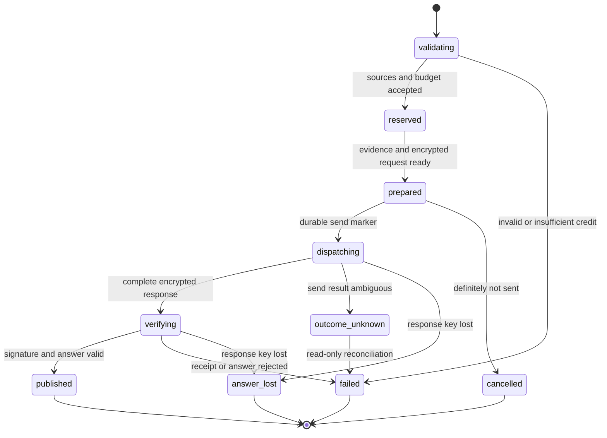

# Chat and Inference

[MVP guide](../README.md) · [Tasks](../delivery/tasks.md) · [Stack and setup](../references/stack-and-provider-setup.md)

Chat is a private conversation first. An owner can talk with the model with no documents at all, and can optionally attach current document or transcript revisions to get answers grounded in them. Every message, with or without sources, uses the mandatory `I01` supported encrypted text route; retrieval and embeddings for attached sources stay inside `C01`. A chat action makes at most one paid model request and publishes an answer only after the response contract verifies and, when sources are attached, its citations validate. This is a bounded conversation pipeline with no autonomous tool loop.

`I01` is an accepted provider trust boundary. Supported channel, attestation, key, encryption, and response checks are mandatory. Provider-wide key custody, internal routing, cache/retention behavior, and shared-key execution attribution are disclosed assumptions; the MVP does not require a separate provider-fleet proof program. Everything below is specified and **Not run**.

## Private chat and optional sources

`chat/start` accepts 0–20 `SourceRevision` entries. With zero sources the chat is a **private chat**: no retrieval runs, the prompt contains only the system instruction, bounded history from the same chat and the question, and the model answers from its general knowledge. The privacy contract is identical to a sourced chat: the message is protected on the owner channel, assembled in `C01`, sent only through the `I01` encrypted route, and stored only as an encrypted chat revision. Nothing about a private chat is written in plaintext or kept by the model provider beyond its accepted `I01` boundary.

When sources are attached, every entry must be owned by the authenticated owner and equal its item's non-deleted current head, and every selected revision must have a `ready` index under the current `indexProfileDigest`. A missing, still-indexing, unsupported, or superseded source blocks admission with its exact safe state. Do not silently fall back to an older revision or exclude a selected source without telling the owner.

A chat fixes its source set, including the empty set, at creation. Continuing it requires the identical source revision set. Attaching sources to a private chat, changing sources, or editing a selected source starts a new chat context (the UI may continue the visible thread, but the new context carries no hidden turns from the old one); saved earlier answers remain readable with their original provenance. Source selection is not expanded by a model instruction, text inside a document, or an earlier generated answer. Source titles, quoted text, and previous messages are all private prompt content.

For a sourced chat, load only the selected encrypted index shards after root delegation. The query embedding is calculated locally using `E02`'s query prefix, bundled tokenizer and normalized 768-dimensional output; document chunks use the corresponding passage prefix. Exact cosine ranking runs over the selected vectors. A protected in-memory lexical index independently ranks the same chunks using its fixed tokenizer and BM25. No plaintext search request goes to an ordinary database or external vector service.

Take the top 40 vector candidates and top 40 lexical candidates, fuse with `score = sum(1/(60 + rank))`, and break ties by item ID, revision ID, and chunk index. Deduplicate candidates covering more than half the same source span, retain at most eight chunks, and enforce a total source budget of 3,000 tokens using the selected `I01` tokenizer. Drop the lowest-ranked whole chunk until the budget fits; do not cut a citation locator in half. Retain encrypted retrieval evidence listing the selected IDs, ranks, profile digest, and exact supplied source spans.

The full request, including system instructions, question, bounded history, delimiters, and any retrieved text, is at most 8,000 input tokens. The question is at most 4,096 UTF-8 bytes. History contains at most the latest 12 messages and 16,384 UTF-8 bytes from this same chat context; remove the oldest complete turn when necessary. Never truncate the current question or system instruction. If those (plus, for a sourced chat, the minimum useful source context) cannot fit, return `CONTEXT_TOO_LARGE` before reserving or dispatching. The exact model tokenizer is a build artifact, not a guessed characters-per-token estimate.

## Prompt and citation contract

`packages/contracts/src/chat.ts` defines `PromptContextV1={sourceSet,question,history,chunks,modelProfile,pricePolicy}`; a private chat has an empty `sourceSet` and no `chunks`. Each chunk has an ephemeral prompt label `S1` through `S8`, exact source revision, locator, text, and retrieval profile. Labels are assigned after final ranking. Delimit source material as untrusted evidence and tell the model that instructions found inside it cannot authorize commands, network access, payments, or changes to source scope.

The selected route uses ordinary text messages, no tool declarations, no provider browsing, and no remote retrieval. The model is asked to emit this bounded JSON inside its encrypted response content:

```text
AnswerV1 = {
  status: "general" | "answered" | "insufficient_context",
  answer: string,                  // at most 12,000 UTF-8 bytes
  citations: [{label, quote}]      // at most 8; quote at most 512 bytes
}
```

In a private chat (no sources) the only valid status is `general`, with an empty citation array. In a sourced chat, `answered` requires at least one citation, `insufficient_context` requires an empty citation array and a plain explanation of the missing evidence, and `general` is invalid, so an answer can never look grounded in files it did not cite. The UI labels `general` answers as general knowledge, not as coming from the owner's files. Every label must have been supplied in this request. Every quote must be an exact contiguous substring of that label's canonical source text. Native page locators resolve block IDs and code-point offsets; PDF locators resolve page and offsets; TXT/MD resolve lines; transcripts resolve recording/segment/epoch, canonical `startMs/endMs`, and source chunk IDs whose audio headers retain sample-frame anchors. Store the resolved locators, not just the model's label string.

Malformed JSON, invented labels, unmatched quotes, oversized output, or invalid locators produces `ANSWER_INVALID`. There is no automatic second model call to repair output. A supported response signature proves the claimed signer and bytes; citation validation proves source correspondence. Neither proves that the prose's reasoning is correct. Display the answer as sanitized text/limited Markdown with clickable internal source locators and no executable HTML or automatic external requests.

## Public logical API and stored state

All methods use the encrypted common envelope and the established owner. The body cannot override billing account or provider destination.

| Method | Body → result | Failure and retry contract |
| --- | --- | --- |
| `/mvp/v1/chat/start` | `{chatId:null|Id128,question,sourceRevisions:[0..20],maxCredits:"132"}` → `{chatId,actionId,state,reserveMaxCredits:"132"}` | Validates any attached sources, context and fixed price policy; an empty `sourceRevisions` starts or continues a private chat; insufficient credit never dispatches. Same operation returns same action. |
| `/mvp/v1/chat/get` | `{chatId,actionId}` → `{state,answer:null|PublishedAnswer,retailState,supplierExpenseState,error:null|SafeError}` | Safe encrypted polling; missing/wrong owner is indistinguishable. |
| `/mvp/v1/chat/history` | `{chatId,cursor,limit:1..20}` → `{turns,nextCursor}` | Returns saved turns with exact source revisions and receipt kind. No implicit cross-chat context. |
| `/mvp/v1/chat/cancel` | `{chatId,actionId}` → `{state,dispatchMayHaveOccurred}` | Stops unsent work; after possible send it cancels publication intent but still reconciles expense. Repetition is safe. |

`PublishedAnswer={revisionId,answer,citations,sourceRevisions,verification,usage}` is encrypted at rest as a chat-item revision. `verification` records the exact upstream signature kind, evidence digest, completion ID, request/response ciphertext digests, and verification timestamp. Provider IDs and usage are encrypted. UI wording distinguishes a provider receipt from a gateway receipt.

The content job projection stores opaque owner/chat/action IDs, enum state, version, and lease state. Its encrypted payload holds source selection, prompt context, prepared body/headers, provider identities, reservation handle, raw response object references, and user-visible result. The accounting module uses a separate blinded lookup key and encrypted owner/action mapping; a shared public action ID must not join ordinary SQL content ownership to private billing usage.



`outcome_unknown` is a persistent accounting/reconciliation state, not a retry instruction. A previously published answer remains published after process restart because its owner-encrypted revision was committed. An unpersisted answer may be lost even when the provider charged for it.

## Billing admission and exactly bounded dispatch

The confidential chat module calls the billing module before preparing paid work:

```text
admitAction({
  ownerId, actionId, kind:"chat", reserveMaxCredits:"132",
  deadlineMs,
  usageBound:{maxInputTokens:8000,maxOutputTokens:1024,
              maxProviderRequests:1}
}) -> {reservationId,state}
```

The authenticated owner-to-account binding lives in the billing module. The action deadline is at most 120 seconds after admission and no later than the active session's absolute deadline; require 120 seconds of remaining session lifetime at admission. Reserve 30 seconds of that window for receipt verification. The outbound response timeout is the smaller of 90 seconds and the remaining action time minus those 30 seconds; a nonpositive remainder cancels before send. The retail policy is `ceil(inputTokens/100) + ceil(outputTokens/20)`, so the selected maxima reserve at most 132 credits. The configured supplier price policy must also cover all chargeable token categories for this exact route; a missing or expired supplier bound rejects admission. Price values and retail credits are separate from provider expense.

Only `settleAction({reservationId,settlementId,actualDebitCredits,usageUnits,providerExpense?})` or `reconcileAction({reservationId,evidence})` can change the reservation. An ordinary database row lock protects the state transition and version; the arithmetic and amounts remain encrypted outside `C01`. Count the provider request as consumed when the transaction changes `prepared` to `dispatching`, before the outbound call. A process lease expiry does not reset that counter.

Charge retail credit only when a verified usable answer and its validated usage are durably published. The encrypted chat publication includes a unique settlement event; an idempotent accounting projection applies that event once after commit. A crash between publication and projection leaves a retail hold until the publication query resolves. Confirmed terminal failure or `answer_lost` with no publication releases the retail reservation; uncertain supplier expense remains tracked and its exposure remains held against the operator's supplier budget. It is not falsely recorded as zero. Payments defines the exact ledger states and reconciliation schedule.

## Supported inference adapter

`I01D` is a thin project adapter around the supported `I01` primitives, not a fork adding new private-key APIs. Its interface is `preflight(profile)`, `prepare(request,verifiedModelKey)`, `sendOnce(prepared)`, `verify(rawRequest,rawResponse,receipt,evidence)`, and `readCost(providerIdentity)`. It runs inside the confidential API and directly owns the actual outbound transport; there is no separate dispatch service.

1. Select the exact canonical `I01M` ID from the accepted build profile. Obtain current supported gateway/model metadata and attestation evidence with fresh challenges. Verify the documented platform, challenge, public-key, configuration, and transport bindings against the configured policy. Retain the accepted preflight evidence. The provider's returned candidate set is not treated as an exhaustive fleet inventory.
2. Use the supported gateway attestation/TLS helpers on the actual outbound connection. Require normal certificate/hostname checks and the supported attested TLS key binding. Do not verify a different connection and then send private data through an unrelated proxy. Fixed destination/route allowlists disallow arbitrary URLs and redirects.
3. Build an allowlisted non-streaming request: canonical `model`, `messages`, the profile-approved output-token parameter bounded to 1,024, `stream:false`, and the fixed approved sampling parameters. Only documented encrypted message fields contain private data. No private text goes in `user`, metadata, headers, model ID, URLs, or unknown JSON fields. Unsupported endpoints/models do not receive a plaintext fallback.
4. Call `prepareE2eeChatRequest({request,modelKey})` with explicit supported field E2EE. Preserve its encrypted wire body, exact encryption headers, and in-memory `decryptResponse` closure. Require no-aliasing and the selected encryption version; inspect emitted headers and field coverage in fixtures. The helper owns its ephemeral response key. The application does not claim an upstream key-export or recovery API.
5. Serialize the encrypted request once. Persist its exact bytes, bounded headers, accepted evidence, reservation binding and dispatch state encrypted under the owner action record. The response private key remains only in the helper closure and is never persisted. Commit `dispatching` before one outbound POST. Disable automatic POST retries and redirects in every HTTP/client layer.
6. Buffer the original uncompressed encrypted response bytes up to 2 MiB; do not publish partial text. Keep `inference-id`, completion `id`, and transport request ID as distinct encrypted fields. Capture ciphertext bytes before parsing or reserializing. Decrypt through the same helper closure and preserve the original bytes for verification.
7. Fetch the completion receipt through read-only requests at offsets 0, 1, 2, 4, 8, and 15 seconds after response completion. Its deadline is the earlier of response completion plus 30 seconds and the original action deadline. These retries never send another inference. Verify exactly the signature contract and signer kind returned by the supported route: `provider_tee` against the matching retained model evidence; `gateway` against the accepted gateway evidence and the gateway contract's signed bytes. Never verify one kind using the other's message layout.
8. A provider receipt supports the provider-signature claim it actually supplies. A gateway receipt supports gateway receipt of the encrypted exchange; it is accepted for this MVP under provider trust, and is not labelled provider-TEE execution proof. Missing/invalid required supported receipts remain `SIGNATURE_UNAVAILABLE` or `RESPONSE_UNVERIFIED`. An undocumented signature-kind spelling, non-success receipt body, ambiguous signer binding, or changed bytes cannot become verified by being success-shaped JSON.
9. Validate `AnswerV1`, citations, actual usage bounds, source heads and deletion state again. Atomically publish the encrypted answer and the retail settlement event. Then discard the response closure and plaintext prompt/response buffers. Raw encrypted exchange/evidence can remain with the owner-encrypted chat for troubleshooting; their retention does not imply a retained private response key.

The build must exercise this exact non-streaming route against the supported current provider contract. If a required cryptographic helper or response kind is unsupported, fix the integration or choose another explicitly supported canonical `I01` profile before the demo. Do not add an unsupported proof requirement and describe it as a provider outage. Accepted provider assumptions remain visible separately from actual failed cryptographic checks.

## Lock, cancellation, crash, and uncertainty

Before send, lock/cancel/deadline/source change aborts the action and releases admission when the persisted state confirms it was not sent. After the send marker, the outcome may be ambiguous even if no bytes actually left the process. Mark it unknown and reconcile; the application does not claim exactly-once delivery across arbitrary network failure.

During an ordinary in-process disconnect, the closure remains alive and the action can finish capturing/verifying within its original deadline. Desktop lock removes the general owner root and stops new source access; the bounded action may finish its already-authorized response using its existing action key. Publication stays encrypted until the next owner unlock. Cancellation after send prevents publication if that is still possible, but does not assert that provider work or charges stopped.

If the API crashes before a verified answer is durably published, the response-key closure is lost. Restart marks a possibly sent action `answer_lost`/`outcome_unknown` as appropriate. Retained ciphertext and IDs allow read-only receipt/cost investigation, but cannot recreate the missing response private key. A definite `prepared` but never `dispatching` action is cancelled rather than secretly recreated. A new attempt requires an explicit owner action with a new operation/action ID and a fresh reservation. The UI explains that the earlier attempt may have incurred supplier cost while no retail charge is taken for a confirmed lost answer.

## Acceptance evidence

Fixtures prove a private chat with zero sources runs no retrieval and accepts only `general` answers, and prove stable source selection, deterministic ranking/ties, token ceilings, exact page/block/time locators, encrypted shard persistence, and refusal of source-changing prompt instructions. Native/UI tests demonstrate source selection, visible indexing states, source edits forcing a fresh context, valid citations opening the exact original revision, an insufficient-context response without invented references, and attaching sources to a private chat starting a fresh context.

Adapter tests mutate attestation nonce, model key, gateway TLS binding, encryption header, request byte, response byte, signature kind, signer identity, citation quote, usage, and completion ID. Verify no private canary appears in plaintext request fields or ordinary logs. Test missing receipts and gateway receipts without presenting them as provider-execution proofs. Test a provider error shaped as a success response.

Crash tests cover before send marker, after marker, after actual send, before decryption, after verification but before publication, and after publication before retail settlement. Each test asserts provider request count never exceeds one, no automatic paid retry occurs, lost response keys produce honest states, retail settlement is idempotent, and unknown supplier costs remain unknown. The final evidence must include one real supported encrypted request with exact-byte receipt verification and a reopenable cited answer. All results currently remain **Not run**.
