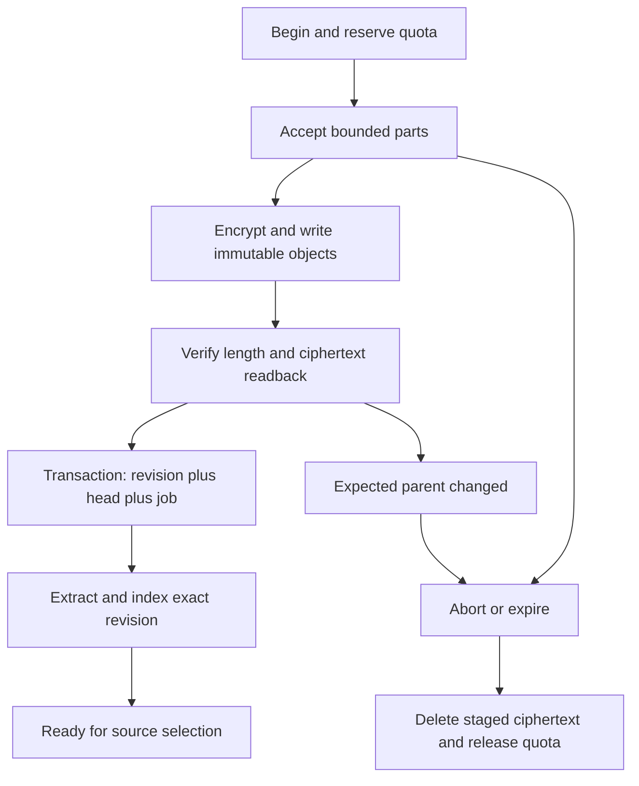

# Files, Documents, and Storage

[MVP guide](../README.md) · [Tasks](../delivery/tasks.md) · [Stack and setup](../references/stack-and-provider-setup.md)

The MVP supports native editable pages, text-bearing PDF uploads, UTF-8 TXT/MD uploads, and transcripts produced by the supported meeting route. Originals and immutable revisions are retained as ciphertext. Native pages use full JSON revisions with an expected-parent comparison; there is no collaborative merge engine. TXT/MD can be opened with **Edit as page**, creating an editable native page while preserving the uploaded original and its provenance. A PDF can be viewed, searched when extraction succeeds, and replaced with a new file revision; it is not edited in place.

All contracts below are implementation requirements. No parser, storage, editor, or restart test has run.

## Content model and editor schema

`ItemKind` is `page|file|transcript|chat`. `SourceRevision` is `{itemId:Id128,revisionId:Id128}`. Each content change creates a new `revisionId`; `expectedRevisionId` must equal the item's current head. Reusing a mutation's original `operationId` returns its original result. A different operation with an outdated expected head receives `REVISION_CONFLICT` and the current head; it never silently overwrites a newer save.

`NativePageV1={schema:"NativePageV1",document,importedFrom:SourceRevision|null}` uses the fixed `N01` node schema in `packages/editor-schema`. Allowed nodes are document, paragraph, headings levels 1–3, bullet/ordered lists, list item, block quote, code block, horizontal rule, text, and hard break. Allowed marks are strong, emphasis, inline code, and a validated link. Every non-text content block has an immutable random `blockId`; splitting creates a new ID, moving preserves it. No executable HTML, embedded browser, arbitrary image source, remote include, or unknown attribute is accepted.

Links use approved `https:`/`http:` destinations or internal item references. They are inert in retrieved context and open only after the owner's deliberate click. File and native-command schemes are rejected. Save-time validation bounds canonical JSON to 2 MiB, depth to 32, nodes to 20,000, and text to 250,000 code points. A pasted unsupported structure becomes visible plain text before save; unknown serialized nodes are rejected rather than interpreted differently by client and server.

The text projection is deterministic: traverse document order, emit text and hard breaks, put one newline between blocks, and retain `{blockId,startCodePoint,endCodePoint}` spans. The same schema and fixture corpus run in renderer, native validation, and `C01`. A revision stores its canonical body digest inside its encrypted manifest.

For TXT import, decode strict UTF-8, strip a leading UTF-8 BOM if present, preserve the original bytes, and normalize CRLF to LF only in the derived page. For MD import, map supported constructs to the fixed node schema; retain unsupported constructs and HTML as visible literal text. The import result reports `literalizedConstructs` so the UI does not imply exact visual round-tripping. The new page's encrypted manifest records `importedFrom`, the original format, and import transform version. Editing this page does not overwrite the original file. The user may also replace the original with another supported file revision.

## Ciphertext representation and SQL ownership

Each revision receives a new random `Krecord` and owner `KeyEnvelope`. The encrypted revision manifest contains title/name, MIME/format, plaintext length/digest, parent revision, optional import provenance, body object descriptors, extraction status, and index descriptors. Payload objects use `CS01` records. Neither object names nor clear SQL columns contain filenames, titles, excerpts, vectors, plaintext hashes, or payment amounts.

The authoritative content schema is the following minimum. `mvp_id128` and `mvp_owner_id` are checked text domains matching the canonical encodings in Privacy. `ciphertext` columns contain complete authenticated record envelopes, not plaintext JSON. All foreign-key references are owner-scoped in application queries and corresponding composite database constraints. Application decoding additionally enforces canonical base64url round trips.

```sql
CREATE DOMAIN mvp_id128 AS text
  CHECK (VALUE ~ '^[A-Za-z0-9_-]{22}$');
CREATE DOMAIN mvp_owner_id AS text
  CHECK (VALUE ~ '^[A-Za-z0-9_-]{43}$');
CREATE TABLE owners (
  owner_id mvp_owner_id PRIMARY KEY,
  auth_public_key bytea NOT NULL UNIQUE,
  stored_bytes bigint NOT NULL CHECK (stored_bytes >= 0),
  reserved_bytes bigint NOT NULL CHECK (reserved_bytes >= 0),
  version bigint NOT NULL CHECK (version >= 0)
);
CREATE TABLE items (
  owner_id mvp_owner_id NOT NULL REFERENCES owners(owner_id),
  item_id mvp_id128 NOT NULL,
  kind text NOT NULL CHECK (kind IN ('page','file','transcript','chat')),
  current_revision_id mvp_id128 NOT NULL,
  deleted_at timestamptz,
  version bigint NOT NULL CHECK (version >= 0),
  PRIMARY KEY (owner_id, item_id)
);
CREATE TABLE revisions (
  owner_id mvp_owner_id NOT NULL,
  item_id mvp_id128 NOT NULL,
  revision_id mvp_id128 NOT NULL,
  parent_revision_id mvp_id128,
  key_envelope bytea NOT NULL,
  manifest_ciphertext bytea NOT NULL,
  index_state text NOT NULL,
  created_at timestamptz NOT NULL,
  PRIMARY KEY (owner_id, revision_id),
  UNIQUE (owner_id, item_id, revision_id),
  FOREIGN KEY (owner_id, item_id) REFERENCES items(owner_id, item_id)
    DEFERRABLE INITIALLY DEFERRED
);
CREATE TABLE object_refs (
  owner_id mvp_owner_id NOT NULL,
  revision_id mvp_id128 NOT NULL,
  object_id mvp_id128 NOT NULL,
  cipher_sha256 bytea NOT NULL,
  cipher_bytes bigint NOT NULL CHECK (cipher_bytes > 0),
  PRIMARY KEY (owner_id, object_id),
  FOREIGN KEY (owner_id, revision_id) REFERENCES revisions(owner_id, revision_id)
);
CREATE TABLE uploads (
  owner_id mvp_owner_id NOT NULL,
  upload_id mvp_id128 NOT NULL,
  state text NOT NULL,
  reserved_bytes bigint NOT NULL CHECK (reserved_bytes >= 0),
  state_ciphertext bytea NOT NULL,
  expires_at timestamptz NOT NULL,
  version bigint NOT NULL,
  PRIMARY KEY (owner_id, upload_id)
);
CREATE TABLE operations (
  owner_id mvp_owner_id NOT NULL,
  operation_id mvp_id128 NOT NULL,
  method text NOT NULL,
  request_commitment bytea NOT NULL,
  result_ciphertext bytea NOT NULL,
  completed_at timestamptz NOT NULL,
  PRIMARY KEY (owner_id, operation_id)
);
CREATE TABLE content_jobs (
  owner_id mvp_owner_id NOT NULL,
  job_id mvp_id128 NOT NULL,
  revision_id mvp_id128 NOT NULL,
  kind text NOT NULL,
  state text NOT NULL,
  lease_until timestamptz,
  attempt integer NOT NULL CHECK (attempt BETWEEN 0 AND 3),
  job_ciphertext bytea NOT NULL,
  PRIMARY KEY (owner_id, job_id),
  UNIQUE (owner_id, revision_id, kind)
);
```

Add a deferred composite foreign key from item head `(owner_id,item_id,current_revision_id)` to revisions `(owner_id,item_id,revision_id)`, the corresponding `(owner_id,item_id,parent_revision_id)` parent constraint, an upload-part table keyed by `(owner_id,upload_id,partIndex)`, and indexes for current non-deleted items, queued jobs, expired uploads, and object garbage collection. Upload parts store only ciphertext object ID/digest/length outside their encrypted state. Set a bounded database statement timeout; serialize quota/head changes with row locks. The database role uses owner-scoped queries and row policies as defense in depth.

`request_commitment` is HMAC-SHA256 over the canonical request body, using `HKDF-SHA256(Kowner,salt=decode(ownerId),info=UTF8("MVP/operation-commit/v1"),length=32)`, not a public hash of guessable text. Derive the operation-result encryption key identically with `info="MVP/operation-result/v1"` and use the common authenticated record format. Retain mutation receipts for the lifetime of owner data. Operation IDs supplied after deletion cannot resurrect a tombstoned item. This schema is separate from the encrypted billing-state schema in Payments.

## Complete content API

Every method below is a logical method inside the encrypted channel, with the common `operationId` and owner binding. IDs, format enums, byte counts, title/name limits of 512 UTF-8 bytes, and unknown-field rejection are part of the strict schema.

| Method suffix under `/mvp/v1` | Body → result | State/failure/idempotency |
| --- | --- | --- |
| `/items/list` | `{cursor:null|string,limit:1..50}` → `{items:[{itemId,kind,title,currentRevisionId,indexState}],nextCursor}` | Owner-bound opaque cursor; deleted items omitted; query is safe to repeat. |
| `/items/get` | `{itemId,revisionId:null|Id128}` → `{item,revision,contentDescriptor}` | Null means current; deleted/missing is `ITEM_NOT_FOUND`; no cross-owner existence disclosure. |
| `/items/revisions` | `{itemId,cursor,limit:1..50}` → `{revisions,nextCursor}` | Returns encrypted metadata through channel; history is read-only. |
| `/docs/create` | `{title,document}` → `{itemId,revisionId,indexState:"queued"}` | Validates fixed schema, reserves storage, creates first revision exactly once. |
| `/docs/save` | `{itemId,expectedRevisionId,title,document}` → `{revisionId,indexState:"queued"}` | `REVISION_CONFLICT`, `DOCUMENT_INVALID`, or `QUOTA_EXCEEDED`; full revision, never partial merge. |
| `/files/begin` | `{itemId:null|Id128,expectedRevisionId:null|Id128,name,format:"pdf"|"txt"|"md",byteLength:U64}` → `{uploadId,itemId,revisionId,chunkBytes:262144,expiresAtMs}` | New item requires both item/head null; replace requires both set. Reserve quota including maximum envelope overhead; expires in 24 hours. |
| `/files/putChunk` | `{uploadId,partIndex:uint32,bytes:base64url}` → `{partIndex,acceptedBytes:U64}` | Native streams picker bytes. At most 256 KiB except shorter final chunk. Same slot/same digest is a no-op; different bytes is `UPLOAD_PART_CONFLICT`. |
| `/files/complete` | `{uploadId,plaintextSha256:Digest32}` → `{itemId,revisionId,indexState}` | Requires all parts, exact declared total and digest, allowed detected format, readback-verified objects, and current expected parent. Commit once. |
| `/files/abort` | `{uploadId}` → `{state:"aborted"}` | Idempotent; releases quota reservation and queues staged-object deletion. Committed upload returns its immutable result. |
| `/files/readChunk` | `{itemId,revisionId,partIndex}` → `{bytes,partIndex,last}` | Decrypts only within active owner session; channel output never uses a public presigned content URL. |
| `/files/editAsPage` | `{itemId,revisionId,title}` → `{itemId:newPageId,revisionId,literalizedConstructs}` | TXT/MD only. Import provenance fixed to source revision; repeated operation returns same new page. |
| `/meetings/transcripts/save` | `{itemId,expectedRevisionId,corrections:[{segmentId,text}]}` → `{itemId,revisionId,parentRevisionId,indexState}` | 1–100 unique existing segment IDs, each text at most 8 KiB, at most 128 KiB replacement text total and 256 KiB encrypted control request. Full immutable transcript revision with expected-parent CAS; only text changes. |
| `/items/delete` | `{itemId,expectedRevisionId}` → `{deleted:true}` | Tombstones item, invalidates retrieval immediately, schedules ciphertext deletion. Head conflict is explicit. |

`/items/get` returns native JSON directly when it fits the body bound; binary originals use bounded read-chunk calls. PDF preview decrypts inside native and passes only the selected document bytes to the restricted platform preview; temporary plaintext files are forbidden. If the preview component requires a file, implement an explicitly bounded native in-memory document adapter or reject that component during build selection.

## Upload and revision transaction



Beginning an upload allocates random item/revision IDs and a revision key. The key is owner-wrapped immediately; staging state includes expected parent, original metadata, part digests, and the key envelope. Each part is encrypted once and written under a fresh random object ID. An interrupted object write is retried to a new object ID unless the existing object's exact ciphertext digest is known; never reuse a nonce with different bytes. Verify object readback before accepting the part.

Completion takes the owner quota and item row locks, checks the expected head again, verifies total bytes and complete content digest inside `C01`, validates format, inserts the revision/object references, updates the head and byte counters, records the completed operation, and enqueues one extraction job in the same transaction. A stale parent leaves the old head intact and requires an explicit owner retry. Readback or database failure cannot publish a half-uploaded revision.

Native page save uses the same immutable-object and head transaction with a server-generated revision key. Local editor changes are encrypted by native into `L01` every two seconds and on focus loss; server autosave is debounced to at least two seconds. Show `Saved on this device`, `Saving`, `Saved`, and `Conflict` distinctly. On app restart, unlock, load the encrypted draft, compare its base revision to the server head, and offer the actual conflicting text for the owner to resolve. Do not discard the local draft on a network failure.

## Protected extraction and retrieval artifacts

The PDF parser subprocess receives only the selected revision bytes, no network, keys, credentials, or database connection. Cap it at 512 MiB memory, 60 seconds CPU/wall supervision, 250 pages, and 250,000 extracted code points. TXT/MD decoding has the same text ceiling. Invalid UTF-8, encrypted/password PDF, parser failure, empty extracted text, and over-limit expansion yield explicit extraction states while preserving the successfully stored original. Scanned/image-only PDF is `text_unavailable`; no OCR is implied.

Store canonical `ExtractedTextV1={sourceRevision,extractorProfile,text,spans,coverage}` encrypted under the revision key. PDF spans carry one-based page and code-point ranges; text files carry line ranges; native pages carry stable block IDs. Transcript spans carry recording ID, `segmentId:Id128`, epoch, `startMs/endMs:U64`, source chunk IDs, and text range; the referenced audio chunks retain exact sample-frame anchors. Partial extraction is never labelled complete; the selected MVP treats a partial/over-limit revision as non-indexable.

Chunk with the bundled `E02` tokenizer into 384-token windows with 48-token overlap, preserving source spans; a window never crosses an item revision. Enforce at most 600 chunks per revision and 20,000 current chunks overall. Persist normalized 768-dimensional float32 vectors and lexical text in an encrypted source shard. The embedding model, tokenizer, parser, and transform version form `indexProfileDigest`. Load only selected source shards into protected memory; no external plaintext/vector service is involved.

`index_state` is `queued|awaiting_unlock|indexing|ready|text_unavailable|unsupported|failed|superseded`. A new head supersedes the old active index; historical revisions remain readable, while new chat context selects current ready heads only. Existing saved answers preserve their exact historical citations. A changed index profile triggers deterministic re-indexing after unlock, not mutation of the original source revision.

## Recording handoff, deletion, and recovery

`commitRecordingArtifact({ownerId,recordingId,artifactId,kind:"transcript",expectedRevisionId,encryptedObjectRef,cipherSha256,recordingKeyEnvelope,provenance})` is internal to accepted `C01`. Verify the recording/account binding, declared artifact type and digest, frame locators, terminal or explicitly partial coverage, and expected transcript head. The core unwraps the recording-scoped artifact inside the confidential boundary and produces a normal owner-wrapped transcript revision with its source mapping. The worker never receives `Kowner`. `artifactId` is the idempotency key; conflicting bytes under that ID fail.

If the owner is locked, handoff is `pending_import`. Native unlock authorizes the normal core import; it is not an instruction to rerun attendance or paid speech. Import commits transcript revision, source links, and indexing job atomically. Original audio remains a separate encrypted recording reference under the same owner quota.

Transcript correction uses `/mvp/v1/meetings/transcripts/save` after unlock. Each patch identifies an existing `segmentId` and replaces only its text. Reject duplicate/unknown segments, invalid UTF-8, empty correction lists, changed timestamp/chunk fields, or a result over the transcript/text bounds. Preserve segment IDs, epoch, `startMs`, `endMs`, `sourceChunkIds`, and `speaker:null` exactly. The new full transcript revision records `edited:true`, `originalTranscriptRevisionId`, and the immediate parent. Commit its new head, supersede the prior active index, and queue re-indexing in one transaction. Do not rerun attendance or speech recognition. The original transcript and recording remain readable; existing saved citations continue pointing to the original revision. `REVISION_CONFLICT` and `OPERATION_CONFLICT` follow the common CAS/idempotency rules.

Deleting an item excludes it from retrieval immediately and cancels unstarted jobs. Active source snapshots are checked again before dispatch/publication; affected chats fail with `SOURCE_CHANGED`. Delete live ciphertext objects and local cached content within 24 hours. Existing ciphertext backups expire within the seven-day backup policy; do not claim immediate physical erasure. Derivative indexes are deleted with their source. Previously completed chats retain their saved quoted text until the owner deletes those chats; the deletion UI states this explicitly.

Deleting an imported transcript also tombstones its owner-bound recording, audio, derived artifacts, and recording key envelopes. Stop/revoke any still-active recording run before physical disposal and reject later imports/retries for the tombstone. Remove live wrappers/objects/caches within 24 hours; release storage quota only after object removal is verified. The result `{deleted:true}` means immediate logical deletion; physical cleanup and existing encrypted-backup expiry follow the stated policy. The original payment/usage ledger remains separate and contains no retained transcript text.

On restart, expired worker leases return uncharged extraction jobs to `awaiting_unlock`. Retry parser failures at most three total attempts only for transient process/storage errors; deterministic invalid input is not retried. Staged uploads can resume after unlock within 24 hours. Garbage collection checks live revisions, uploads, recordings, and backup inventory before deleting an unreferenced object. Missing object/tag failure marks a revision unavailable and never substitutes another revision.

Acceptance covers create/edit/reopen, offline draft recovery, concurrent autosave conflict, TXT/MD import and provenance, PDF page citations, binary replacement history, multipart interruption, quota exhaustion, malicious parser inputs, ciphertext readback failure, SQL failure after object write, delete during chat, exact transcript time locators, and locked recording import. Inspect database and object-store snapshots for text/vector/name canaries. All evidence is **Not run**.
