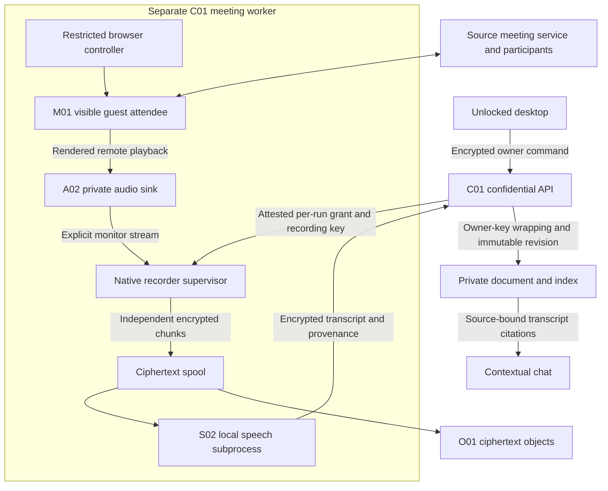
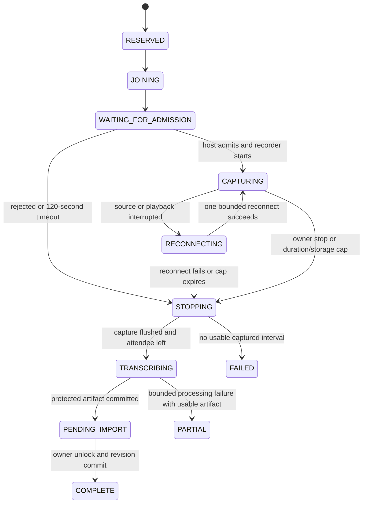

# Google Meet and Transcripts

[MVP guide](../README.md) · [Tasks](../delivery/tasks.md) · [Stack and setup](../references/stack-and-provider-setup.md)

This implements one real, owner-authorized meeting transcription route for the desktop MVP: paste a meeting link, admit a visibly named guest attendee, capture its rendered remote audio inside an approved confidential worker, and save a private transcript that can be opened and cited in chat. The reference call must allow guests and its host must admit the attendee. Browser admission and playback are implementation tests, not established results of this specification.

The runtime and source profiles are C01, M01, A02 and S02. Exact suppliers, candidate versions, source URLs and build recipes live in the reference pages. The source provider already handles the original call and delivers the meeting page's JavaScript; that is an accepted source-call boundary. The separate C01 meeting worker receives only the selected meeting and recording-scoped authority. It has no historical documents, owner vault root, payment credentials or inference credentials.

## 1. Supported journey and finite limits

The owner unlocks the desktop installation, pastes a supported meeting URL, enters a recording title and explicitly authorizes the attendee and recording. The UI displays the attendee name, maximum duration, maximum credit reservation and the fact that participants must know about the recording. The attendee uses the fixed visible name `Private Notes — recording`. This is a product notice; browser playback recording does not activate the source provider's native recording indicator. The host admits that attendee. Microphone and camera remain off.

| Reference limit | Value and behavior |
| --- | --- |
| Concurrent sessions | One active meeting per owner and one meeting per worker VM |
| Admission deadline | 120 seconds from join request; timeout leaves the call and releases proven unused reservation |
| Maximum admitted duration | 1,800,000 ms, including reconnect time after first admission |
| Capture format | Signed 16-bit little-endian PCM, 48,000 Hz, mono |
| Storage chunk | Independent complete FLAC stream for 240,000 frames, normally 5 seconds |
| Count and storage | At most 361 chunks, each at most 1 MiB; total ciphertext spool at most 512 MiB |
| Recorder queue | Two seconds maximum; overflow becomes an explicit gap |
| Remote-audio warning | After 30 seconds without evidence of rendered remote media, show `No remote audio confirmed` |
| Reconnect | One attempt, at most 60 seconds, within the original duration cap |
| Final processing | At most 30 minutes after capture ends; six CPU threads and 8 GiB speech-worker memory |
| Retail reservation | At most 750 service credits; optional summary is a separate chat action |

These are proposed build limits. The actual CPU speed and transcription accuracy must be measured. Setup fails if the approved worker cannot complete the representative 30-minute fixture within these limits; the release must lower its advertised supported duration before accepting longer sessions. A full process, an admitted participant, a running audio callback and a useful recording are different observations.

## 2. Process and key boundaries



C01's attested runtime, confidential transport, approved image and key-validation rules are those in `02 Privacy Keys and Sessions`. The API validates the worker's approved image and binds a single-use grant to `ownerId`, `recordingId`, `reservationId`, `workerRunId`, capture profile, hard duration and upload scope. A worker attestation failure stops before the link or key is released. This uses the accepted provider boundary; it does not introduce a separate authority service.

Run the browser/controller, audio daemon, native recorder and speech subprocess under separate Unix principals and namespaces. The browser cannot inspect recorder memory, read recorder descriptors, traverse its private directory or call its key IPC. Preserve the browser sandbox. The controller uses a private pipe, not an exposed debugging port; no remote desktop service is opened. No host audio, GPU or display socket is mounted. Disable crash uploads and plaintext core dumps. Only the browser has source-service network access; native capture and speech have no general network access. The supervisor can upload ciphertext to the run's exact object prefix through the approved storage path.

The API creates a random 32-byte `Krec` when the owner starts the meeting. It persists:

```text
RecordingKeyEnvelope = {
  schema: "RecordingKeyEnvelope", ownerId: OwnerId, recordingId: Id128,
  serviceKeyVersion: U64,
  serviceWrappedKey: {nonce: Bytes24, ciphertext: Bytes48} | null,
  ownerWrappedKey: {nonce: Bytes24, ciphertext: Bytes48}
}
```

`ownerWrappedKey` is mandatory at creation because start requires an unlocked session. Its wrapping key is HKDF-SHA256 from the active owner key with the `recording-wrap` domain, owner ID and recording ID. `serviceWrappedKey` uses a versioned service wrapping key persisted only through C01's approved sealing mechanism. Both use CS01 authenticated record encryption with associated data binding schema, owner, recording, purpose and key version. The service key can recover recording keys; it cannot recover the owner's general vault root. The browser page receives neither wrapping key nor `Krec`.

Derive chunk and artifact keys with HKDF-SHA256 from `Krec`, with distinct `recording-chunk` and `recording-artifact` domains plus recording ID and immutable chunk/artifact ID. Each record uses a fresh 24-byte nonce and CS01 XChaCha20-Poly1305. Never reuse an ID for changed plaintext. Only the native recorder and approved local speech process receive the minimum recording keys through bounded private IPC. Encrypt before writing a spool file; do not place clear FLAC or transcript text on disk.

After a terminal run and successful import, delete the service-wrapped recording key after a 24-hour retry window. If import is pending, retain it for at most seven days; then expire server work and delete that service wrap. For a retained, non-deleted recording, ciphertext and the owner wrap remain recoverable from the same unlocked installation. Owner deletion overrides these retry windows as specified below. Disconnecting the desktop does not silently extend duration or increase the credit cap.

## 3. Owner APIs and idempotency

All method names below have the `/mvp/v1` prefix and are carried inside the shared encrypted request to outer `POST /mvp/v1/channel`. The channel envelope supplies `operationId`, session and authenticated owner. IDs, source URLs and titles are not URL paths or edge-visible query parameters. Every mutation binds its canonical body digest to the operation ID; the same operation and body returns the recorded result, while changed content returns `OPERATION_CONFLICT`.

| Route | Body | Result and principal failures |
| --- | --- | --- |
| `/meetings/start` | `{meetingUrl, title, durationCapMs:U64, maxDebitCredits:U64, captureConsent:true}` | `{recordingId, actionId, reservationId, state, limits, reservedCredits}`; `LOCKED`, `INVALID_MEETING_URL`, `CONSENT_REQUIRED`, `MEETING_ALREADY_ACTIVE`, `CAP_EXCEEDED`, `INSUFFICIENT_CREDIT`, `WORKER_UNAVAILABLE` |
| `/meetings/get` | `{recordingId}` | `MeetingResult`; `NOT_FOUND`. Foreign-owner IDs use the same failure. Reads never create a worker. |
| `/meetings/stop` | `{recordingId, reason:"owner_stop"}` | `{recordingId, state, stopRequestedAtMs}`; an already stopped run returns its original terminal result. Failure to contact the worker is `STOP_PENDING`, not `STOPPED`. |
| `/meetings/import` | `{recordingId, expectedRevisionId:Id128|null}` | `{itemId, revisionId, indexState}`; `LOCKED`, `NOT_READY`, `REVISION_CONFLICT`, `ARTIFACT_INVALID`. Replays of the same artifact return its original item and revision. |
| `/meetings/transcripts/save` | `TranscriptCorrectionsSaveRequest` defined below | `TranscriptCorrectionsSaveResult`; `LOCKED`, `NOT_FOUND`, `REVISION_CONFLICT`, `TRANSCRIPT_INVALID`, `REQUEST_TOO_LARGE`, `QUOTA_EXCEEDED`. Owner-only text correction; no source-anchor editing. |

`meetingUrl` is at most 2,048 UTF-8 bytes, normalized against the exact supported source origin and meeting-code path grammar. Reject credentials, fragments, unexpected query parameters, non-HTTPS origins and redirects outside the approved source routes. Do not navigate arbitrary pasted web URLs. Titles are at most 160 Unicode scalar values. A start request can lower but cannot raise the release duration and price caps. The authenticated owner maps to the billing account inside C01; the caller cannot select an account.

`MeetingResult` contains `{recordingId, state, admittedAtMs:null|U64, captureState, observedAudioFrames:U64, gapCount:u32, elapsedMs:U64, stopReason:null|StopReason, transcriptState, itemId:null|Id128, revisionId:null|Id128, usageState, reservedCredits:U64, settledCredits:null|U64, error:null|ErrorCode}`. `captureState` is `not_started | waiting_for_audio | audio_observed | interrupted | ended`; these states do not claim speaker identity or uninterrupted coverage. Results are bounded to 16 KiB; detailed gaps and transcript segments belong to the encrypted artifact.

The API reserves the worst-case price using `admitAction` before provisioning a worker. Start acceptance means a durable recording and reservation exist. It does not mean source admission or successful transcription. A unique partial database constraint permits only one owner recording in a nonterminal capture state. Worker allocation uses a compare-and-swap lease on `workerRunId`; a retry attaches to that lease rather than launching another attendee.

## 4. Native media capture and truthful timing

The audio daemon creates a private playback sink and a separate silent microphone source. Browser playback routes to `meet_remote`; the recorder explicitly connects to `meet_remote.monitor`; browser microphone input routes to `meet_silence.monitor` as defense in depth. Keep microphone and camera denied in browser permissions and off in the UI. Do not loop remote playback into microphone input.

The recorder uses `pa_stream_new` with `PA_SAMPLE_S16LE`, 48,000 Hz and one channel, then `pa_stream_connect_record` against the explicit monitor. Check the negotiated format and buffer attributes. Read using `pa_stream_peek` and call `pa_stream_drop` only after copying the bounded data into native-owned memory. `data == NULL && nbytes > 0` denotes a hole; record missing frames rather than inserting captured silence. Reject a byte count not divisible by the two-byte frame size. Record `pa_stream_get_time`, `pa_stream_get_timing_info`, monotonic receive time and sink-input identity observations. Reserve space within the owner's shared 1 GiB retained-object quota before starting; the 512 MiB spool ceiling does not grant additional storage quota.

The monitor's clock is the guest playback clock. It is not the remote speaker's microphone clock. For each uninterrupted epoch, `startFrame` and `frameCount` are exact sample counts. A source restart, stale timing, hole or overflow ends that continuous interval. Keep a separate `Gap` with observed duration and uncertainty; do not stitch disconnected intervals into a false continuous recording. UTC timestamps are useful display anchors; monotonic elapsed time and sample counts govern duration and billing limits.

Audio readiness requires the intended browser playback stream on the approved sink plus actual rendered samples. To qualify the route, a remote participant plays a known spoken phrase and timing marker and the captured decoded audio must contain both. In normal operation, a nonzero level can be reported as an observation, but is not proof that a human spoke. Silence is valid audio when the stream is healthy; silence by itself does not establish that source playback ever worked.

Encode every five-second interval as a complete, independent FLAC stream using `avcodec_find_encoder(AV_CODEC_ID_FLAC)`, `avcodec_send_frame`, `avcodec_receive_packet`, packet rescaling, mux header/trailer and explicit encoder drain. Closing one file and slicing bytes from a longer FLAC stream is not equivalent. A final partial chunk is allowed. Its decoded frame count must equal its manifest count. Encrypt the completed bounded buffer immediately, upload ciphertext and commit its checkpoint only after the object digest and size have been verified.

```text
RecordingChunk = {
  recordingId, workerRunId, chunkId:Id128, ordinal:u32, epoch:u32,
  source:"rendered_remote_mix", sampleRate:48000, channels:1, sampleBits:16,
  startFrame:U64, frameCount:U64,
  monotonicStartNs:U64, monotonicEndNs:U64,
  sourceTiming:"valid"|"estimated", gapBefore:null|Gap,
  objectRef, cipherSha256, cipherBytes:U64, nonce:Bytes24
}
Gap = {reason:"source_disconnect"|"audio_hole"|"queue_overflow"|"timing_reset",
       startElapsedMs:U64, durationMs:U64|null, durationConfidence:"measured"|"unknown"}
```

Bind recording ID, chunk ID, ordinal, epoch, source format, frame count and prior manifest digest into authenticated chunk metadata. Storage checksums do not replace decryption authentication. Duplicate chunk commit with identical immutable bytes is accepted; different bytes under the same identity are rejected. On object-upload failure, retain encrypted spool within the size limit; when full, stop capture and mark `STORAGE_LIMIT` instead of deleting unacknowledged chunks or spilling plaintext.

## 5. Lifecycle, stop, interruption and transcript commit



The supervisor checks the monotonic deadline independently of browser UI events. Stop first revokes capture permission locally, stops reading new samples, flushes the partial chunk, commands the attendee to leave and verifies browser exit or destroys its process namespace. Only then mark capture ended. Source UI failure does not prevent native stop. If the VM is unreachable, report `STOP_PENDING`; its locally installed deadline is the final bound. A recovered worker may complete upload and settlement, but must never rejoin after the deadline or owner stop.

On disconnect, keep recording identity and start a new epoch after reconnect. Do not create a replacement full-duration reservation. On supervisor restart, resume uploading acknowledged ciphertext and processing committed chunks. Rejoining after a crash is disabled: the run becomes interrupted and is finalized from durable chunks. Any crash ambiguity about external billing remains a reserved accounting outcome until reconciled.

S02 reads authenticated chunks through descriptors, decodes and validates sample counts, then uses `swr_alloc_set_opts2`, `swr_convert` and `swr_get_delay` to resample to 16 kHz mono floating-point PCM. Preserve resampler delay mapping within continuous epochs; reset at gaps. Process 30-second windows with five seconds overlap and never cross an unmeasured gap. Deduplicate overlapping tokens deterministically by time overlap and text alignment, retaining a boundary warning when alignment is uncertain. Native worker limits prevent malformed chunks or long silence from consuming unbounded memory or time.

Initialize the approved local model with `whisper_init_from_file_with_params`; disable GPU and network; use `whisper_full` with fixed greedy parameters, no prompt carry-over, no translation and no VAD time compaction. Use `whisper_full_get_segment_t0/t1`, token-time accessors and `whisper_full_get_segment_text` to construct segments. Engine timestamp units are centiseconds; map them through resampling/window/epoch offsets to the original capture timeline. Do not infer speaker identity from a mixed audio stream. Label the source `Meeting audio`, with `speaker:null`; uncertain text remains uncertain and silent windows must not be filled with invented dialogue.

The immutable transcript artifact contains `{artifactId, recordingId, schemaVersion, language, captureSummary, segments:[{segmentId:Id128, epoch:u32, startMs:U64, endMs:U64, text, sourceChunkIds:Id128[], speaker:null}], gaps, warnings, speechProfileHash}`. Millisecond bounds are recording-relative timeline positions encoded as canonical decimal strings, with start not greater than end and bounds validated against the referenced chunks and epoch. The source chunks retain exact `startFrame`/`frameCount`; transcript locators use the epoch, millisecond interval and those chunk references without introducing a second frame coordinate. Segment IDs are random 16-byte base64url IDs, never ordinal numbers or text hashes. Cap text at 250,000 Unicode code points and 2 MiB UTF-8, with at most 10,000 segments. A larger result becomes a failed bounded job with preserved recording; it is not silently truncated into a complete transcript. Title, timing metadata and transcript text remain encrypted outside C01. The owner reads the artifact through the core item descriptor and bounded encrypted chunk-read API; `meetings/get` does not inline the transcript into a control response.

Call the shared core function:

```text
commitRecordingArtifact({ownerId, recordingId, artifactId, kind:"transcript",
  expectedRevisionId, encryptedObjectRef, cipherSha256,
  recordingKeyEnvelope, provenance}) -> {itemId, revisionId, indexState}
```

`provenance` includes recording ID, capture profile, chunk-manifest digest, timeline/gap summary, speech profile and immutable segment locators. The API verifies owner/run binding, artifact digest and scope. With an active owner root, it rewraps the artifact key and creates an immutable transcript document revision under the file/document contract. Without it, return `PENDING_IMPORT` and finish when the owner unlocks. This operation uses a unique `(recordingId, artifactId)` import key; repeated delivery cannot duplicate documents. A later owner edit produces a new revision and preserves original source provenance. Chat cites exact transcript revision plus segment ID/time range and must not claim words during a gap.

### Owner transcript text corrections

The logical method `/mvp/v1/meetings/transcripts/save` provides the supported text edit for a transcript item; it does not submit a native page document to `/docs/save`.

```text
TranscriptCorrectionsSaveRequest = {
  itemId:Id128, expectedRevisionId:Id128,
  corrections:[{segmentId:Id128, text:string}]
}
TranscriptCorrectionsSaveResult = {
  itemId:Id128, revisionId:Id128, parentRevisionId:Id128,
  indexState:"queued"
}
```

Require an authenticated owner, active unlocked root, transcript item kind and 1–100 corrections with unique segment IDs present in the expected revision. Each replacement is valid UTF-8 of at most 8 KiB; total replacement text is at most 128 KiB. The fully encoded request including the shared envelope must fit the 256 KiB control-message limit. Reject oversized batches without truncation; the desktop can save additional batches sequentially using each returned revision as the next parent. Empty replacement text is allowed to correct a hallucinated phrase while retaining its original source interval. Unknown fields, duplicate/nonexistent segments and a resulting transcript exceeding either 250,000 code points or 2 MiB UTF-8 are `TRANSCRIPT_INVALID`.

Inside C01, load and authenticate the expected immutable transcript, apply only the requested `text` values and create a complete new encrypted revision. Preserve every segment ID, time bound, epoch, source chunk ID, recording ID, gap, original source provenance and `speaker:null`. No timing edits, segment creation/deletion, speaker reassignment or diarization is implemented. The revision metadata records `{edited:true, originalTranscriptRevisionId:Id128, parentRevisionId:Id128}`; the first imported revision has `edited:false`, its own ID as `originalTranscriptRevisionId` and a null parent. Corrections inherit that original revision ID. The viewer and citation source identify an edited transcript and keep the original revision available.

Commit the immutable revision pointer and index invalidation/queue entry with the item's expected-parent compare-and-swap in the same database transaction. An outdated parent returns `REVISION_CONFLICT` with the current head and commits nothing. The original operation ID with the original body returns its original result even after later saves; changing that body under the same ID is `OPERATION_CONFLICT`. New default retrieval uses the newly queued revision only after indexing completes; superseded indexed text is not mixed into its context. Existing citations can still open their exact historical revision. Text correction does not rerun speech, join a meeting or incur a paid inference action. Acceptance must cover two conflicting saves, replay after a later revision, preserved anchors, new-revision indexing and reopening an old citation.

### Delete the transcript and its recording

Use the existing owner-scoped `/mvp/v1/items/delete` with `{itemId, expectedRevisionId}`. For an imported transcript, the action deletes that complete recording: its transcript revisions and indexes, original audio chunks, intermediate speech artifacts, encrypted run metadata and both recording-key wrappers. There is one transcript item per recording; copying a source reference cannot keep a hidden audio object alive. The confirmation states that deleting the transcript also deletes its recording audio. It does not erase text already saved inside a completed chat; those chats follow their own deletion action.

In the expected-parent transaction, tombstone the item and its linked recording, invalidate retrieval, deny future transcript saves/imports and enqueue one idempotent cleanup job keyed by recording ID. `{deleted:true}` means immediate logical deletion, not completed physical erasure. If a capture or speech run is active, revoke its grant, request stop and keep its cleanup state `stopping` until the worker confirms exit or its installed maximum deadline expires and termination is verified. The worker must stop capture, leave the call, cancel speech, erase its in-memory recording key and dispose of its encrypted spool. Native and API upload/commit paths recheck the tombstone; delayed deliveries cannot recreate the item. Cleanup rescans the run's exact object prefix after termination to remove late writes and incomplete multipart uploads.

Delete live ciphertext, transcript derivatives, local caches and live key-wrapper copies within 24 hours of the accepted deletion. Remove retained active object versions rather than merely placing a storage delete marker. Existing encrypted backup copies expire within the same seven-day backup policy used for other documents; a restore reapplies tombstones before enabling reads or jobs. No immediate physical-erasure claim is made. Release the owner's retained-byte quota only after verified removal of the corresponding active objects; keep charged bytes and an internal `cleanup_pending` state when deletion fails, and retry without republishing content. Backup expiry is tracked separately from active-object quota. Preserve only encrypted accounting evidence needed to reconcile the already authorized action; content deletion neither refunds a settled charge nor turns an uncertain supplier expense into zero.

## 6. Storage, failure and acceptance evidence

D01 stores `meeting_runs(recording_id PK, owner_id, action_id UNIQUE, reservation_id, worker_run_id UNIQUE, capture_state, revision, lease_deadline, deleted_at, cleanup_state, encrypted_run)`; `recording_chunks(recording_id, ordinal, chunk_id UNIQUE, object_ref, cipher_digest, encrypted_manifest, PRIMARY KEY(recording_id,ordinal))`; and `recording_artifacts(artifact_id PK, recording_id, encrypted_manifest, import_item_id, import_revision_id, UNIQUE(recording_id,artifact_id))`. Unencrypted values are opaque identifiers, state/lease/deletion projections and ciphertext routing/integrity metadata. Source URL, title, actual media timing, transcript text, object cleanup inventory and keys are encrypted. Keep a minimal tombstone after content rows are purged so stale operation replay cannot resurrect a recording. A state projection is never sufficient authority to decrypt a foreign owner's object.

Failures remain distinguishable: `ADMISSION_TIMEOUT`, `HOST_REJECTED`, `REMOTE_AUDIO_UNCONFIRMED`, `SOURCE_DISCONNECTED`, `CAPTURE_GAP`, `STORAGE_LIMIT`, `CHUNK_INVALID`, `TRANSCRIPTION_FAILED`, `PROCESSING_LIMIT`, `STOP_PENDING` and `IMPORT_PENDING`. A partial recording may be useful, but the UI shows its missing intervals and partial status. Financial settlement follows the actual admitted duration and authenticated captured frames under the payment contract; an upload or STT retry does not create a second retail debit.

Required acceptance evidence is **Not run**. Before demo acceptance, demonstrate an actual authorized source call: visible attendee and host admission; microphone/camera off; a remote spoken phrase and timing marker in decoded capture; successful private transcript reopen; and a chat citation opening the exact segment. Check host rejection and admission timeout, silent call, source disconnect/reconnect, deliberate recorder overflow, owner stop, forced worker crash and maximum-duration stop. Verify complete independently decodable five-second chunks and truthful gaps, plus only one settlement on retries. Delete an imported transcript during pending processing and after completion; verify worker termination, no stale-import resurrection, removal of audio/artifacts/wrappers, quota held on failed deletion and released only after verified active-object removal, and tombstone application on backup restore. Inspect ordinary edge, database, object store, logs and browser-accessible filesystem for seeded secret markers; verify browser code cannot obtain recording or vault keys. A successful screenshot of an attendee is insufficient evidence of audio capture, privacy, transcript quality or payment.
