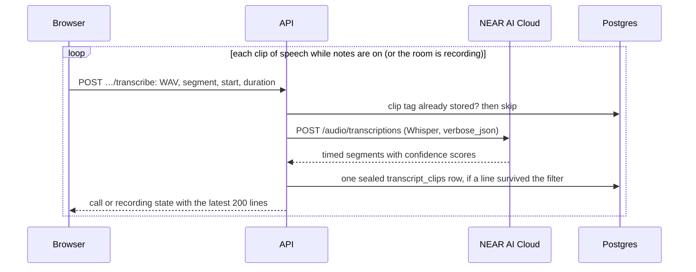

# Notes and inference

[Docs home](../README.md) · [Calls and recordings](calls-and-recordings.md) · [Payments and usage](payments-and-usage.md)

## Status

Notes are written end to end with NEAR AI Cloud (`I01`). While notes are on, the browser sends short clips
of speech; Whisper transcribes each one, and the lines are kept as sealed rows, so the call and the room
recorder show a live transcript. When the recording stops, the transcript moves into the note, and a
worker inside the API process has the notes model write the summary, decisions, open questions, follow-ups,
chapters and suggested questions. Anyone who has the note can then ask questions about the call. Calls that
follow on from each other form a series, and what earlier ones settled and left open carries into the next
([Series](#series)).

`apps/api/src/inference.ts` is the only module that uses `NEAR_AI_API_KEY` or talks to NEAR AI. Without a
key the server still records: the transcribe endpoints answer `503 unavailable`, recordings are kept and
play back, notes stay `pending` ("Waiting for the notes service to be connected"), and `/health` reports
`inference: missing`. Once a key is configured, maintenance picks up the waiting jobs; a note recorded
without a key has no transcript, so it is finished without notes.

Requests go over TLS to NEAR AI Cloud's private inference with a bearer key. Alcove doesn't use NEAR AI's
end-to-end encrypted request mode or check its attestation yet ([What's left](#whats-left)).

## Note states

| Status | Meaning |
| --- | --- |
| `recording` | The call's notes or the room recording are still going. Audio pieces and transcript clips are arriving; the live transcript is in `transcript_clips`. |
| `pending` | The recording stopped. The transcript is in the note, and a `content_jobs` row with kind `notes` is waiting for the notes worker or being written. |
| `ready` | Finished: summary, decisions, open questions, follow-ups, chapters and suggested questions are in a new revision. They stay empty when nothing was transcribed or the notes model failed three times. The transcript and the audio are kept either way. |

The job has its own state:

| `content_jobs.state` | Meaning |
| --- | --- |
| `queued` | Waiting. `lease_until` is empty for a new job, or the time a retry is due. |
| `writing` | Claimed by a worker until `lease_until`, 180 seconds later. If the worker dies, the lease runs out and the job can be claimed again. |

`attempt` counts claims, up to 3. The row is deleted when its note is finished.

## The live transcript

1. **In the browser.** Beside the encrypted MediaRecorder pieces, `apps/web/src/features/call/speech.ts`
   runs the microphone through an AudioWorklet (`apps/web/public/pcm-capture.js`) that mixes it to mono,
   filters out everything above the speech band and resamples it to 16 kHz. The samples are cut into clips
   at natural pauses, clips with no voice in them are dropped, and the rest are sent one at a time, in
   order, with a few retries. A lost clip costs a line of transcript, never the recording. Turning notes
   off, pausing or leaving sends the last audio and speech first.
2. **The request.** `POST /v1/live/calls/:id/transcribe` or `POST /v1/recordings/:id/transcribe`. The body
   is 16 kHz mono 16-bit PCM WAV (`content-type: audio/wav`) of at most 30 seconds
   (`MAX_TRANSCRIPT_CLIP_MS`, 960,044 bytes). The headers are `x-alcove-segment` (the recording segment),
   `x-alcove-start-ms` (where the clip starts in its segment, pauses not counted) and
   `x-alcove-duration-ms`. A declared `content-length` over the limit is refused before the body is read;
   then the WAV header is checked (RIFF/WAVE, PCM, one channel, 16,000 Hz, 16 bits). Anything else is
   `400 invalid`. Each account may send 120 clips a minute, calls and room recordings together; past that
   the answer is `503 unavailable` ("Too many attempts").
3. **When a clip is taken.** For a call, only while it is live, notes are on and the clip's segment is the
   current one. For a room recording, only while it is recording (not paused), and only segment 0.
   Otherwise `409 conflict` (`400 invalid` for a room segment other than 0). Only the account's own calls
   and recordings: anyone else gets `404 not-found`.
4. **Once only.** A clip is tagged `HMAC(transcript key, "clip:<segment>:<startMs>")`. If that tag is
   already stored, the clip is skipped without calling NEAR AI, so a retried upload is transcribed and
   kept once. A clip in which nothing survived the filter stores no row, so a retry of it is sent again.
5. **Transcription and the filter.** NEAR AI returns timed segments. Alcove drops what Whisper is known to
   invent in silence and noise: segments with low confidence (`avg_logprob` below −1), looping text
   (`compression_ratio` above 2.4), likely non-speech (`no_speech_prob` above 0.6 with `avg_logprob`
   below −0.5), subtitle credits ("amara.org", "subtitles by", ...), lines that are only punctuation,
   symbols or one bracketed sound description, and a clip whose whole text is a stock closing line such as
   "Thank you." or "Thanks for watching". A reply without segments but with text becomes one line.
6. **Placing lines.** A line's `at` is seconds into the whole recording as the note's player counts it:
   the earlier segments' recorded seconds, plus where the clip starts, plus where the line starts in the
   clip, to a tenth of a second.
7. **Kept sealed.** The lines of one clip are one `transcript_clips` row, sealed under the state key
   `transcript:<noteId>` (record kind `transcript-clip`; the header binds the owner, the note and the tag).
   The insert holds a share lock on the recording row. A clip that arrives after the recording stopped is
   dropped, because its note is already finished.
8. **Shown live.** `CallState.transcript` and `RoomRecordingState.transcript` carry the latest 200 lines,
   oldest first. Call lines are attributed to the organizer (calls have one participant); room lines name
   nobody. The HTTP client takes only the transcript from a clip's answer, so a slow clip can't undo a
   newer mic or notes change.

## When the recording stops

`POST /v1/live/calls/:id/leave` and `POST /v1/recordings/:id/stop` call `finishRecording`
(`apps/api/src/modules/notes.ts`) in the transaction that stops the recording:

1. The note becomes `pending` with its duration: for a call, its length from start to leave; for a room
   recording, the seconds recorded.
2. The transcript rows are opened, sorted by `at` and written into the note's sealed manifest (in a call
   every line is the organizer's; in a room nobody is named). Then the `transcript_clips` rows are deleted.
3. Everyone invited gets a `note_access` row.
4. A `content_jobs` row is inserted for the note's new head revision: kind `notes`, state `queued`,
   attempt 0, with `{noteId, recordingId}` sealed under the state key `job:<noteId>`.

Stopping a room recording twice finishes it once. After the commit, the notes worker is started for that
account.

## The notes worker

`apps/api/src/modules/writer.ts` runs inside the API process.

- **Starting.** A stop starts the account's worker in the background straight away; while it runs, another
  stop makes it go round again. It takes only the services from the request (configuration, database pool,
  object store), never the request's keys. Maintenance (at start and every 5 minutes) also takes up to 20
  due jobs from any account, which covers restarts and retries that are due. Without `NEAR_AI_API_KEY`
  nothing is claimed.
- **Claiming.** One statement picks the job with the oldest lease that is empty or past
  (`FOR UPDATE SKIP LOCKED`), sets it to `writing`, leases it for 180 seconds and counts the attempt, so two
  workers or two instances never write the same note.
- **Keys.** The worker opens the account's keys through `KMASTER`, as a request does, and zeroes its copies
  when the job ends.
- **Writing.** A job whose account can't be opened, or whose note was deleted, is dropped. A note without
  transcript lines is finished straight away, without notes and without a charge. Otherwise `draft` in
  `apps/api/src/modules/drafting.ts` asks the notes model, and one transaction writes the note `ready`
  with what it wrote, deletes the job and charges the account.
- **Retries.** A failed attempt (NEAR AI unreachable, busy or refusing, or a reply that isn't the expected
  JSON) puts the job back to `queued`, due 20 seconds later after the first failure and 90 seconds after the
  second, with a timer that starts the worker again then. The third failure finishes the note `ready`
  without notes: its transcript and audio stay, and nothing is charged. A job found with all three attempts
  used (its last worker died) is finished the same way.
- **Charging.** 25 credits a minute recorded (the seconds of encrypted audio across every segment, rounded
  up to whole minutes, at least one), taken in the same transaction as the note and labelled "Notes, N min".
  Time in a call with notes off isn't charged. Nothing checks the balance first, so a charge can take it below
  zero ([Payments and usage](payments-and-usage.md)).

## Progress

`GET /v1/notes/:id/progress` streams NDJSON, one update a second for at most two minutes, with four steps:

| Step | Label |
| --- | --- |
| 1 | `Call ended` or `Recording stopped` |
| 2 | `<time> of audio saved, encrypted`, or `No audio was recorded` |
| 3 | `Transcribing as it goes` while recording; then `Transcript of N lines` or `Nothing was transcribed` |
| 4 | `Notes written` once `ready`. Before that: `Queued for the notes service`, `Writing the summary, decisions and follow-ups`, `The notes service is busy. Trying again shortly` (after a failed attempt) or `Waiting for the notes service to be connected` (no key) |

`ready` is true only when the note is `ready`.

## Asking

`POST /v1/notes/:id/ask` with `{question}` (1 to 500 characters, in the body) answers anyone who can read
the note ([Privacy › Who can read a note](privacy-keys-and-sessions.md#who-can-read-a-note)). It needs a
`ready` note with transcript lines (`409 conflict` otherwise) and allows 20 questions a minute per
account. The answer is one `text` part followed by up to four `cite` parts: seconds into the recording the
app can play from. Questions and answers are not stored, keep no operation receipt, and cost no credits.

## Catching up during a call

While a call is on, the notes panel's **Catch up** reads the live transcript for the person asking alone
(`apps/api/src/modules/calls.ts`):

- `POST /v1/live/calls/:id/catch-up` with `{minutes?}` (1 to 600; none means the whole call) reads the lines
  from `through − minutes` onwards, where `through` is the newest line, and returns a `CatchUp`: a short
  `summary`, what was `decided`, what was `proposed` and not agreed, what's still `open`, and what's `next`,
  each item with the second it was said. It also says what it read (`from`, `through`, `lines`), when it was
  put together (`asOf`, seconds since the call started) and the `gaps`: the stretches of the call with notes
  off, kept as on/off times in the sealed call state, since nothing said then can be in it.
- `POST /v1/live/calls/:id/ask` with `{question}` answers from the transcript so far, with cited moments.
- Both need a live call that has had notes on (`409 conflict` otherwise) and share the 20-a-minute limit
  with asking about notes. Nothing is stored and neither keeps an operation receipt: an answer goes only to
  the person who asked. The app offers the last 5 minutes, the last 15 or the whole call, and **Back to live**.

## Series

Calls that follow on from each other form a series, and what the earlier ones settled and left open carries
into the next (`apps/api/src/modules/series.ts`).

- **Joining one.** A series is a random ID (`seriesId`) in its calls' sealed meeting manifests; it has no
  record of its own. Every occurrence of one recurring Google Calendar event made an Alcove call shares one:
  adopting an occurrence also keeps Google's ID for the whole recurring event (`recurringEventId`) in its
  manifest, so later occurrences find the series, and `GET /v1/calendar` marks them with it.
  `POST /v1/meetings/:id/next` with `{startsAt?}` schedules the next call after one of the organizer's calls,
  starting a series if the call isn't in one: the same title, people, length and notes setting, at
  `startsAt` or else the same time a week on (the first such time still to come), placed on the calendar
  like any scheduled call. It has to start after the call it follows (`400 invalid`). An occurrence of a
  recurring Google event is refused (`409 conflict`): its next one is on the calendar already. Room
  recordings have no call, so they're never in a series.
- **What carries over.** `GET /v1/series/:id` puts the series together for whoever asks, from the calls in
  it whose notes they can read at that moment: the organizer's own notes; for anyone else, the notes given
  to them by invitation or sharing, found through `note_access` by their email's index
  ([Privacy › Who can read a note](privacy-keys-and-sessions.md#who-can-read-a-note)). A call's notes join
  its series when the call ends. From the written ones, newest call first, it takes decisions that are
  confirmed, no longer hold (`superseded`) or are still `proposed` (never ones said not to be decided), open
  questions, and follow-ups not done yet or ticked since the latest call started. Each question and
  follow-up says how many later calls it stayed open through (`later`) and is `stale` from two. Each item
  names its note (`noteId`) and moment (`at`). Only the organizer gets the next call scheduled in Alcove
  (`next`), whether the series follows a recurring Google event (`recurring`), and the call each note is
  from (`meetingId`). Someone with no notes from a series gets `404 not-found`, as for one that doesn't exist.
- **Nothing derived is kept.** A series is read afresh on each request and stored nowhere, so a note that's
  deleted, removed from someone's notes or never given to them isn't in it. Being invited to one call opens
  nothing from the others.
- **Settling things.** `PATCH /v1/notes/:id/questions/:id` with `{state?: "open" | "answered", text?}`
  says an open question was answered, reopens it or rewords it; like decisions and follow-ups, anyone who
  has the note can, and every change records who and when. A confirmed decision can be said to no longer
  hold (`superseded`) when a later one replaces it; only a confirmed one (`409 conflict` otherwise).
- **Asking across a series.** `POST /v1/series/:id/ask` with `{question}` reads the asker's written calls in
  the series, newest first and at most 12: each one's notes, then as much of their transcripts as fits in
  120,000 characters, the newest calls' first. The answer is one `text` part and up to four `source` parts:
  a call's note, title and date, and the second it comes from when the model gives one inside the
  recording. It needs a written note in the series (`409 conflict` otherwise), shares the 20-a-minute limit
  with asking about notes, keeps no operation receipt, stores nothing and costs no credits.
- **In the app.** Home shows **From earlier calls** under the call that's up next when it's in a series:
  confirmed decisions, questions still open and follow-ups someone took on, with counts of the rest. A note
  says when it's in a series, and offers its organizer **Meet again** when it isn't. The series page
  (`/notes/series/<id>`) has everything, lets people settle it, and answers questions across the calls. The
  call screen doesn't show any of it yet ([What's left](#whats-left)).

## Prompts

The prompts are in `apps/api/src/modules/drafting.ts`; read them there. In short:

- **What the model is told.** The meeting's title; whether it was a video call or an in-person meeting
  recorded on one device; the organizer's name; the invited people by name, or by the part of their
  address before the @ when Alcove has no name for them (never full addresses); the length in minutes;
  and the transcript as `[mm:ss] Name: words` lines (`[mm:ss] words` in a room). A transcript over 120,000
  characters (about 30,000 tokens) keeps its beginning and end, with a marker for the lines left out.
- **Writing notes.** One JSON object: `summary` (two to four plain sentences, substance first),
  `decisions` (each with the second it was settled; something only suggested isn't one), `questions` (what
  someone asked that the meeting didn't answer or settle, each with the second it was asked), `actions`
  (text that starts with a verb, an owner as the transcript names them or null, a due date as it was said or
  null, and the second it came up), `chapters` (two to six, each starting at a second read from the
  `[mm:ss]` marks) and three `suggestedQuestions`. In the transcript's language, using only what it says,
  never inventing names, numbers, dates or decisions. What comes back is stored as proposals: decisions
  are `proposed`, questions `open` and follow-ups not `takenOn` until people say so
  (`PATCH /v1/notes/:id/decisions/:id`, `…/questions/:id` and `…/actions/:id`, each answering with the
  note; see [Privacy › Who can read a note](privacy-keys-and-sessions.md#who-can-read-a-note)).
- **Answering.** The summary, the asker's name and the question are added. One JSON object,
  `{answer, moments}`: a direct answer of at most four sentences (longer when the question asks for a draft
  such as an email), "I" and "me" meaning the asker, answering from what's been said so far when the call is
  still going on, saying plainly when the transcript doesn't cover it, and up to four seconds the answer
  comes from.
- **Catching up.** The transcript so far, told the meeting is still going on. One JSON object: a one- or
  two-sentence `summary` and four lists, `decided`, `proposed` (never counted as decided), `open` questions
  and `next` steps, each item a short sentence with the second it was said. At most 8 items a list; times
  must fall within the recording.
- **Answering across a series** (in `apps/api/src/modules/series.ts`). Each call the asker has, numbered
  newest first: its title, date and length, the organizer's and invited people's names (never addresses),
  the summary, the decisions with where they stand, the open questions, the follow-ups with who has them,
  their due dates and whether they're done, then the transcript; after them the asker's name and the
  question. One JSON object, `{answer, sources}`: plain, at most four sentences unless the question asks for
  a draft or a list, "I" meaning the asker, saying which call by its date when that matters, saying plainly
  when these calls don't cover it and never guessing about calls that aren't there, and up to four sources,
  each a call's number and a second (or null when it comes from the notes rather than a moment).

Replies are checked before anything is kept:

- The reply must hold one JSON object; text or code fences around it are tolerated. A reply without one,
  or with an empty `summary` or `answer`, fails: a notes attempt is retried, and a question answers
  `503 unavailable`.
- Malformed optional fields become empty lists instead of failing.
- Follow-up owners are matched to the organizer and the people invited, by name, by address name or by first
  name. Words such as "unknown" or "the team" mean no owner; anyone else keeps the name the model gave.
- Lengths are capped: a summary of 1,500 characters; at most 12 decisions, 12 open questions, 20
  follow-ups, 8 chapters and 3 suggested questions. Chapter times are kept within the recording and
  de-duplicated, and cited moments must fall within it. A series answer's source must be one of the calls
  sent, its moment inside that call's recording; repeats are dropped.

## Models and requests

| Setting | Default | Used for |
| --- | --- | --- |
| `NEAR_AI_API_KEY` | none | The bearer key. Without it nothing is sent. |
| `NEAR_AI_BASE_URL` | `https://cloud-api.near.ai/v1` | NEAR AI Cloud's OpenAI-style API |
| `NEAR_AI_STT_MODEL` | `openai/whisper-large-v3` | The live transcript |
| `NEAR_AI_NOTES_MODEL` | `z-ai/glm-5.3-flash` | Writing notes and answering questions |

The deploy pipeline sets the base URL and uses the default models.

| Request | Format | Timeout |
| --- | --- | --- |
| Transcribe a clip | `POST /audio/transcriptions`, multipart: `model`, `response_format=verbose_json`, `temperature=0`, `file` (`clip.wav`, `audio/wav`) | 20 s |
| Write notes | `POST /chat/completions`, JSON: `model`, a system and a user message, `temperature` 0.2, `max_tokens` 2,500, `response_format: {"type": "json_object"}`, `chat_template_kwargs: {"enable_thinking": false}` | 90 s |
| Answer a question (about a note, a call so far or a series) | The same, with `max_tokens` 1,200 | 60 s |

NEAR AI's answers map onto Alcove's errors: `400`, `413` and `422` become `400 invalid`; `401` and `403`
become a `500` (the key was refused); being unreachable, a timeout, a reply that can't be parsed and any
other status, such as `429` or `5xx`, become `503 unavailable`.

Measured on NEAR AI Cloud in November 2026: a 5-second clip transcribes in about 0.6 s; notes for a short
call are written in about 4 s with thinking disabled (about 48 s with it on, which is why it's off); a
question is answered in about 2 s. NEAR AI answers pure digital silence with `502`, which Alcove reports as
`503 unavailable`; the browser doesn't send silence.

## What's logged

`inference.ts` logs only models, byte sizes, durations, segment and line counts, statuses, timings, finish
reasons and token counts, at debug (`clip transcribed`, `notes model answered`). Around it, IDs, attempts,
counts and timings: `series read` at debug; `notes job queued`, `notes written` (with decision, follow-up and
chapter counts), `question answered`, `series question answered`, `question changed`, `next call in a series
scheduled`, `notes job dropped`, `nothing was transcribed; note finished without notes` and `clip arrived
after the recording stopped; dropped` at info; `notes not written yet; trying again` at warn; a note
finished without a summary after its last attempt at error. Speech, transcript lines, prompts, replies and
questions are never logged, and neither are Google's event IDs: an occurrence's ID begins with its recurring
event's, so logged paths show `/v1/calendar/events/:id`. The privacy test looks for spoken canaries in every table, object
and debug log line ([Logging and errors](logging-and-errors.md)).

## Tests

`apps/api/src/testing/fake-near.ts` stands in for NEAR AI over HTTP, behind a bearer key. It "hears" words
a test writes into the WAV samples, answers a clip without them with Whisper's favourite hallucination,
writes notes from the transcript it was sent, and can fail its next replies (down, or prose instead of
JSON). The `live transcript and written notes` flows in `apps/api/src/flows.integration.test.ts` cover a
call and a room recording, retried and silent clips, notes off and on again, the clip format and access
checks, a server without a key, writing and charging, asking (also by someone invited), and retries up to
the third failure. `apps/api/src/series.integration.test.ts` covers series: scheduling the next call, what
carries over for the organizer and for everyone invited, staleness, decisions that no longer hold and
questions answered, someone invited to only the second call (who sees only that one, can't open the first,
and gets it once it's shared with them and loses it when they remove it), asking across only the calls the
asker has, someone with no notes from it, room recordings, and recurring Google events.

## What's left

- **Verified private inference.** Use NEAR AI's end-to-end encrypted request mode and check its
  attestation before sending speech or transcripts, with no plaintext fallback. Until then NEAR AI's
  service is trusted with every clip, transcript and the context listed under [Prompts](#prompts). The
  encrypted mode is described in [Source evidence](../references/source-evidence.md).
- **Who said what.** Calls have one participant, so every call line is attributed to the organizer. Room
  recordings have no speaker diarization.
- **Admission.** Nothing checks credits before recording or transcribing, and a charge can take the
  balance below zero ([Payments and usage](payments-and-usage.md)).
- **Lost lines stay lost.** Notes are written from the live transcript only. Speech that wasn't
  transcribed during the recording (NEAR AI down, a clip lost) isn't transcribed again from the stored
  audio afterwards.
- **Series during the call.** Neither the call screen nor pre-join shows what carries over or answers
  across the series yet; both are being rebuilt for group calls.
- **Series for people invited.** Someone invited finds a series through its notes. Their own Home doesn't
  mark the organizer's next call as part of it, because Home lists only their own calls and calendar.
- **Repeats.** Alcove schedules one next call at a time and has no recurrence rule of its own. Calls that
  already exist can't be put into one series afterwards.
