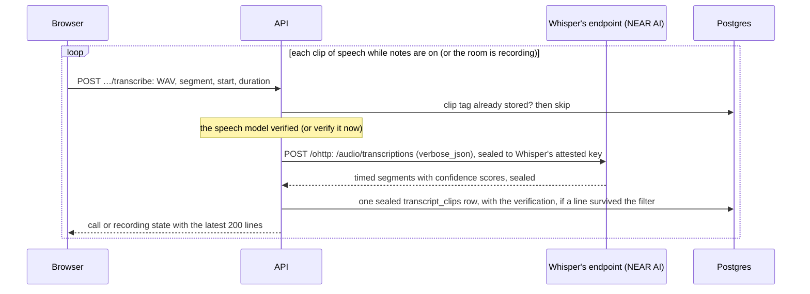

# Notes and inference

[Docs home](../README.md) · [Calls and recordings](calls-and-recordings.md) · [Payments and usage](payments-and-usage.md)

## Status

Notes are written end to end with NEAR AI Cloud (`I01`). While notes are on, the browser sends short clips
of speech (in a call, the organizer's browser, for everyone it hears); Whisper transcribes each one, and the lines are kept as sealed rows, so the call and the room
recorder show a live transcript. When the recording stops, the transcript moves into the note, and a
worker inside the API process has the notes model write the summary, decisions, open questions, follow-ups,
chapters and suggested questions. Anyone who has the note can then ask questions about the call. Calls that
follow on from each other form a series, and what earlier ones settled and left open carries into the next
([Series](#series)).

`apps/api/src/inference.ts` and `apps/api/src/evidence.ts` are the only code that uses `NEAR_AI_API_KEY` or
talks to NEAR AI, and `inference.ts` is the only one that sends it anything with content. Without a key the
server still records: the transcribe endpoints answer `503 unavailable`,
recordings are kept and play back, notes stay `pending` ("Waiting for the notes service to be connected"),
and `/health` reports `inference: missing`. Once a key is configured, maintenance picks up the waiting jobs;
a note recorded without a key has no transcript, so it is finished without notes.

Nothing with content goes to NEAR AI until its hardware evidence for the model checks out, and then only
sealed with Oblivious HTTP to the key that evidence vouches for, at the model's own endpoint: speech to
Whisper's, transcripts and questions to the notes model's
([Verified private inference](#verified-private-inference)). There is no plaintext way, and no setting that
turns it off.

## Verified private inference

`apps/api/src/evidence.ts` checks NEAR AI's evidence, `apps/api/src/inference.ts` seals requests to the
keys it vouches for, and `apps/api/src/ohttp.ts` is the Oblivious HTTP sender.

Every request goes the same way: Oblivious HTTP (RFC 9458), a Binary HTTP request (RFC 9292) sealed with
HPKE (RFC 9180; X25519, HKDF-SHA256, AES-128-GCM) to the model's own OHTTP key, posted to `/ohttp` at the
model's own endpoint. The whole HTTP request is sealed, the API key included, so NEAR AI's TLS
termination, load balancers and gateway see ciphertext, its size and its timing; only something holding
the model's OHTTP key can open it. The reply comes back sealed under the same exchange, so only Alcove can
open it, and only whoever opened the request could have sealed it.

| Request | Model | Endpoint |
| --- | --- | --- |
| Transcribe a clip | `openai/whisper-large-v3` | `NEAR_AI_STT_URL`, `https://whisper-large-v3.completions.near.ai` |
| Write notes, answer a question (about a note, a call so far or a series), catch up, translate captions | `z-ai/glm-5.3-flash` | `NEAR_AI_NOTES_URL`, `https://glm-5-3-flash.completions.near.ai` |

These are the endpoints NEAR AI calls "direct completions" and documents as experimental. Its gateway
also takes chat with end-to-end encrypted fields (E2EE v2), but that protocol encrypts each message to the
model without binding it to the client's key, so whoever terminates the TLS can copy the encrypted
messages into a request of their own and have the model answer to their key. Its gateway also takes OHTTP,
but opens it itself. The models' own endpoints are where NEAR AI opens a sealed request inside the model's
own VM.

### What is checked

Before a model's first request, and whenever its verification has run out, Alcove asks NEAR AI's gateway
(`NEAR_AI_BASE_URL`) for
`GET /attestation/report?model=<model>&provider=near&signing_algo=ed25519&include_tls_fingerprint=false&nonce=<32 random bytes, hex>`
with `x-no-aliasing: true`, and checks the gateway's report and every model report it returns:

1. **The Intel TDX quote**, with [dcap-qvl](https://github.com/Phala-Network/dcap-qvl) (`@phala/dcap-qvl`
   0.7.0): its signature chain (quote, QE report, PCK certificate, Intel's PCK CA) to `INTEL_ROOT_CA`, Intel's
   collateral from `INTEL_PCS_URL` (TCB info, QE identity, PCK revocation list, each signed under the same
   root, and the root's own revocation list from its distribution point), nothing revoked or past its
   update date, a TCB status of `UpToDate` or `SWHardeningNeeded`, and debug off.
2. **The OS it booted.** MRTD, RTMR0, RTMR1 and RTMR2 (firmware, the machine, the kernel, its command line
   and initrd, which names the root filesystem's hash) must be exactly those of a published dstack image on
   the machines NEAR AI runs, listed in `apps/api/src/dstack-images.ts`: `dstack-nvidia-0.5.12` on its model
   VMs and `dstack-0.5.12` on its gateway, as released by
   [meta-dstack v0.5.12](https://github.com/Dstack-TEE/meta-dstack/releases/tag/v0.5.12) and measured with
   `dstack-mr` for the machine each report's `vm_config` describes. The `os-image-hash` event must be that
   image's digest. Another image, or the same image on another machine, is refused until it is measured the
   same way and added.
3. **Its report data**: the reported signing key, then our nonce. The echoed `request_nonce` must be our
   nonce, and the gateway's echoed `report_data` the quote's.
4. **What that OS measured after boot**: the event log replays to the quote's RTMR3; MRCONFIGID is `01`, then
   SHA-256 of the report's `app_compose`, then zeros; and the `compose-hash` event is that same SHA-256.
5. **A model's GPUs**: its `nvidia_payload` carries our nonce; NVIDIA's Remote Attestation Service
   (`NVIDIA_NRAS_URL`) checks it, and its verdict is a JWT signed ES384 by a key from NRAS's published keys
   whose certificate chain (CAs only, all current) ends at `NVIDIA_ROOT_CA`, from NRAS, not expired, for our
   nonce, with one result per GPU and `x-nvidia-overall-att-result: true`.
6. **A model's OHTTP key**: `ohttp_attestation` is an Ed25519 signature by the attested key over the exact
   key configuration, which must offer X25519 with HKDF-SHA256 and AES-128-GCM.
7. The report is for the model asked for, and its public key is its signing address.

Every model report is checked and only those that pass may be used. If none passes, or the gateway's
doesn't, nothing is sent: the request answers `503 unavailable`, "We couldn’t verify NEAR AI’s private
model, so nothing was sent. Try again in a moment." ("couldn’t check" when NEAR AI, Intel or NVIDIA can't
be reached), a notes job waits ([The notes worker](#the-notes-worker)), and the refusal is logged with its
code: `expired`, `tdx-quote`, `tcb-status`, `debug`, `os-image`, `nonce`, `signing-key`, `rtmr3`, `compose`,
`gpu`, `ohttp-key`, `model-mismatch`, `no-model-evidence`, `malformed`, or `report-unavailable`,
`collateral-unavailable` and `gpu-unavailable` when a service couldn't be reached. A reply that won't open
under the request's exchange is refused too (`reply-sealed`), and isn't used.

What these checks don't show is in [What's left](#whats-left): the app compose runs NEAR AI's compose
manager, which starts the model code NEAR AI chooses; the GPU evidence is tied to the VM only by the nonce;
the model name is the report's word; and the OHTTP key's signature doesn't cover the nonce.

### How long a verification holds

- A verification is used for ten minutes at most, or until NVIDIA's verdict expires (it gives an hour), then
  the next request verifies again. Intel's collateral is kept up to 30 minutes, or until Intel says it's due.
- A refusal stands for 30 seconds: requests in that time are refused without fetching new evidence.
- Requests that arrive while a model is being verified wait for that one verification.
- **When the key changes.** A model's endpoint answers a request sealed to a key it no longer holds with
  `400` ("OHTTP decapsulation failed"). Then Alcove drops the verification, verifies again, and sends the
  request once more if the key changed; if it didn't, or the new evidence doesn't check out, the request fails.
  A connection the endpoint cuts is treated the same way; a timeout isn't. A model that doesn't answer (it
  times out, can't be reached or is busy) has its verification dropped too, so the next request verifies
  again and may reach one that answers.
- Verifications live in the API process's memory. Nothing about them is stored except what a note keeps.

### What a note keeps

Each transcript clip's sealed row keeps the evidence of the verification it was sent to, also when nothing
in it survived the filter. When the recording stops, the distinct verifications (by model, key, OS image,
measured configuration and TCB status, the first time each was used) move into the note's sealed manifest
as `inference`; the notes model's is added when the notes are written. `GET /v1/notes/:id` returns them as
`Note.inference` (`InferenceEvidence` in `packages/api`): the model, the task, when it was verified, the
model's key, Intel's TCB status and the quote's SHA-256, the dstack image it booted, the GPUs NVIDIA
confirmed, the SHA-256 of the measured app compose, and the gateway's TCB status, image and compose hash.
None of it is secret. Questions, catch-ups and caption translations are verified and sealed the same way,
but nothing of theirs stays with the note, so neither do their verifications.

The note page says "Written by a verified private model" ("Transcribed by…" while the notes are being
written, or when they couldn't be) under the title. It opens the checks that ran, model by model, and links
to NEAR AI's [Verification Center](https://cloud.near.ai/verify) for each model, which checks fresh evidence
for the model, not this note; the link carries nothing about the note, sends no referrer, and the page says
NEAR AI sees the visit. The call screen shows none of it.

### Services verification depends on

- **Intel's Provisioning Certification Service**: `api.trustedservices.intel.com` for TCB info, QE identity
  and the PCK revocation list, and `certificates.trustedservices.intel.com` for the root's revocation list.
  Alcove sends it only the platform's FMSPC.
- **NVIDIA's Remote Attestation Service**: `nras.attestation.nvidia.com`, sent each model's GPU evidence
  (certificates and measurements, no content).
- **NEAR AI's gateway** for the reports, and **the models' own endpoints**,
  `whisper-large-v3.completions.near.ai` and `glm-5-3-flash.completions.near.ai`, for everything sealed.

Measured against NEAR AI Cloud on 3 November 2026: verifying the first model takes about 1.2 to 1.4 s (the
report, Intel's collateral, NRAS and the quote checks), the next about 0.5 s, as Intel's collateral is kept;
a 5-second clip through OHTTP about 0.45 s, or up to 2 s on a new connection; a short completion through
OHTTP 0.5 to 1.1 s.

## Note states

| Status | Meaning |
| --- | --- |
| `recording` | The call's notes or the room recording are still going. Audio pieces and transcript clips are arriving; the live transcript is in `transcript_clips`. |
| `pending` | The recording stopped. The transcript is in the note, and a `content_jobs` row with kind `notes` is waiting for the notes worker, for the notes model to check out, or being written. |
| `ready` | Finished: summary, decisions, open questions, follow-ups, chapters and suggested questions are in a new revision. They stay empty when nothing was transcribed or the notes model failed three times. The transcript and the audio are kept either way. |

The job has its own state:

| `content_jobs.state` | Meaning |
| --- | --- |
| `queued` | Waiting. `lease_until` is empty for a new job, or the time a retry is due. |
| `writing` | Claimed by a worker until `lease_until`, 180 seconds later. If the worker dies, the lease runs out and the job can be claimed again. |
| `waiting` | The notes model's evidence didn't check out, or couldn't be checked, so nothing was sent. Checked again at `lease_until`, five minutes later, for as long as it takes. |

`attempt` counts claims, up to 3; a claim whose evidence didn't check out doesn't count. The row is deleted
when its note is finished.

## The live transcript

1. **In the browser.** Beside the encrypted MediaRecorder pieces, `apps/web/src/features/call/speech.ts`
   runs the microphone (in a call, the organizer's browser runs each voice it plays, the organizer's own and
   each other microphone in its part of the call, on its own: `CallEars`) through an AudioWorklet (`apps/web/public/pcm-capture.js`) that mixes it to mono,
   filters out everything above the speech band and resamples it to 16 kHz. The samples are cut into clips
   at natural pauses, clips with no voice in them are dropped, and the rest are sent one at a time, in
   order, with a few retries. A lost clip costs a line of transcript, never the recording. Turning notes
   off or leaving sends the last audio and speech first; pausing a call's notes drops whatever wasn't sent
   ([Calls and recordings › What's captured](calls-and-recordings.md#whats-captured)).
2. **The request.** `POST /v1/live/calls/:id/transcribe` or `POST /v1/recordings/:id/transcribe`. The body
   is 16 kHz mono 16-bit PCM WAV (`content-type: audio/wav`) of at most 30 seconds
   (`MAX_TRANSCRIPT_CLIP_MS`, 960,044 bytes). The headers are `x-alcove-segment` (the recording segment),
   `x-alcove-start-ms` (where the clip starts in its segment, pauses not counted) and
   `x-alcove-duration-ms`, and for a call `x-alcove-speaker` (the participant ID of whoever's voice it is,
   which must be someone in the call, or `400 invalid`) and `x-alcove-ago-ms` (how long before the request the
   speech began, at most ten minutes). A declared `content-length` over the limit is refused before the body is read;
   then the WAV header is checked (RIFF/WAVE, PCM, one channel, 16,000 Hz, 16 bits). Anything else is
   `400 invalid`. Each account may send 240 clips a minute, calls and room recordings together, and in a call
   each voice 40; past that the answer is `503 unavailable` ("Too many attempts").
3. **When a clip is taken.** For a call, only while it is live, notes are on (not paused) and the clip's
   segment is the current one; the capture gate, `mayCapture` in `apps/api/src/modules/capture.ts`, decides.
   Then only where the call can place it: in the part of the call its speaker was in when it began (`placeAt`,
   from where each person has been, and never before they came into the call), which must still be open, and
   the gate is asked again for that part, so nothing is taken in a breakout room the organizer has paused. A clip
   from before its speaker's last two moves, for a breakout room that has closed, or for a paused room, is
   refused (`409`). For a room recording, only while it is recording
   (not paused), and only segment 0.
   Otherwise `409 conflict` (`400 invalid` for a room segment other than 0). Only the account's own calls
   and recordings: anyone else gets `404 not-found`.
4. **Once only.** A clip is tagged `HMAC(transcript key, "clip:<segment>:<startMs>:<speaker>")` (no speaker
   in a room recording), so two people starting at the same moment are both kept. If that tag is
   already stored, the clip is skipped without calling NEAR AI, so a retried upload is transcribed and
   kept once, whether or not anything in it survived the filter.
5. **Transcription and the filter.** NEAR AI returns timed segments. Alcove drops what Whisper is known to
   invent in silence and noise: segments with low confidence (`avg_logprob` below −1), looping text
   (`compression_ratio` above 2.4), likely non-speech (`no_speech_prob` above 0.6 with `avg_logprob`
   below −0.5), subtitle credits ("amara.org", "subtitles by", ...), lines that are only punctuation,
   symbols or one bracketed sound description, and a clip whose whole text is a stock closing line such as
   "Thank you." or "Thanks for watching". A reply without segments but with text becomes one line.
6. **Placing lines.** A line's `at` is seconds into the whole recording as the note's player counts it:
   the earlier segments' recorded seconds, plus where the clip starts, plus where the line starts in the
   clip, to a tenth of a second.
7. **Kept sealed.** The lines of one clip (none, if nothing survived the filter), each with the part of the
   call it was said in and, while rooms were open, who may read it, its segment and the evidence of the
   verification it was sent to are one `transcript_clips` row, sealed under the state key
   `transcript:<noteId>` (record kind `transcript-clip`; the header binds the owner, the note and the tag).
   The insert holds a share lock on the recording row. A clip that arrives after the recording stopped is
   dropped, because its note is already finished.
8. **Shown live.** `CallState.transcript` and `RoomRecordingState.transcript` carry the latest 200 lines,
   oldest first. Each call line is said by whoever's voice it was, named from the call's people as the viewer
   may see them (a guest sees names, never email addresses), with the breakout room it was said in, by name, if
   any. Someone reads the lines said in the part of the call they're in now, and of those said while breakout
   rooms were open (which list their readers: the people there at the time), only the ones said while they were
   there: one room's lines never show in another or in the main room, and the main room's while rooms were open
   aren't shown to people who were away in a room. Catching up, questions and caption translations read the same
   lines, and are refused in a room the organizer has paused. Room recording lines name nobody. The HTTP client merges a clip's answer into the transcript it has, and
   clears it when the browser moves to another part of the call.
9. **A room's lines go with it.** When a breakout room closes, its clips and their translations are deleted, in
   the transaction that closes it. A clip or translation still being made then is dropped where it would be kept:
   that transaction holds the call's row, which keeping a clip shares and checks again
   ([Calls and recordings › Breakout rooms](calls-and-recordings.md#hands-spotlight-breakout-rooms-and-captions)).

## When the recording stops

`POST /v1/live/calls/:id/leave` and `POST /v1/recordings/:id/stop` call `finishRecording`
(`apps/api/src/modules/notes.ts`) in the transaction that stops the recording:

1. The note becomes `pending` with its duration: for a call, its length from start to leave; for a room
   recording, the seconds recorded.
2. The transcript rows are opened and written into the note's sealed manifest in recording order, each line
   kept inside its own segment (one placed past the end of its segment's audio goes at the segment's end); in
   a call each line keeps who said it, and only the main room's lines go in; in a room recording nobody is
   named; with the verifications they went to as `inference`. A call's gaps go into the manifest too (`gaps`:
   every stretch with notes off or paused, when, and where it falls in the recording). Then the `transcript_clips` rows, and any `transcript_translations` made for captions, are
   deleted. A call's breakout rooms are written into the manifest too, in recording time, until the notes
   are written.
3. Everyone invited gets a `note_access` row.
4. A `content_jobs` row is inserted for the note's new head revision: kind `notes`, state `queued`,
   attempt 0, with `{noteId, recordingId}` sealed under the state key `job:<noteId>`.

Stopping a room recording twice finishes it once. After the commit, the notes worker is started for that
account.

## The notes worker

`apps/api/src/modules/writer.ts` runs inside the API process.

- **Starting.** A stop starts the account's worker in the background straight away; while it runs, another
  stop makes it go round again. It takes only the services from the request (configuration, database pool,
  object store), never the request's keys. Maintenance (at start and every 5 minutes) also takes up to 20
  due jobs from any account, which covers restarts and retries that are due. Without `NEAR_AI_API_KEY`
  nothing is claimed.
- **Claiming.** One statement picks the job with the oldest lease that is empty or past
  (`FOR UPDATE SKIP LOCKED`), sets it to `writing`, leases it for 180 seconds and counts the attempt, so two
  workers or two instances never write the same note.
- **Keys.** The worker opens the account's keys through `KMASTER`, as a request does, and zeroes its copies
  when the job ends.
- **Writing.** A job whose account can't be opened, or whose note was deleted, is dropped. A note without
  transcript lines is finished straight away, without notes and without a charge. Otherwise `draft` in
  `apps/api/src/modules/drafting.ts` asks the notes model, and one transaction writes the note `ready`
  with what it wrote and the model's verification, deletes the job and charges the account. The call's
  breakout rooms join the chapters in that transaction (one chapter per time rooms were open: who was in
  which room, and for how long).
- **Waiting for evidence.** When the notes model's evidence doesn't check out, or can't be checked (Intel,
  NVIDIA or NEAR AI unreachable, a platform out of date, anything in [What is checked](#what-is-checked)),
  nothing was sent. The job goes to `waiting` without using up the attempt, and is tried again five minutes
  later, for as long as it takes, so an outage or a TCB recovery doesn't lose notes. The same goes when the
  notes model doesn't answer (`UnansweredError`: no answer within three minutes, unreachable, `429` or `5xx`):
  nothing about the note is wrong, so it waits rather than using its attempts up. A draft can take the model
  well over a minute (about 24 tokens a second, up to 2,500 of them), so it gets three minutes, and the job's
  lease five.
- **Retries.** A failed attempt (NEAR AI refusing the request, a reply that won't open, or one that isn't the
  expected JSON) puts the job back to `queued`, due 20 seconds later after the first failure and 90 seconds
  after the second, with a timer that starts the worker again then. The third failure finishes the note `ready`
  without notes: its transcript and audio stay, and nothing is charged. A job found with all three attempts
  used (its last worker died) is finished the same way.
- **Charging.** 25 credits a minute recorded (the seconds of encrypted audio across every segment, rounded
  up to whole minutes, at least one), taken in the same transaction as the note and labelled "Notes, N min".
  Time in a call with notes off isn't charged. Nothing checks the balance first, so a charge can take it below
  zero ([Payments and usage](payments-and-usage.md)).

## Progress

`GET /v1/notes/:id/progress` streams NDJSON, one update a second for at most two minutes, with four steps:

| Step | Label |
| --- | --- |
| 1 | `Call ended` or `Recording stopped` |
| 2 | `<time> of audio saved, encrypted`, or `No audio was recorded` |
| 3 | `Transcribing as it goes` while recording; then `Transcript of N lines` or `Nothing was transcribed` |
| 4 | `Notes written` once `ready`. Before that: `Queued for the notes service`, `Writing the summary, decisions and follow-ups`, `The notes service is busy. Trying again shortly` (after a failed attempt), `Waiting for the notes model. The notes are written as soon as it’s verified and answering` (waiting) or `Waiting for the notes service to be connected` (no key) |

`ready` is true only when the note is `ready`.

## Asking

`POST /v1/notes/:id/ask` with `{question}` (1 to 500 characters, in the body) answers anyone who can read
the note ([Privacy › Who can read a note](privacy-keys-and-sessions.md#who-can-read-a-note)). It needs a
`ready` note with transcript lines (`409 conflict` otherwise) and allows 20 questions a minute per
account. The answer is one `text` part followed by up to four `cite` parts: seconds into the recording the
app can play from. Questions and answers are not stored, keep no operation receipt, and cost no credits.
Writing an answer can take up to a minute, so once it's written the asker's access is checked again: if the
note was deleted or removed from their notes meanwhile, the answer, which may quote it, isn't sent
(`409 conflict`).

## Catching up during a call

While a call is on, **Catch up** (top bar, the More menu, and "Catch me up" in the Ask view) reads the live
transcript for the person asking alone (`apps/api/src/modules/calls.ts`). The Notes view during a call uses
the same request over the whole call to show what's decided, the follow-ups (with who and when, as said)
and a summary, refreshed as new lines arrive (at most every 30 seconds, only while it's open):

- `POST /v1/live/calls/:id/catch-up` with `{minutes?}` (1 to 600; none means the whole call) reads the lines
  from `through − minutes` onwards, where `through` is the newest line, and returns a `CatchUp`: a short
  `summary`, what was `decided`, what was `proposed` and not agreed, what's still `open`, and what's `next`,
  each item with the second it was said. It also says what it read (`from`, `through`, `lines`), when it was
  put together (`asOf`, seconds since the call started) and the `gaps`: the stretches with notes off or paused
  in what it read or after it, kept as changes in the sealed call state, since nothing said then can be in it.
  The notes model reads each as a `--` line in the transcript.
- `POST /v1/live/calls/:id/ask` with `{question}` answers from the transcript so far, with cited moments.
- Both need a live call that has had notes on, and notes not paused (`409 conflict` otherwise), and share the
  20-a-minute limit with asking about notes. Nothing is stored and neither keeps an operation receipt: an answer goes only to
  the person who asked. Catch up reads the last 5 minutes; the Notes view reads the whole call.

## Captions in another language

`POST /v1/live/calls/:id/translate` with `{language, lines}` (one of `en`, `es`, `fr`, `de`, `pt`, `it`, `ja`,
`zh`; up to 20 line IDs from the live transcript) returns those lines in that language, for the person
asking. Lines already translated into that language come from their sealed `transcript_translations` row;
the rest go to the notes model in one request, sealed to its verified key like every request, and are kept
the same way, until the recording stops. Line IDs
that aren't in this call's live transcript are left out. 90 requests a minute per account; nothing is
charged, and no operation receipt is kept. Refused while notes are paused, when nothing goes to the AI.

## Series

Calls that follow on from each other form a series, and what the earlier ones settled and left open carries
into the next (`apps/api/src/modules/series.ts`).

- **Joining one.** A series is a random ID (`seriesId`) in its calls' sealed meeting manifests; it has no
  record of its own. Every occurrence of one recurring Google Calendar event made an Alcove call shares one:
  adopting an occurrence also keeps Google's ID for the whole recurring event (`recurringEventId`) in its
  manifest, so later occurrences find the series, and `GET /v1/calendar` marks them with it. Adopts take
  turns per account (a lock on the account's row), and each reads the account's calls only once it's its
  turn, so occurrences adopted at the same moment still share one series, and one event adopted twice at
  once is still one call. Google decides what counts as the same recurring event: editing "this and
  following events" there ends the recurrence and starts a new recurring event with a new ID, so the
  occurrences from then on start a new series in Alcove.
  `POST /v1/meetings/:id/next` with `{startsAt}` schedules the next call after one of the organizer's calls,
  starting a series if the call isn't in one: the same title, people, length and notes setting, at
  `startsAt`, placed on the calendar like any scheduled call. The app sends the same clock time a week on in
  the browser's time zone (the first such time still to come), so a change of the clocks in between doesn't
  move it an hour. It has to start after the call it follows and still be to come (`400 invalid`). An
  occurrence of a recurring Google event is refused (`409 conflict`): its next one is on the calendar
  already. Room recordings have no call, so they're never in a series.
- **What carries over.** `GET /v1/series/:id` puts the series together for whoever asks, from the calls in
  it whose notes they can read at that moment: the organizer's own notes; for anyone else, the notes given
  to them by invitation or sharing, found through `note_access` by their email's index
  ([Privacy › Who can read a note](privacy-keys-and-sessions.md#who-can-read-a-note)). Everyone finds them
  the same way: the notes they have whose call (`meetingId`) is in the series, once the call has ended. A
  call whose link is opened again after it ended is held again, with notes of its own each time, and each
  counts. Only the newest 24 calls are read; `older` says how many more the asker has notes from, which
  aren't shown and carry nothing over. From the written ones, newest call first, it takes decisions that are
  confirmed, no longer hold (`superseded`) or are still `proposed` (never ones said not to be decided), open
  questions, and follow-ups not done yet or ticked since the latest call started. Each question and
  follow-up says how many later calls it stayed open through (`later`) and is `stale` from two. Each item
  names its note (`noteId`) and moment (`at`). Only the organizer gets the next call scheduled in Alcove
  (`next`), whether the series follows a recurring Google event (`recurring`), and the call each note is
  from (`meetingId`). Someone with no notes from a series gets `404 not-found`, as for one that doesn't exist.
  Reading the notes others gave the asker opens each organizer's keys once a request, however many of their
  notes it reads.
- **Nothing derived is kept.** A series is read afresh on each request and stored nowhere, so a note that's
  deleted, removed from someone's notes or never given to them isn't in it. Being invited to one call opens
  nothing from the others.
- **Settling things.** `PATCH /v1/notes/:id/questions/:id` with `{state?: "open" | "answered", text?}`
  says an open question was answered, reopens it or rewords it; like decisions and follow-ups, anyone who
  has the note can, and every change records who and when. A confirmed decision can be said to no longer
  hold (`superseded`) when a later one replaces it; only a confirmed one (`409 conflict` otherwise). These
  changes and sharing keep no operation receipt
  ([Privacy › Requests](privacy-keys-and-sessions.md#requests)).
- **Asking across a series.** `POST /v1/series/:id/ask` with `{question, timeZone}` reads the asker's
  written calls in the series, newest first and at most 12: each one's notes, then as much of their
  transcripts as fits in 120,000 characters, the newest calls' first. They go to the notes model in one
  request, sealed to its verified key at its own endpoint like every request
  ([Verified private inference](#verified-private-inference)). `timeZone` is where the asker is, an
  IANA name such as `Europe/London` (the app sends the browser's); each call's date is given to the model in
  it, so "Tuesday's call" is the day the asker saw. Anything `Intl.DateTimeFormat` can't use as a time zone
  is refused (`400 invalid`). The answer is one `text` part and up to four `source` parts: a call's note,
  title and date, and the second it comes from when the model gives one inside the recording. Once the
  answer is written, the asker's access to every call it read is checked again: if one of those notes was
  deleted or removed from theirs meanwhile, the whole answer is dropped, since it may quote it, and the
  asker is told to ask again (`409 conflict`). It needs a written note in the series (`409 conflict`
  otherwise), shares the 20-a-minute limit with asking about notes, keeps no operation receipt, stores
  nothing and costs no credits.
- **In the app.** Home shows **From earlier calls** under the call that's up next when it's in a series:
  confirmed decisions, questions still open and follow-ups someone took on, with counts of the rest. A note
  says when it's in a series, and offers its organizer **Meet again** when it isn't. The series page
  (`/notes/series/<id>`) has everything, lets people settle it, and answers questions across the calls; under
  its calls it says how many older ones aren't shown. When a series follows a recurring Google event and
  Google Calendar isn't connected any more, the series page and the note say so and offer **Connect Google
  Calendar**, since Home can't show the next occurrence without it. The call screen doesn't show any of it
  yet ([What's left](#whats-left)).

## Prompts

The prompts are in `apps/api/src/modules/drafting.ts`; read them there. In short:

- **What the model is told.** The meeting's title; whether it was a video call or an in-person meeting
  recorded on one device; the organizer's name; the invited people by name, or by the part of their
  address before the @ when Alcove has no name for them (never full addresses); the length in minutes;
  and the transcript as `[mm:ss] Name: words` lines (`[mm:ss] words` in a room), with a line such as
  `-- at 12:30 notes were paused for 3 min: nothing said then was recorded --` where nothing was captured.
  Every prompt that reads a transcript tells the model never to say or guess what happened in one. A transcript over 120,000
  characters (about 30,000 tokens) keeps its beginning and end, with a marker for the lines left out.
- **Writing notes.** One JSON object: `summary` (two to four plain sentences, substance first),
  `decisions` (each with the second it was settled; something only suggested isn't one), `questions` (what
  someone asked that the meeting didn't answer or settle, each with the second it was asked), `actions`
  (text that starts with a verb, an owner as the transcript names them or null, a due date as it was said or
  null, and the second it came up), `chapters` (two to six, each starting at a second read from the
  `[mm:ss]` marks) and three `suggestedQuestions`. In the transcript's language, using only what it says,
  never inventing names, numbers, dates or decisions. What comes back is stored as proposals: decisions
  are `proposed`, questions `open` and follow-ups not `takenOn` until people say so
  (`PATCH /v1/notes/:id/decisions/:id`, `…/questions/:id` and `…/actions/:id`, each answering with the
  note; see [Privacy › Who can read a note](privacy-keys-and-sessions.md#who-can-read-a-note)).
- **Answering.** The summary, the asker's name and the question are added. One JSON object,
  `{answer, moments}`: a direct answer of at most four sentences (longer when the question asks for a draft
  such as an email), "I" and "me" meaning the asker, answering from what's been said so far when the call is
  still going on, saying plainly when the transcript doesn't cover it, and up to four seconds the answer
  comes from.
- **Catching up.** The transcript so far, told the meeting is still going on. One JSON object: a one- or
  two-sentence `summary` and four lists, `decided`, `proposed` (never counted as decided), `open` questions
  and `next` steps, each item a short sentence with the second it was said; a next step also has its
  `owner` and `due` as said, or null. At most 8 items a list; times must fall within the recording.
- **Translating captions.** The language's English name and the lines as `{id, text}` JSON. One JSON
  object, `{lines: [{id, text}]}`: every line translated, ids kept, names, numbers and dates exact, a line
  already in that language returned as it is, nothing added or left out. Lines with an unknown id or empty
  text are dropped.
- **Answering across a series** (in `apps/api/src/modules/series.ts`). Each call the asker has, numbered
  newest first: its title, date (the day it was where the asker is) and length, the organizer's and invited
  people's names (never addresses), the summary, the decisions with where they stand, the open questions,
  the follow-ups with who has them, their due dates and whether they're done, then the transcript; after
  them the asker's name and the question. One JSON object, `{answer, sources}`: plain, at most four
  sentences unless the question asks for a draft or a list, "I" meaning the asker, saying which call by its
  date when that matters, saying plainly when these calls don't cover it and never guessing about calls
  that aren't there, and up to four sources, each a call's number and a second (or null when it comes from
  the notes rather than a moment).

Replies are checked before anything is kept:

- The reply must hold one JSON object; text or code fences around it are tolerated. A reply without one,
  or with an empty `summary` or `answer`, fails: a notes attempt is retried, and a question answers
  `503 unavailable`.
- Malformed optional fields become empty lists instead of failing.
- Follow-up owners are matched to the organizer and the people invited, by name, by address name or by first
  name. Words such as "unknown" or "the team" mean no owner; anyone else keeps the name the model gave.
- Lengths are capped: a summary of 1,500 characters; at most 12 decisions, 12 open questions, 20
  follow-ups, 8 chapters and 3 suggested questions. Chapter times are kept within the recording and
  de-duplicated, and cited moments must fall within it. A series answer's source must be one of the calls
  sent, its moment inside that call's recording; repeats are dropped.

## Models and requests

| Setting | Default | Used for |
| --- | --- | --- |
| `NEAR_AI_API_KEY` | none | The bearer key. Without it nothing is sent. |
| `NEAR_AI_BASE_URL` | `https://cloud-api.near.ai/v1` | NEAR AI's gateway, for the attestation reports models are verified with |
| `NEAR_AI_STT_MODEL` | `openai/whisper-large-v3` | The live transcript |
| `NEAR_AI_STT_URL` | `https://whisper-large-v3.completions.near.ai` | The speech model's own endpoint, where clips go by Oblivious HTTP |
| `NEAR_AI_NOTES_MODEL` | `z-ai/glm-5.3-flash` | Writing notes, answering questions, catching up and translating captions |
| `NEAR_AI_NOTES_URL` | `https://glm-5-3-flash.completions.near.ai` | The notes model's own endpoint, where chat goes by Oblivious HTTP |
| `INTEL_PCS_URL` | `https://api.trustedservices.intel.com` | Intel's collateral for TDX quotes |
| `INTEL_ROOT_CA` | Intel SGX Root CA (`apps/api/src/roots.ts`) | The root TDX quotes and Intel's collateral must chain to |
| `NVIDIA_NRAS_URL` | `https://nras.attestation.nvidia.com` | NVIDIA's verdict on a model's GPUs |
| `NVIDIA_ROOT_CA` | NVIDIA Attestation Service CA 001 (`apps/api/src/roots.ts`) | The root NRAS's signing keys must chain to |

The deploy pipeline sets the base URL and uses the defaults for everything else. The two roots are
configuration so that tests can run the same checks against their own; `roots.ts` says where each real one
is published and its SHA-256 fingerprint. Inside a TEE (`TEE=dstack`) only the built-in roots and Intel's and
NVIDIA's own services are accepted, so whoever sets the environment there can't choose what inference is
verified against. The measured OS images aren't configuration at all.

| Request | Format | Timeout |
| --- | --- | --- |
| Verify a model | `GET /attestation/report`, as in [What is checked](#what-is-checked); then Intel's collateral and `POST {NVIDIA_NRAS_URL}/v3/attest/gpu` with the GPU evidence unchanged | 20 s, 15 s, 30 s |
| Transcribe a clip | `POST {NEAR_AI_STT_URL}/ohttp`, `message/ohttp-req`, sealing `POST /v1/audio/transcriptions`, multipart: `model`, `response_format=verbose_json`, `temperature=0`, `file` (`clip.wav`, `audio/wav`), with the bearer key | 20 s |
| Write notes | `POST {NEAR_AI_NOTES_URL}/ohttp`, `message/ohttp-req`, sealing `POST /v1/chat/completions`, JSON: `model`, a system and a user message, `temperature` 0.2, `max_tokens` 2,500, `response_format: {"type": "json_object"}`, `chat_template_kwargs: {"enable_thinking": false}`, `stream: false`, with the bearer key | 90 s |
| Answer a question (about a note, a call so far or a series) | The same, with `max_tokens` 1,200 | 60 s |
| Catch up | The same, with `max_tokens` 1,500 | 60 s |
| Translate captions | The same, with `max_tokens` 2,000 | 30 s |

NEAR AI's answers map onto Alcove's errors: `400`, `413` and `422` become `400 invalid`; `401` and `403`
become a `500` (the key was refused); being unreachable, a timeout, a reply that can't be parsed and any
other status, such as `429` or `5xx`, become `503 unavailable`. So does evidence that doesn't check out
(`UnverifiedError`), and a reply that won't open. A model endpoint's `400`, `421` or `422` to the sealed
request itself, before anything inside it is read, means it didn't open it: the model is verified again
first ([How long a verification holds](#how-long-a-verification-holds)).

Measured on NEAR AI Cloud in November 2026: a 5-second clip transcribes in about 0.6 s; notes for a short
call are written in about 4 s with thinking disabled (about 48 s with it on, which is why it's off); a
question is answered in about 1.5 to 3.5 s. Oblivious HTTP adds a few milliseconds; the first verification of
a model adds about 1.3 s to its first request. NEAR AI answers pure
digital silence with `502`, which Alcove reports as `503 unavailable`; the browser doesn't send silence.

## What's logged

`inference.ts` logs only models, byte sizes, durations, segment and line counts, statuses, timings, finish
reasons and token counts, at debug (`clip transcribed`, `notes model answered`). `evidence.ts` logs every
verification at info, `model verified` with the model, the task, the code `verified`, the duration, Intel's
TCB statuses and advisory IDs, the OS images, the GPUs, a short hash of the key, the quote's SHA-256 and the
compose hashes; a refusal is `model evidence refused` (error, or warn when a service couldn't be reached)
with its code, a short reason and the duration, and each refused model report `model report refused` at
warn. A reply that won't open is `reply refused` at error, with its code; a key a model no longer takes is
`model key not accepted; verified again` at info; a notes job that waits for evidence is
`notes waiting for the notes model to check out` at warn, and one that waits for an answer
`notes waiting for the notes model to answer`, also at warn. Evidence itself, keys and anything sent are
never logged. Around it, IDs, attempts, counts and timings: `series read` at debug; `notes job queued`,
`notes written` (with decision, follow-up and chapter counts), `question answered`, `series question
answered`, `question changed`, `next call in a series scheduled`, `notes job dropped`, `nothing was
transcribed; note finished without notes` and `clip arrived after the recording stopped; dropped` at info;
`notes not written yet; trying again` at warn; a note finished without a summary after its last attempt at
error. Speech, transcript lines, prompts, replies and questions are never logged, and neither are the
asker's time zone or Google's event IDs: an occurrence's ID begins with its recurring event's, so logged
paths show `/v1/calendar/events/:id`, and a refused adopt's error carries no ID in its context. An answer
dropped because a note went while it was written is logged at info as a refused request with the series or
note ID, the number of calls read and how many went. The privacy test looks for spoken canaries, and the IDs
of events whose adopt was refused, in every table, object and debug log line
([Logging and errors](logging-and-errors.md)).

## Tests

`apps/api/src/testing/fake-near.ts` stands in for NEAR AI over HTTP, behind a bearer key: its gateway's
attestation reports, and each model's own endpoint with Oblivious HTTP. Its quotes carry the measurements of
the dstack images NEAR AI runs (`dstack-images.ts`), as NEAR AI's do. `apps/api/src/testing/fake-tee.ts`
stands in for Intel's certification service and NVIDIA's attestation service, under test roots made at the
start of the run (`apps/api/src/testing/pki.ts`), so its TDX quotes, collateral and GPU verdicts have the real
formats and the API checks them with the code it checks NEAR AI's real evidence with; only `INTEL_ROOT_CA`,
`NVIDIA_ROOT_CA` and the URLs differ. The fake "hears" words a test writes into the WAV samples, answers a
clip without them with Whisper's favourite hallucination, writes notes (open questions included) from the
transcript it was sent, answers a question across a series from the calls it was sent, "translates"
captions by tagging each line with the language, and can fail its next replies (down, or prose instead of
JSON) or take its time over the next one (`slowNext`). It keeps every request body as it arrived; its
evidence can be made to lie in each way [What is checked](#what-is-checked) refuses (on the gateway's report
or a model's), Intel and NVIDIA can be made unreachable, out of date or wrongly chained, its endpoints can
refuse what was sealed to them or seal their replies wrong, and its models' keys can change.

The `live transcript and written notes` flows in `apps/api/src/flows.integration.test.ts` cover a call and
a room recording, retried and silent clips, notes off and on again, the clip format and access checks, a
server without a key, writing and charging, asking and catching up (also by someone invited), an answer
dropped because its note was deleted or removed while it was written, retries up to the third failure, and
the evidence the note keeps. `in the call: hands, spotlight, breakout rooms and captions` covers translating
captions (once per line and language, sealed to the verified notes model, cross-account, gone when the call
ends) and breakout rooms ending up in the notes' chapters. `verified private inference` covers:

- each of 27 ways the evidence can be wrong or unavailable, each with its own NEAR AI: nothing with content
  reaches NEAR AI, and the refusal is logged with its code;
- a refusal standing for half a minute, and an honest report used over a tampered one;
- a notes job waiting through an NVIDIA outage without using up its attempts;
- replies that won't open, a key a model won't open that its evidence still names, and a new key whose
  evidence doesn't check out;
- keys that change, a verification that runs out, and a note keeping every verification it relied on.

`privacy at rest` checks that no clip, transcript, title, name or question crossed the wire to NEAR AI
readable, in any encoding, and that nothing went to NEAR AI's plaintext endpoints.

`apps/api/src/capture.integration.test.ts` covers what a call captures: only the organizer pausing, resuming
and turning notes on or off (everyone else refused); everyone seeing the same state with who changed it;
asking for notes, saying yes (notes on, or resumed) and not now, taking an ask back, and an ask another call's
organizer can't answer; audio, speech, captions, catch-up and questions refused while paused, with nothing sent
to NEAR AI, what came before kept, and the next segment after resuming; the gaps in the call, a catch-up, the
finished note and the transcript the notes model reads, with a line from before a pause kept before it; notes
staying paused through breakout rooms, someone coming back and a new organizer connection; and the card and
someone asking to join seeing the state with nobody's name, nothing said, and nothing readable in logs or rows.

`apps/api/src/series.integration.test.ts` covers series: scheduling the next call (and the times it
refuses), what carries over for the organizer and for everyone invited, staleness, decisions that no longer
hold and questions answered, someone invited to only the second call (who sees only that one, can't open the
first, and gets it once it's shared with them and loses it when they remove it), asking across only the
calls the asker has (sealed to the verified notes model, like every question), someone with no notes from
it, room recordings, recurring Google events (also adopted all at once), a call held again after it ended
(every time counts, for everyone, and only the newest 24 are shown), dates in the asker's time zone, and
answers dropped because a note they read went while they were written.

## What's left

- **The model code isn't pinned.** The OS is: a model's VM must have booted a published dstack image,
  measured exactly. But the app compose that OS starts runs NEAR AI's compose manager
  (`nearaidev/compose-manager`, pinned by digest in the compose), which pulls and starts the model
  deployment NEAR AI chooses at runtime (tags such as `v0.0.496` or `gpu23-glm53-bench-r4`, recorded in the
  report's `compose_manager_attestation`, which Alcove doesn't check). So the code that opens a sealed
  request is whatever NEAR AI runs in an attested VM on that OS, not a build anyone can review. The compose
  itself isn't pinned either: it changes as NEAR AI redeploys, and on 3 November 2026 GLM's reports
  alternated between two composes from instances sharing one key. Pinning needs NEAR AI to publish signed
  provenance for its deployments.
- **GPU evidence is tied to the VM only by the nonce.** The quote's report data binds the signing key and
  the nonce, not the GPU evidence, so NEAR AI could pair a VM's quote with another machine's GPU evidence for
  the same nonce, which it sees in the request.
- **The model name is the report's word.** Nothing measured names the model a report is for, so a report
  NEAR AI labels `z-ai/glm-5.3-flash` could come from another of its deployments.
- **The OHTTP key's signature doesn't cover the nonce.** It shows the attested key signed that OHTTP key,
  not when.
- **The endpoints are experimental.** NEAR AI calls its per-model "direct completions" endpoints
  experimental, and Alcove sends everything with content to them. If NEAR AI changes them, transcription and
  notes stop (`503`, notes waiting) rather than falling back.
- **What NEAR AI still sees.** Alcove's API key on gateway requests, which models are verified when, the
  size and timing of every sealed request, and the server's address. The models' VMs read the content, as
  they must to transcribe and write. Instances of a model share one key, so a verified report and the
  instance that answers can differ, as NEAR AI documents.
- **New images need measuring.** When NEAR AI moves to another dstack release or another machine size,
  verification refuses it (`os-image`) and notes wait until its measurements are added to
  `dstack-images.ts`, computed the same way.
- **Who said what.** A call line is said by whoever's voice it was, as the organizer's browser heard each
  voice on its own; someone in a breakout room the organizer isn't in isn't heard. The notes recording keeps
  the organizer's microphone only: without one, nothing is recorded, and lines in later segments are placed
  from the start of the recording. Guests name themselves, so the notes model reads them marked as guests.
  Room recordings have no speaker diarization.
- **Admission.** Nothing checks credits before recording or transcribing, and a charge can take the
  balance below zero ([Payments and usage](payments-and-usage.md)).
- **Lost lines stay lost.** Notes are written from the live transcript only. Speech that wasn't
  transcribed during the recording (NEAR AI down, a clip lost) isn't transcribed again from the stored
  audio afterwards.
- **Series during the call.** Neither the call screen nor pre-join shows what carries over or answers
  across the series yet; both are being rebuilt for group calls.
- **Series for people invited.** Someone invited finds a series through its notes. Their own Home doesn't
  mark the organizer's next call as part of it, because Home lists only their own calls and calendar.
- **Repeats.** Alcove schedules one next call at a time and has no recurrence rule of its own. Calls that
  already exist can't be put into one series afterwards.
- **"This and following events".** Editing a recurring event that way in Google Calendar ends it and
  creates a new recurring event with a new ID. The occurrences from then on start a new series in Alcove,
  and what the earlier ones settled and left open doesn't carry into it.
