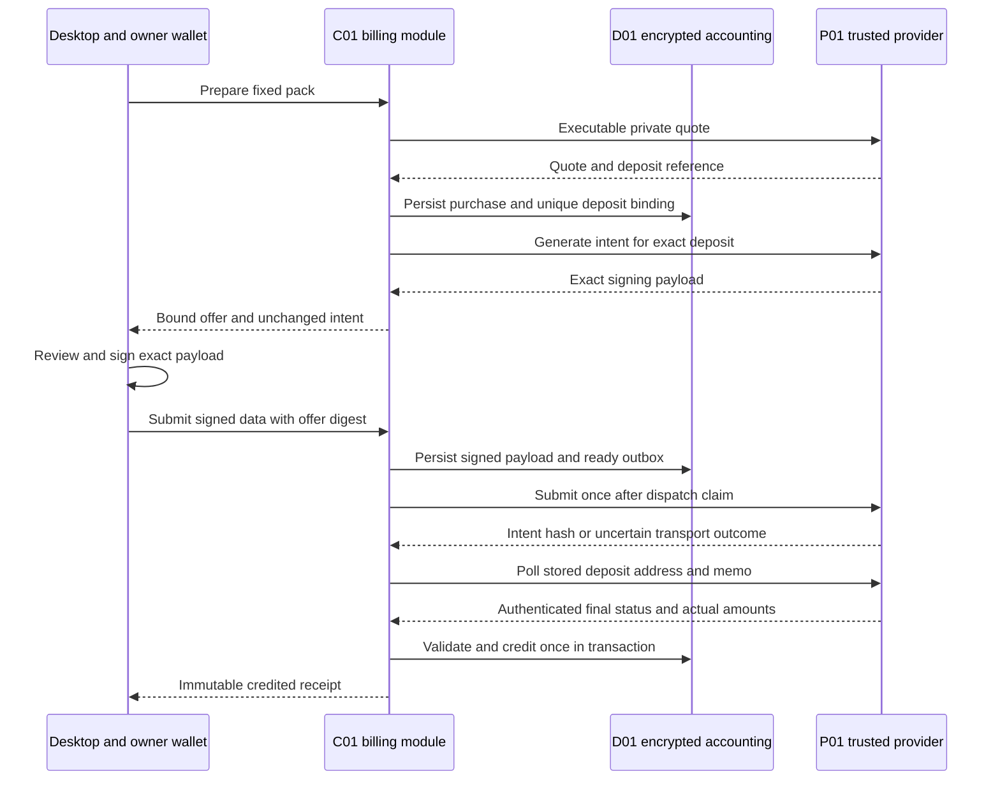

# Payments and Usage

[MVP guide](../README.md) · [Tasks](../delivery/tasks.md) · [Stack and setup](../references/stack-and-provider-setup.md)

The MVP accepts a real private payment through P01 for one fixed prepaid credit pack, then reserves bounded service credit before chat or meeting work starts. The owner signs the exact payment intent in their wallet. P01's authenticated final execution status is the accepted settlement authority. C01 validates it against the original purchase and credits the owner once in a database transaction. This is a trusted-provider integration; quote signatures and confidential execution do not prove that a compromised provider or merchant operator cannot misreport settlement.

Customer service credits, retail usage charges and supplier expenses are different quantities. Credits are an application entitlement, not a stablecoin balance, bank balance or provider credit balance. I01 is funded separately by the operator through its ordinary supported procurement route. A customer top-up does not automatically fund that supplier, and an administrative supplier limit is not proof of a payment.

## 1. One route, one pack and explicit units

The reference product config grants **10,000 service credits** for **10.00 units of one configured source asset**. This is a proposed pack price, not a claim of a dollar peg, guaranteed exchange value or supplier purchasing power. The source and destination use the same exact supported asset for the selected private route. During setup, read the actual token catalog, select one route that successfully quotes and executes, then freeze its exact asset ID and decimals. Do not invent a token contract from its symbol or assume that catalog listing proves private-route availability.

```text
PaymentRouteConfig = {
  routeId:"P01_ROUTE_01", policyVersion:U64,
  sourceAssetId, destinationAssetId, assetDecimals:u32,
  merchantRecipient, depositType:"CONFIDENTIAL_INTENTS",
  recipientType:"CONFIDENTIAL_INTENTS", refundType:"CONFIDENTIAL_INTENTS",
  sourceAmountAtomic:AssetAtomic, minimumOutputAtomic:AssetAtomic,
  maximumOutputAtomic:AssetAtomic,
  slippageToleranceBps:u32, quoteLifetimeMs:U64,
  packId:"PACK_10000", packCredits:"10000",
  signingStandard:"nep413", generatedIntentValidatorVersion,
  settlementContractVersion
}
```

`sourceAmountAtomic = 10 × 10^assetDecimals`. Setup pins `minimumOutputAtomic`, `maximumOutputAtomic` and the permitted slippage for the tested route; the owner sees the actual quote and fees before signing. The initial same-asset route caps accepted final output at `sourceAmountAtomic`; a larger unexplained receipt needs reconciliation. No input in a purchase request can change the recipient, route, asset, pack size or price. A missing exact asset, recipient, outcome range, validated intent fixture or settlement mapping disables payment with `PAYMENT_CONFIGURATION_INCOMPLETE`. Initial quote lifetime is at most five minutes and cannot exceed the provider's own deadline. These are configuration values to establish through the actual integration, not invented live-route evidence.

`Credits` and internal nanodollar supplier counters use canonical `U64` decimal strings and checked integer arithmetic. `AssetAtomic` is a canonical unsigned decimal integer string bounded to 256 bits, matching upstream atomic quantities without binary floating point. A token's `price` and formatted USD displays are not accounting inputs. Rounding of retail units is specified below; never mix atomic token values, credits or supplier nano-USD in one column or total.

## 2. Trusted endpoints and keys

The billing module is part of C01 confidential API. It uses the authenticated owner context to resolve one `billingAccountId`; caller-supplied account IDs are never an authorization source. The module has a separate accounting key hierarchy and no document-content root. P01 partner credentials, merchant authentication/signing material when required, merchant access/refresh tokens and I01 supplier credentials are released only to their approved C01 modules and persisted through approved confidential sealing. They do not enter the desktop browser, ordinary environment stores, edge logs or plaintext database fields.

P01 sees the purchase route and private account execution; the owner's wallet sees its exact signing payload. The source provider and its accepted private-network operators remain trusted boundaries. Our API uses authenticated HTTPS directly from C01 to the configured P01 origin and validates certificate/hostname and exact response schemas. Quote signature verification is additional origin authentication for the fields actually covered. It is not treated as a signature over unrelated final status or amount fields.

The owner's wallet signs `nep413` data generated for this particular purchase. The desktop native boundary checks the received intent against the purchase offer and invokes the configured wallet handoff. It binds the returned account and public key to the expected signer and verifies signature encoding and payload digest before submission. The ordinary app login is not wallet ownership proof. Wallet signing does not grant general background spending authority.

The reference desktop uses one WAL01 extension wallet in an external desktop browser through the documented `signMessage(SignMessageParams): Promise<SignedMessage|void>` adapter. Exact wallet/package names and the reviewed source commit are in References. The owner configures and unlocks that wallet for the demo account; missing extension, missing selected account or wrong network produces `WALLET_UNAVAILABLE` before signing. No wallet key is imported into this application and this bridge does not request a transaction-access key.

Native opens a bundled signing page from a temporary listener bound only to `127.0.0.1` on a random port. A random 32-byte one-use capability travels in the launch URL fragment, is immediately removed from browser history, and authorizes same-origin local POST calls in a header. Validate the exact Host and Origin; disable CORS, access/body logging, remote assets and caching. The listener exposes only this pending purchase's offer and unchanged provider signing payload, never app session credentials or content keys. Only one handoff is active; it expires at the earlier of the quote deadline and five minutes.

The bundled bridge selects the single configured wallet module and calls its `signMessage` with the exact provider `message`, `recipient` and decoded 32-byte `nonce`, preserving an optional `callbackUrl` only if already present in the generated payload. It must not add a return URL to the signed structure. The selected extension adapter returns `SignedMessage={accountId,publicKey,signature,state?}` through its Promise; the page returns that bounded result to native with the one-use local capability. This local POST is our handoff callback, not an extra provider intent field. Native verifies the expected signer, full NEP-413 signature over the original payload and offer digest, performs the documented encoding conversion, then invokes purchase submission. Reject `void`, an expired/duplicate return, a changed account, payload mutation or unexpected response. Wallet cancellation closes the handoff and leaves the purchase unsigned. The browser listener and sensitive page state are destroyed after completion or timeout. Actual extension permission, nonce encoding and original-payload compatibility are mandatory reference-demo fixtures, not assumed proven by the interface.

## 3. Owner API contract

The following method names are logical routes inside the encrypted request to outer `POST /mvp/v1/channel`. All bodies/results use the shared session-bound envelope with `operationId`; private purchase IDs, amounts and addresses are not exposed in URL parameters. Mutations logically persist `(ownerId, operationId, bodyDigest, result)` atomically with their state change; physically, the lookup uses an accounting-key HMAC tag and the tuple/result is encrypted. Same ID/same body returns the prior result; same ID/different body fails `OPERATION_CONFLICT`.

| Logical method | Body | Result; principal errors |
| --- | --- | --- |
| `/mvp/v1/billing/purchases/prepare` | `{packId:"PACK_10000", expectedSignerId, refundAccountId}` | `{purchaseId, state, offer:PurchaseOffer|null, intent:ProviderIntent|null}`; `ROUTE_UNAVAILABLE`, `PAYMENT_CONFIGURATION_INCOMPLETE`, `SIGNER_UNSUPPORTED`, `PREPARE_PENDING` |
| `/mvp/v1/billing/purchases/submit` | `{purchaseId, offerDigest, signedData:ProviderSignedData}` | `{purchaseId, state, nextPollAfterMs:U64|null}`; `INVALID_SIGNATURE`, `PAYLOAD_MISMATCH`, `QUOTE_EXPIRED`, `PURCHASE_CONFLICT`, `SUBMISSION_UNKNOWN` |
| `/mvp/v1/billing/purchases/get` | `{purchaseId}` | `{purchaseId, state, receipt:PurchaseReceipt|null, reason:null|ErrorCode, nextPollAfterMs:U64|null}`; `NOT_FOUND` |
| `/mvp/v1/billing/purchases/list` | `{cursor:null|OpaqueCursor, limit:u32}` | `{purchases:PurchaseHistoryEntry[], nextCursor:null|OpaqueCursor}`; `INVALID_CURSOR`. Includes pending, credited, failed, refunded and expired attempts. |
| `/mvp/v1/billing/account/get` | `{}` | `{billingAccountId, balanceCredits:U64, heldCredits:U64, availableCredits:U64, unresolvedActionCount:u32, pendingPurchaseCount:u32, pricePolicyVersion:U64}` |
| `/mvp/v1/billing/usage/list` | `{cursor:null|OpaqueCursor, limit:u32}` | `{events:UsageEvent[], nextCursor:null|OpaqueCursor}`; `INVALID_CURSOR` |

Provider account strings are bounded by the pinned provider schema and at most 256 UTF-8 bytes. The generated intent and signed envelope must conform to the selected standard and fit the shared control-message bound; do not accept an arbitrary JSON blob with unknown fields. Usage and purchase page sizes are 1–50 and their authenticated encrypted cursors bind owner, logical method, sequence and any filter. Foreign purchase IDs return the same `NOT_FOUND` response as absent IDs. `account/get` returns a typed unavailable error if accounting state cannot be authenticated; it never substitutes zeros.

`PurchaseHistoryEntry={purchaseId:Id128, purchaseSequence:U64, state:PurchaseState, createdAtMs:U64, updatedAtMs:U64, packId:"PACK_10000", receipt:PurchaseReceipt|null, reason:ErrorCode|null}`. A credited entry includes its actual immutable local credit receipt; failed/refunded/expired entries retain their outcome and reason with no fabricated credit receipt or zero payment amount. `/purchases/get` resolves any listed attempt's current details. Each history entry is bounded to 4 KiB. Return fewer entries when needed to keep the complete response within 256 KiB, with a cursor after the last returned entry; never silently omit the remainder.

Allocate `purchaseSequence` monotonically per accounting account when creating the purchase. The first list request fixes an upper sequence bound and returns descending sequence order. Its cursor contains that bound and the last returned sequence, so newer purchases cannot cause duplicate or skipped entries while paging. Entry states are current observations at read time; refresh the first page to see later settlement changes. Cursors expire after 15 minutes; invalid, foreign-owner, expired or wrong-method cursors fail without falling back to an unscoped query. This is a read-only account-scoped query, with no side effect or credit issuance. `pendingPurchaseCount` replaces the unbounded pending-ID list; history is always retrieved through the explicit bounded list.

`PurchaseOffer` is `{purchaseId, packId, packCredits, routeId, policyVersion, sourceAssetId, sourceAmountAtomic, destinationAssetId, minimumOutputAtomic, maximumOutputAtomic, merchantRecipient, expectedSignerId, refundAccountId, quoteDigest, intentDigest, expiresAtMs, offerDigest}`. It is delivered through the attested channel and binds the complete commercial terms to the exact provider payload. The immutable local receipt is `{receiptId, purchaseId, billingAccountId, offerDigest, providerEvidenceDigest, actualInputAtomic, actualOutputAtomic, destinationAssetId, creditedCredits, ledgerEntryId, creditedAtMs}`. `receiptId` is our own ID; it is not represented as an upstream receipt field.

`UsageEvent={eventId:Id128, sequence:U64, actionId:Id128, kind:"chat"|"meeting", state, reservedCredits:U64, chargedCredits:U64|null, releasedCredits:U64|null, units:UsageUnits|null, supplierCostState:"unknown"|"confirmed"|"not_applicable", occurredAtMs:U64}`. This owner-only response is encrypted; its detailed action-to-owner mapping is not a plaintext analytics export. Unknown charged or released quantities are null with an unresolved state, not zero.

## 4. Actual P01 mapping and durable purchase lifecycle



The adapter uses these documented operations, with partner authentication where required:

1. `POST /v0/quote` with `{dry:false, swapType:"EXACT_INPUT", slippageTolerance, originAsset, depositType:"CONFIDENTIAL_INTENTS", destinationAsset, amount, refundTo, refundType:"CONFIDENTIAL_INTENTS", recipient, recipientType:"CONFIDENTIAL_INTENTS", deadline}`. Capture exact `quoteRequest`, `quote`, `correlationId`, `timestamp` and `signature`. Validate requested fields, actual usable deadline, `quote.depositAddress`, optional `quote.depositMemo` and output minimum. Display estimates do not grant credit.
2. Commit the purchase and unique deposit binding before generation. `POST /v0/generate-intent` uses `{type:"swap_transfer", standard:"nep413", signerId, depositAddress}` and returns `{intent:{standard,payload}, correlationId}`. This request does not document `depositMemo`; do not add that field. The selected baseline route must have no memo, or its exact returned payload must demonstrably bind the required memo through the actual provider contract before configuration is enabled. Persist any returned memo exactly for status lookup.
3. Inspect the generated payload with the pinned route-specific validator: expected signer, deposit target, exact asset amount, deadline, allowed intent actions, signing recipient/domain and nonce semantics must match the stored purchase. Preserve all required optional signing fields unchanged. An opaque payload that cannot be validated is `PAYLOAD_UNSUPPORTED`, not a generic authorization to sign.
4. After native signature validation, persist the exact `signedData` and `SUBMIT_READY` outbox in the purchase transaction. `POST /v0/submit-intent` sends `{type:"swap_transfer", signedData}` and returns `{intentHash, correlationId}` when acknowledged. `intentHash` and correlation ID have distinct meanings. Neither is assumed to provide HTTP retry idempotency.
5. Poll `GET /v0/status?depositAddress=...` and include the exact `depositMemo` only when present. Retain `correlationId`, `quoteResponse`, `status`, `updatedAt` and `swapDetails`, including actual `amountIn`, `amountOut`, `depositedAmount`, `refundedAmount` and `intentHashes` when returned. These are upstream request/query fields inside the protected provider connection, not public app routes.

Use one `purchaseId` from initial preparation through reconciliation. Preparation retries reuse the stored quote and generated intent if valid. A crash after requesting a quote but before storing it may leave an unused unexposed quote; it cannot have an owner signature. Once a signing offer is exposed, retain that deposit reference for reconciliation even after local expiry. Never overwrite it with a fresh quote. The owner can request a new purchase after an unsigned offer expires; a signed or uncertain purchase is shown clearly before starting another one.

States are `PREPARING → AWAITING_SIGNATURE → SUBMIT_READY → SUBMITTING → PROCESSING → CREDITED`. Branches include `PREPARE_FAILED`, `EXPIRED_UNSIGNED`, `FAILED`, `REFUNDED`, `SUBMISSION_UNKNOWN` and `RECONCILIATION_REQUIRED`. Upstream `PENDING_DEPOSIT`, `KNOWN_DEPOSIT_TX`, `INCOMPLETE_DEPOSIT` and `PROCESSING` remain pending. `INCOMPLETE_DEPOSIT` is not a safe failure or zero outcome. Final provider failure/refund gives no service credit; the provider's original refund path is recorded, not replaced by an invented service refund API.

Before the network send, atomically claim the outbox and mark it `may_have_sent`. A timeout, crash or lost submit response after that point sets `SUBMISSION_UNKNOWN`. Poll the original deposit reference; do not create or resend another signed intent. The provider does not document generic exactly-once HTTP submission, and our SQL outbox cannot manufacture it. An operator may resolve the evidence and clear the hold through the same protected reconciliation path; an unresolved purchase remains visible.

## 5. Settlement validation and credit-once transaction

The selected P01 integration accepts authenticated `SUCCESS` as authoritative only when all fields establish the original purchase's outcome. Check the returned quote against the stored quote/request, exact deposit address and memo, configured recipient, private route types, source/destination asset and intended signer/payload linkage. Check the returned actual atomic output and input against the permitted amounts and final minimum. If `intentHash` was received, it must agree with returned execution identities where supplied. Preserve the actual provider fields; do not synthesize a receipt UUID, merchant event ID or net-credit field absent from its contract.

The setup fixture must establish the interpretation of `swapDetails.amountOut` for this route, including whether it is final recipient output and how fees appear. A provider-documented status receipt is sufficient when it supplies that contract. Merchant history is consulted only if this particular contract needs it to disambiguate an actual outcome; invite-only history access is not a universal second authority or independent cryptographic proof requirement. Missing recipient linkage, conflicting amounts or unclear final semantics means `RECONCILIATION_REQUIRED`, not guessed credit.

The application deduplication key is `HMAC(KaccountingIndex, "p01-settlement" || profile || merchant || depositAddress || presenceAndValue(depositMemo))`. This is an internal key over the known provider execution reference, not an invented upstream ID. The exact tuple must map to one stored purchase. Correlation IDs are diagnostic values and cannot fund credits independently. A settlement-key collision or an attempted binding to another purchase is rejected. A second read of the same purchase's evidence returns the original credit receipt.

Within one SQL transaction, lock the billing account and purchase rows, decrypt/authenticate their current snapshots, validate the terminal evidence, insert the settlement key under a UNIQUE constraint, insert one immutable `PURCHASE_CREDIT` ledger entry, add 10,000 checked credits to the account snapshot, mark the purchase `CREDITED`, store its encrypted receipt and commit. The unique purchase credit constraint is `(purchase_id, entry_kind='PURCHASE_CREDIT')`. A conflict rolls back; re-read and return the existing receipt only after verifying it belongs to the same purchase/evidence. Never mark credited before the transaction commits. A client disconnect after commit cannot duplicate a credit.

Quote expiry does not prove money did not move. Continue reconciling all exposed signed or potentially submitted references. A late successful execution under the unchanged original terms may credit once. Unexpected extra deposits, output above the allowed outcome range, duplicate funding or conflicting final responses are held for explicit reconciliation and are never silently assigned to a second account. The MVP has no recurring wallet authority or automated refund platform.

## 6. Confidential ledger and concurrency

Use D01 for honest durable transactions and locking. The design does not claim protection from a malicious database operator restoring or cloning complete accounting history. Monetary values, exact units, addresses, quotes, signed payloads, receipts and supplier costs are encrypted before leaving C01. SQL sees opaque identifiers, revision numbers, limited state projections, keyed deduplication tags and ciphertext. It does not run arithmetic on encrypted balances.

| Table | Required keys/projection; encrypted content |
| --- | --- |
| `billing_accounts` | `account_id PK`, `owner_tag UNIQUE`, `revision`; owner identity, snapshot of `balanceCredits`, `heldCredits`, cap counters and price version |
| `purchases` | `purchase_id PK`, `account_id`, `purchase_sequence`, `state`, `operation_tag UNIQUE`, `deposit_tag UNIQUE`, `revision`, `UNIQUE(account_id,purchase_sequence)`; offer, exact creation/update timestamps, quote, intent/signed data, provider evidence and receipt |
| `payment_outbox` | `purchase_id UNIQUE`, `state`, `lease_deadline`, `attempt_no`; exact request digest/payload and send observations |
| `settlement_claims` | `settlement_tag UNIQUE`, `purchase_id UNIQUE`; authenticated evidence digest |
| `usage_actions` | `action_tag PK`, `account_id`, `reservation_tag UNIQUE`, `state`, `revision`; original owner/action/reservation IDs, bounds, reservation, usage, debit, supplier state and provider request identity |
| `ledger_entries` | `entry_id PK`, `account_id`, `sequence`, `event_tag UNIQUE`; entry kind, credits, action/purchase reference and resulting snapshot digest |

C01 obtains `SELECT ... FOR UPDATE` locks in account→purchase/action order, authenticates encrypted rows, computes all counters with checked integers, encrypts the new versions with fresh nonces and commits. A balance snapshot has `balanceCredits ≥ heldCredits ≥ 0`; `availableCredits = balanceCredits − heldCredits`. Debits reduce balance; reservations increase held; settlement reduces the full hold and subtracts actual debit. An overflow, inconsistent snapshot or failed authentication stops admission. SQL uniqueness and the account lock prevent two simultaneous actions from spending the same free credit.

Derive `owner_tag`, `action_tag`, `reservation_tag` and operation lookup tags with separate domains under `KaccountingIndex`. Do not store the raw core owner/action/reservation identifiers as clear billing foreign keys: content and meeting tables may expose those opaque IDs, which would otherwise permit an ordinary database join to the owner's detailed usage. The random accounting account ID permits internal billing-row grouping but is not exposed as a clear content-table mapping. Its owner binding and all exact usage associations stay in authenticated ciphertext. Coarse billing states and row counts remain declared metadata.

Each owner has a proposed daily retail ceiling of 4,000 credits in UTC. A job's budget bucket is its admission day, retained through settlement; the UI calls this the daily authorized-work cap. The account's hold remains across midnight. On admission, account availability, current owner-day settled+held exposure and the action/job cap must all permit the new maximum. A meeting or chat is one bounded job; there are no open-ended paid agent loops. A new day does not release an unresolved previous-day hold. Report those holds separately so a lower available balance is explainable.

## 7. Admission, settlement and supplier reconciliation

```text
admitAction({ownerId, actionId, kind:"chat"|"meeting",
  reserveMaxCredits:U64, deadlineMs:U64, usageBound})
  -> {reservationId, state:"reserved", reservedCredits:U64}

settleAction({reservationId, settlementId:Id128,
  actualDebitCredits:U64, usageUnits, providerExpense:null|ProviderExpense})
  -> {state:"settled", chargedCredits:U64, releasedCredits:U64}

reconcileAction({reservationId, evidence:ReconciliationEvidence})
  -> {state:"reserved"|"dispatched"|"unknown"|"settled"|"released"}
```

These are internal functions called only by approved modules with authenticated owner/job context. `admitAction` is idempotent by owner/action and rejects changed bounds. `settleAction` is idempotent by reservation/settlement ID and rejects a debit above its reservation, a second different settlement or mismatched usage. Admission errors are `INSUFFICIENT_CREDIT`, `OWNER_CAP_REACHED`, `ACTION_CAP_EXCEEDED`, `SUPPLIER_UNAVAILABLE` and `ACCOUNTING_UNAVAILABLE`. A caller cannot release a hold by asserting that a timeout means no charge.

`UsageUnits` is the closed union `{kind:"chat", inputTokens:u32, outputTokens:u32, publishedAnswerId:Id128}` or `{kind:"meeting", admittedMs:U64, eligibleCapturedFrames:U64, transcriptOutcome:"complete"|"partial"|"failed"}`. `ProviderExpense={state:"unknown", inferenceId:string|null}` or `{state:"confirmed", inferenceId:string, costNanoUsd:U64, evidenceDigest:Digest}`; missing identity is allowed only for a possibly sent request. `ReconciliationEvidence` is an internal tagged reference to durable `unsent`, `published_answer`, `terminal_no_answer`, `meeting_final` or `supplier_report` evidence with `{kind, evidenceDigest, objectRef}`. The relevant approved module verifies the record's owner/action, provider response or native checkpoint and digest before the accounting transition; a caller-supplied string cannot assert its outcome. A zero-charge failed chat completes through `reconcileAction` with `terminal_no_answer`, sets retail state `released` and stores null units; it does not fabricate a published answer or zero token report.

`ChatUsageBound={maxInputTokens:8000,maxOutputTokens:1024,maxProviderRequests:1}`. The release price is `ceil(inputTokens/100) + ceil(outputTokens/20)` credits, maximum 132. Reserve 132 before dispatch. Charge using validated final provider usage only when a verified usable answer is durably published under the chat contract. Publication and retail settlement share an idempotent action result. If publication is uncertain, retain the retail hold until the durable result is checked. A terminal failed or `answer_lost` action with confirmed no published answer and closed dispatch costs zero retail credits; release that retail hold even when supplier expense is still unknown. The protected response-decryption closure is memory-only, so a process crash may lose an answer without proving the supplier did no work. Keep that supplier exposure held separately. No automatic second paid request is allowed for the action.

`MeetingUsageBound={maxAttendanceMs:"1800000",maxCapturedFrames:"86400000",maxChunks:361}`. Reserve at most 750 credits before joining: `5 × ceil(admittedMs/60000) + 20 × ceil(eligibleCapturedFrames/2880000)`. Attendance runs from actual host admission to confirmed departure or the installed cap, including a bounded reconnect. Captured frames exclude holes and invalid chunks; silence in a healthy captured stream still consumes capture/transcription resources. No admission and no work costs zero. Retry of upload or local transcription does not add another charge. If transcription cannot produce a usable complete or clearly partial artifact, charge attendance only and release the speech component. An optional summary requires a separate explicit chat action and reservation.

The retail hold moves through `reserved → dispatched → settled` or `unknown`; the operator's supplier exposure has its own state. Work proved unsent can be cancelled and released. Once a provider request may have been sent, supplier exposure survives deadline and process restart until its disposition is known. Retail follows the explicit publication policy above; absence of publication is established from durable state, not inferred from a network timeout. No response, a missing cost record, a zero with warning, or an unrecognized request ID is not confirmed zero supplier expense.

For I01, store the documented inference identity from `inference-id`, or the documented body-ID derivation when needed; do not use transport `x-request-id`. Cost lookup is `POST /v1/billing/costs` with `{requestIds:[...]}` and returns `requests:[{requestId,costNanoUsd}]` plus possible warnings. Use a lossless number parser, treat unknown-ID zero/warnings as unknown, and reconcile delayed results. Organization usage export may confirm detailed supplier charges; deduplicate its stable rows and do not add an aggregate cost total to those same rows again. Supplier cost state is `unknown | confirmed`, independent of retail settlement.

Keep a separate supplier balance/expense reserve and stop admitting new paid work when configured capacity cannot cover the bounded request. The operator can manually prefund through its supported provider account route. Display the actual supplier funding evidence privately in operations; neither source-wallet funds nor customer service credit is a substitute. Confirmed supplier expense can be recorded after retail settlement without charging the user a second time.

## 8. Acceptance and proof boundaries

All acceptance evidence is **Not run**. The payment demo must execute a real authorized private-route purchase, show the exact wallet signing payload, record actual terminal P01 evidence and atomically add the configured credits. A fake SUCCESS fixture proves only local parsing/state logic. A quote, wallet approval or submitted intent alone does not prove payment.

Exercise two concurrent same-amount purchases with different deposit bindings; mismatched recipient/asset/quote evidence; expired unsigned and late-success signed offers; memo presence and absence; lost submit response; crash before and after ledger commit; repeated status/submit requests; and a conflicting settlement claim. Require exactly one credit per valid purchase and no credit from forged or unrelated evidence. Page through more than 50 mixed purchase outcomes while new purchases arrive; test foreign/expired cursors, bounded responses and receipt retrieval after restart. Test the wallet bridge's missing extension, cancellation, altered payload, account mismatch, duplicate callback and exact signature round trip. Test concurrent chat/meeting reservations at the balance and owner cap, integer overflow and rounding boundaries, crash after paid dispatch, delayed supplier cost, zero-with-warning and settlement replay. Demonstrate that ordinary database/object/log inspection reveals ciphertext rather than amount, account address, signed payload, usage units or provider secret. Provider-wide compromise resistance and independently proven merchant net balances are not claims of this MVP.
