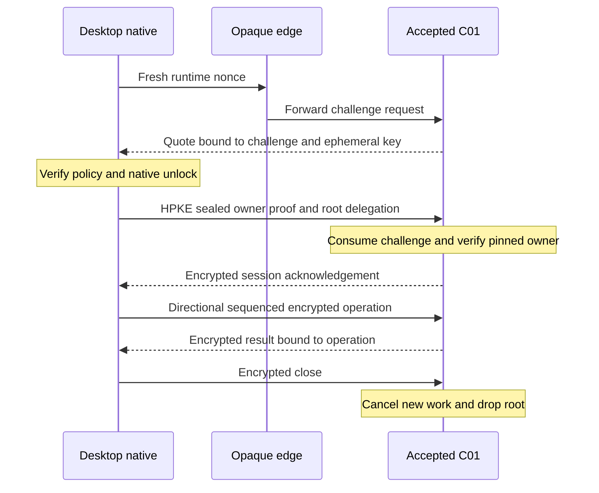

# Privacy, Keys, and Sessions

[MVP guide](../README.md) · [Tasks](../delivery/tasks.md) · [Stack and setup](../references/stack-and-provider-setup.md)

The owner root stays sealed on the reference desktop when the app is locked. An unlocked owner can delegate it through a verified encrypted channel to the accepted `C01` application for active document, indexing, and chat operations. This is an intentional trusted plaintext endpoint. Ordinary edge, database, object-storage, and logging systems receive ciphertext content. A meeting worker receives only recording-scoped keys. These contracts are specified; no implementation or live verification has run.

## Key inventory and local boundary

| Key or identity | Creation, holder, and permitted persistence |
| --- | --- |
| `ownerAuthSeed` | Native-generated 32-byte signing seed. Stored only in the non-synchronizing, user-presence-protected native key item; used only for session authentication. |
| `ownerAuthPublicKey` | Public 32-byte Ed25519 key. Exportable for the single-owner deployment binding. |
| `ownerId` | Base64url SHA-256 of `UTF8("MVP/owner/v1\u0000") || ownerAuthPublicKey`; 43 characters. Derived and checked on both sides. |
| `Kowner` | Native-generated random 32-byte vault root, in the same protected native key item. Released to accepted `C01` only by `session/open`. Never persisted as a server-side general vault key. |
| `Krecord`, `Kaction` | Independent random 32-byte record/job keys. Wrapped under an owner-derived wrapping key and persisted with ciphertext artifacts. Plaintext retained only by the active task that needs it. |
| `Krec` | Independent random 32-byte recording key. Owner-wrapped plus scoped service-wrapped for the bounded meeting/speech job; detailed lifecycle in Meetings. |
| `Kservice` | `C01` application-scoped sealing root. Protects provider credentials, accounting-sensitive payloads, and the separate recording-key wrapper. Cannot decrypt `Kowner` or arbitrary historical vault content. |
| Channel keys | Ephemeral, directional keys derived from a fresh HPKE context. Never persisted; lost on process restart. |

`CL-MAC` uses the native data-protection key store with user-presence access, when-unlocked access, and synchronization disabled. The implementation must inspect the actual access-control result on the reference machine. Software Ed25519 seeds are OS-protected secret values; they are not described as hardware-native Ed25519 keys. The renderer has no API to read the native key item.

`NativeKeyProvider` exposes `createInstallation()`, `unlock()`, `lock()`, `exportOwnerPublicKey()`, `openVerifiedSession(evidence)`, `sendOperation(method, body)`, and encrypted local-draft methods. It exposes no arbitrary signing, raw-key export, arbitrary decrypt, or arbitrary network command. Its native key handles are not serialized through the UI bridge. Clipboard/export only exposes owner-selected document content, never key material.

The desktop bundle has a fixed content-security policy, no remote privileged iframe, no downloaded executable application code, and a narrow file-picker capability. The reference build uses explicit installation of the signed bundle; it does not introduce an automatic-update protocol. Local application replacement and a compromised operating system remain trusted-device risks.

## Common types and primitive construction

`Id128` is 16 cryptographically random bytes encoded as 22-character unpadded base64url. `Digest32` is 32 bytes encoded as 43-character unpadded base64url. `U64` is a decimal string matching `0|[1-9][0-9]*`, at most `18446744073709551615`; reject overflow and leading zeros. Monetary values never pass through a floating-point number. Byte strings use canonical unpadded base64url and must round-trip to the exact specified length.

Parse UTF-8 strictly, reject duplicate JSON keys, unknown fields, invalid Unicode, nonfinite numbers, and excess depth before canonicalizing. `JCS(x)` means the restricted schema's canonical JSON bytes. Protocol integer counters and milliseconds use `U64`; bounded counts explicitly declared `uint32` use integral JSON numbers. Text is not silently Unicode-normalized. Hash input boundaries are explicit:

```text
H(tag, body) = SHA256(UTF8(tag) || 0x00 || body)
Kwrap = HKDF-SHA256(Kowner, salt=decode(ownerId),
                   info=UTF8("MVP/owner-wrap/v1"), length=32)
```

`CS01` fixes strict Ed25519 verification with weak/small-order keys rejected; HPKE Base mode with X25519, HKDF-SHA256, AES-256-GCM; and XChaCha20-Poly1305 immutable records. HPKE suite identifiers are `KEM=0x0020`, `KDF=0x0001`, `AEAD=0x0002`. Reject invalid public keys and all-zero shared secrets through the selected library's checked interface. Authentication keys and encryption keys are independently generated.

Each immutable record has `header={v:1,kind,ownerId,itemId,revisionId,recordId,keyVersion:"1"}`, a random 24-byte `nonce`, and AEAD `ciphertext` including its 16-byte tag. Associated data is `JCS(header)`. A record ID and nonce are never reused for different plaintext under the same key. `KeyEnvelope={v:1,ownerId,scopeId,keyVersion:"1",nonce,ciphertext}` wraps a 32-byte key under `Kwrap`, with the envelope header excluding nonce/ciphertext as associated data. Scope is the immutable revision or action ID, so an envelope cannot move between owners or revisions.

Structured record plaintext is strict canonical JSON; raw file chunks use raw bytes and a fixed typed header. The enclosing encrypted manifest binds every chunk's index, byte length, ciphertext digest, object ID, and plaintext digest. Plaintext digests are never put in ordinary database columns or public headers. `O01` object keys are random IDs rather than names or plaintext hashes.

## Provisioning and runtime evidence

During reference setup, native generates the installation and exports only `ownerAuthPublicKey`. Deployment binds that public key as the one accepted owner. It is not a secret. The application derives the corresponding `ownerId` and creates the one-to-one billing account in a transaction. There is no public first-writer enrollment race, support reset, additional-device enrollment, or login credential that bypasses the native keys.

The signed desktop bundle includes an `AcceptedRuntimePolicy` containing the application identity, expected configuration/image measurements, approved verifier policy, allowed hardware/TCB statuses, and fixed edge origin. Actual digests are produced by the implementation build. An empty or placeholder policy cannot enable real use. The MVP accepts the provider's platform, key management, and attestation infrastructure; it does not treat a quote as proof against every provider insider or undisclosed key holder.

`GET /mvp/v1/runtime?nonce=<32 random bytes>` returns at most 2 MiB of evidence:

```text
RuntimeStatement = {
  v:1, runtimeId:Id128, bootId:Id128, challengeId:Id128,
  clientNonce:Bytes32, serverNonce:Bytes32,
  hpkePublicKey:Bytes32, configDigest:Digest32,
  issuedAtMs:U64, expiresAtMs:U64
}
RuntimeEvidence = {statement, quote, eventLog, collateral}
reportData = SHA512(UTF8("MVP/runtime/v1\u0000") || JCS(statement))
```

Each challenge expires after 60 seconds, is single-use, and binds a fresh boot-local HPKE key. Native verifies the full quote/collateral chain, exact report-data bytes, its own nonce, the supported platform/TCB policy, application/configuration measurement, and the endpoint binding. Ordinary TLS still verifies the configured hostname and certificate. Invalid or stale evidence fails before root release. The API stores a bounded challenge entry; excess unauthenticated requests are rate-limited without logging the challenge body.

## Session opening and encrypted transport



Native chooses a new `sessionId:Id128`. `OpenBody` contains `v:1`, `sessionId`, `ownerId`, `ownerAuthPublicKey`, `challengeId`, `clientNonce`, `serverNonce`, `runtimeId`, `bootId`, `configDigest`, `delegation:{kind:"active_owner",vaultRoot:Bytes32}`, and `signature`. The signature is strict Ed25519 over `H("MVP/session-open/v1", JCS(OpenBody without signature))`. The signature and root are inside HPKE ciphertext; neither is a public URL or log field.

HPKE `info` is `UTF8("MVP/session/v1\u0000") || SHA256(JCS(statement))`. HPKE associated data is `JCS({v:1,challengeId})`. `POST /mvp/v1/session/open` carries only `{v:1,challengeId,enc,ciphertext}`. `C01` atomically consumes the challenge, validates every binding, derives the owner ID, verifies the configured public key and signature, and creates the session. A bad or repeated challenge is `SESSION_REJECTED`; no root is retained on failure. Replaying a consumed open does not recreate the session; native starts a fresh challenge.

Both endpoints derive `Kc2s=Export("MVP/c2s/key/v1",32)`, `Ks2c=Export("MVP/s2c/key/v1",32)`, and separate 16-byte nonce prefixes with exporter contexts `MVP/c2s/nonce/v1` and `MVP/s2c/nonce/v1`. Each frame uses XChaCha20-Poly1305 with nonce `prefix16 || uint64be(seq)`. Separate keys prevent cross-direction nonce collision. The initial server acknowledgement uses server sequence `0`; normal server responses start at `1`; client requests start at `1`.

`ChannelFrame={header:{v:1,sessionId,direction:"c2s"|"s2c",seq:U64},ciphertext}` authenticates `JCS(header)` as associated data. The encrypted request is `{operationId:Id128,ownerId,method,body}`. A successful response is `{operationId,ok:true,result}`; failure is `{operationId,ok:false,error}`. Acknowledgement plaintext binds owner/session/runtime IDs and absolute expiry. The native transport permits one in-flight request per session; long jobs return an action ID and use encrypted polling. This avoids out-of-order channel complexity.

The receiver requires its next sequence exactly. For 60 seconds it retains the last 32 complete encrypted request hashes and exact response frames; an identical duplicate returns the original response without repeating work. Same sequence with different bytes closes the session. Older replay, wrong direction, wrong session, malformed tag, or sequence overflow also closes it. A timeout beyond the replay window opens a fresh session and recovers by the original `operationId`. Do not re-encrypt a different response under an already used sequence.

Outer frames are at most 4 MiB, authenticated bodies at most 3 MiB, depth 40, and method strings at most 96 ASCII characters. Public close carries an authenticated channel frame whose method is `/mvp/v1/session/close`; the separate fixed route is only a transport convenience. A close acknowledgement may be lost; expiry still closes the normal process session. Edge failures expose fixed safe status codes only.

## Active delegation and scoped work

The API keeps `Kowner` only in the current owner's protected session object. The absolute lifetime is 60 minutes; successful authenticated activity extends the inactivity deadline only up to that limit. A newly opened owner session closes the old one. Native locks on explicit lock, application exit, and system lock/sleep notification; API inactivity is the fallback when delivery fails. These are normal-runtime controls, not a guarantee that a hostile host cannot pause a machine holding keys.

New extraction/chat work requires an active delegation. A task receives only the revision keys and bounded input it needs. On lock, the API drops the general root, clears decrypted source/index caches, stops new paid dispatch, and pauses unstarted content work as `awaiting_unlock`. An already sent model request may still incur cost: its narrowly scoped action key can finish capturing encrypted bytes until its original deadline, without reading more documents. After ordinary restart, owner unlock can unwrap the persisted `Kaction` record key and read saved ciphertext/evidence. This does not restore the provider helper's response private key, which existed only in its in-memory closure. An unpublished answer whose response key was lost remains `answer_lost`; cost/receipt reconciliation is read-only and cannot dispatch a replacement inference.

Recording creation requires an unlocked owner and immediately creates both owner and scoped service wrappers for `Krec`. The service wrapper allows the originally authorized recording/speech run to finish or resume without the general root. Delete that wrapper 24 hours after terminal run plus successful import, or after seven days maximum for unfinished work. The owner wrapper remains with the encrypted recording. Transcript completion while locked is `pending_import`; the next unlock completes owner-vault publication. The original run deadline is never extended by a worker restart.

`Kservice` derives separate purpose keys for accounting, credentials, and recording wraps. The billing module never receives `Kowner`. That separation is enforced by interfaces and access tests, while the accepted application image remains the common trust boundary. Plaintext provider secrets are not placed in ordinary environment variables or deployment logs.

## Failure behavior and required evidence

Unavailable native key material produces `LOCAL_KEY_UNAVAILABLE`, not a new empty vault silently attached to old ciphertext. A failed runtime policy produces `RUNTIME_NOT_ACCEPTED`. Expired sessions produce `SESSION_EXPIRED`; wrong-owner records produce `OWNER_MISMATCH`; failed record tags produce `RECORD_INTEGRITY`; strict parse failures produce `INVALID_REQUEST`. Every caller sees a safe explanation and an exact retry category.

Tests must cross-check native and service canonical bytes, HPKE exporter outputs, signatures, key wraps, nonce construction, and AEAD records against fixed vectors and library vectors. Negative fixtures include duplicate keys, decimal overflow, malformed base64url, weak authentication keys, wrong suite, wrong owner, swapped record envelopes, altered ciphertext, reused sequence, expired challenge, stale quote, incorrect measurement, and changed transport binding.

Use native bridge tests to prove no route returns raw keys or permits arbitrary signing/decryption. Instrument renderer assets, IPC payloads, ordinary logs, temporary files, database, and object store with separate canaries. Test lock during extraction, lock during a paid request, process crash before/after session open, close acknowledgement loss, and fresh unlock after restart. Confirm general owner roots do not survive server restart and that recording-scoped restart does not confer historical access. The implementation must record real native storage and actual attestation results; all evidence is currently **Not run**.
