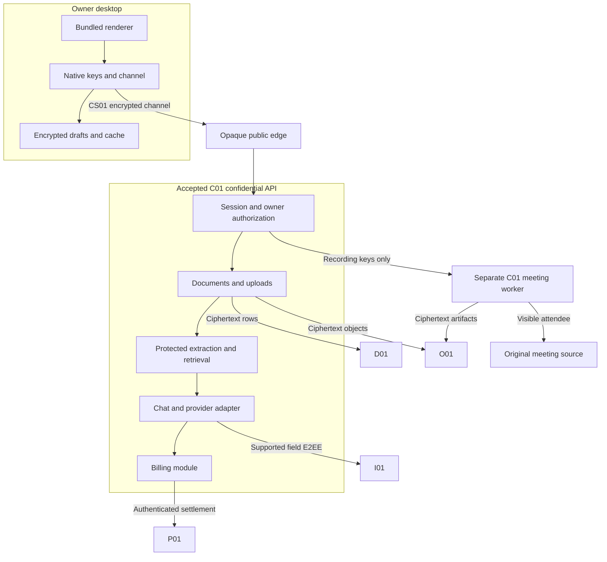
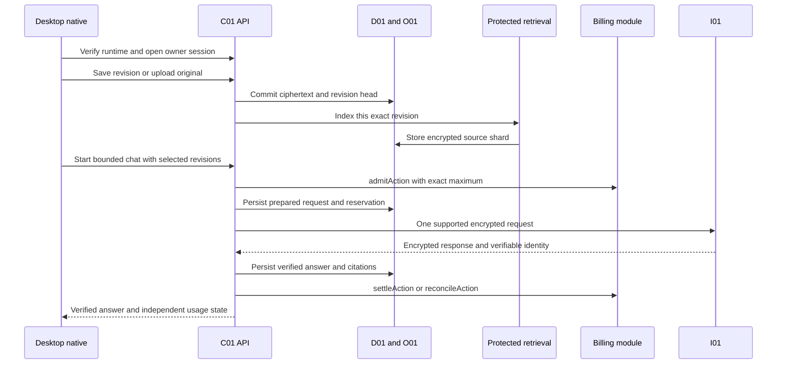

# System Architecture

[MVP guide](../README.md) · [Tasks](../delivery/tasks.md) · [Stack and setup](../references/stack-and-provider-setup.md)

This is the implementation contract for the personal desktop MVP. One owner uses one installation to store supported files, edit native pages, ask questions over selected sources, authorize one supported meeting-attendance route, and buy prepaid credit for capped processing. The reference build is `CL-MAC` on arm64. The system deliberately accepts `C01`, `I01`, and `P01` as trusted provider boundaries while checking their supported attestation, encryption, identity, and settlement contracts.

Everything here is specified, not implemented or tested. Source research and candidate versions live in References. The build must produce actual lockfiles, images, model digests, and evidence; this document supplies none of those results.

## Components and trust boundaries

The renderer receives document text needed for display and editing. It never receives the owner root, authentication private key, channel keys, recording keys, or provider credentials. Native commands validate the calling window, request schema, size, and current unlock state. Remote pages have no privileged bridge. File selection and byte streaming run through the native file adapter; a path supplied by document content is never an authority to read a local file.

The owner root is randomly generated and sealed by the native key provider. Unlock permits a narrowly defined authenticated delegation to the accepted confidential API. That process intentionally sees authorized source plaintext and the owner root while the session is active. It may derive revision and index keys in protected memory. It never stores the general owner root in its database, object store, service seal, environment, or logs. App restart requires the same installation to unlock again.

The public edge terminates ordinary transport and forwards opaque application messages. It may observe the device network address, connection timing, body sizes, public runtime evidence, and opaque session identifiers. It cannot inspect authenticated method names, filenames, payment intents, prompts, or application results. Do not route decrypted application exceptions back through edge logging.

`D01` stores ciphertext content plus the minimum transactional projection: opaque IDs, content relationships, byte counts, state enums, and sequence numbers. Private balances, amounts, detailed usage, and the owner-to-usage mapping stay encrypted outside `C01`; billing arithmetic runs in the protected module under transactional row locks and version checks. `O01` stores immutable ciphertext objects under random names. Storage operators can observe sizes, timing, opaque content ownership grouping, and activity/state patterns. Ordinary database transaction isolation, object durability, and backup correctness are accepted dependencies. This MVP does not claim protection against a malicious host restoring or cloning an old database.

The meeting worker is a separate confidential VM for one run. Its browser sees the original call and the source site's scripts. The native recorder and speech process receive recording-scoped material only. They cannot read historical documents or obtain the owner root. The original meeting provider and participants already have their own access to call content. This source boundary remains visible in the product explanation.

## Repository and module ownership

| Path | Responsibilities and prohibited coupling |
| --- | --- |
| `apps/desktop` | Bundled UI, native command registration, file picker, unlock, encrypted cache, channel client, editor. No provider secrets in renderer assets. |
| `apps/edge` | Fixed routes, transport limits, rate limiting, health forwarding. No application decryption or content diagnostics. |
| `services/confidential-api/src/auth` | Runtime evidence, challenge consumption, owner signatures, session keys, active root delegation. |
| `services/confidential-api/src/documents` | Immutable revisions, expected-parent checks, list/read/delete, encrypted manifests. |
| `services/confidential-api/src/uploads` | Bounded chunk ingestion, ciphertext objects, quota reservation and finalization. |
| `services/confidential-api/src/retrieval` | Protected parser supervision, canonical text, source locators, local embeddings and lexical ranking. |
| `services/confidential-api/src/chat` | Source snapshot, prompt assembly, paid-action state machine, inference verification, answer publication. |
| `services/confidential-api/src/billing` | Owner/account binding, purchases, reservations, credit ledger and uncertain supplier outcomes. Its interface accepts no source text or content key. |
| `services/meeting-worker` | One visible attendee, audio capture, encrypted chunks, bounded speech job, artifact handoff. |
| `packages/contracts` | Strict channel, record, API, state and error schemas; shared canonicalization and generated native fixtures. |
| `packages/native-crypto` | Native key handles, sealing, signing, channel cryptography and encrypted local persistence. |
| `packages/editor-schema` | Fixed native editor schema, validation, text projection and block IDs. |
| `packages/provider-adapters` | `I01D`, `P01`, `C01` evidence, and object-store adapters; fixed destinations only. |
| `infra`, `scripts`, `tests` | Immutable builds, deployment manifests, migration runner, fixtures and acceptance evidence. |

The API is one `R01` application with modules, not separate distributed services for each responsibility. Content and billing are separate typed interfaces in the same accepted confidential application; this limits accidental data propagation but is not process-level protection against a compromised application. Parser and speech subprocesses have bounded input/output, no network, no credentials, and no database socket. Local embedding weights are bundled build artifacts.

## Finite MVP limits

| Resource | Fixed limit and behavior |
| --- | --- |
| Ownership | One pre-provisioned owner public key and one installation. No password login. |
| Owner session | 15 minutes inactive, 60 minutes absolute, one current session. Lock and app exit close it. |
| Vault | 500 non-deleted items and 1 GiB of retained ciphertext, including historical revisions and recording objects. Reserve bytes before accepting writes. |
| Original uploads | PDF at most 25 MiB and 250 pages; TXT/MD at most 5 MiB. Each upload at most 100 chunks of 256 KiB. |
| Native editor | Canonical JSON at most 2 MiB, depth 32, 20,000 nodes, 250,000 text code points. |
| Search corpus | At most 250,000 extracted code points and 600 chunks per revision; 20,000 active indexed chunks per owner. |
| Interactive context | At most 20 explicitly selected source revisions; 8 retrieved chunks and 3,000 source tokens; 8,000 total prompt tokens. |
| Chat work | One provider request, at most 1,024 output tokens, 120-second dispatch deadline, maximum 132 service credits. |
| Meeting | One active meeting run, 30-minute attendance cap; detailed audio and reservation bounds in Meetings and Payments. |

These limits are product decisions to keep the demo implementable. Exceeding a bound produces a typed error or a clear non-indexed state; the application does not truncate an original file and call it successfully imported. Retained historical revisions count toward storage; the UI shows quota pressure before a write. The implementation must measure actual ciphertext bytes, including framing and manifests.

## Network and API contract

Only these public routes exist: `GET /healthz`, `GET /mvp/v1/runtime?nonce=...`, `POST /mvp/v1/session/open`, `POST /mvp/v1/channel`, and `POST /mvp/v1/session/close`. The privacy page defines their complete outer protocol. Authenticated application route strings, such as `/mvp/v1/docs/save`, live in the encrypted `Request.method` field. Object access also crosses this channel; there are no public source titles or caller-supplied storage URLs.

`packages/contracts/src/api.ts` owns `Request`, `Result`, and the method-to-body/result mapping. A request carries `operationId`, the established `ownerId`, an exact method, and a strict bounded body. The authenticated session determines owner scope; a body cannot select another account. Unknown fields, unknown methods, duplicate JSON keys, invalid encodings and oversized bodies fail before dispatch.

Mutations are idempotent by `(ownerId, operationId)`. Their canonical body hash must match on retry. A different body under the same ID returns `OPERATION_CONFLICT`. One transaction records the content change, completed operation, and any work queue entry. Encrypted saved results make a committed operation discoverable after the response is lost. A mutation retry never creates another revision, meeting, reservation, or payment purchase.

Every error is `{code, retryClass, safeMessage, details?}`. `retryClass` is `same_operation`, `unlock`, `owner_action`, or `never`. `details` contains only schema-approved fields such as the expected current revision, remaining quota, or opaque action state. Raw parser/provider errors remain inside short-lived protected diagnostics. A timeout does not establish that a paid action was never sent.

## Core execution paths

Upload and editing work without purchased inference credit. Protected extraction and indexing are included within the bounded vault. Chat and meeting processing require admission before paid work. The billing module owns `admitAction`, `settleAction`, and `reconcileAction`; caller-supplied balance assertions have no effect. The user-visible answer state and supplier-expense state are separate: a verified answer can have a cost still under reconciliation.

Queue claims use a transactional row lock and a renewable process lease. This prevents ordinary duplicate workers; it is not a defense against malicious database forks. Content jobs require a current root-bearing session and become `awaiting_unlock` when it ends. Meeting work follows its explicit recording grant, so recording may finish after desktop lock without gaining access to historical documents.

## Restart, failure, and acceptance

On ordinary API restart, session keys and owner roots disappear. Native performs a fresh challenge and unlock; it replays only original operation IDs. Pending uncharged extraction resumes from committed ciphertext after unlock. A prepared inference that was definitely not sent is cancelled because its in-memory response-key closure was lost. Any action whose network send could have happened becomes `outcome_unknown`; a lost response key is recorded as `answer_lost`. Recovery retrieves receipts and cost evidence without dispatching another paid request. Already published encrypted answers remain reopenable.

An object-store write followed by failed SQL commit leaves an unreferenced ciphertext object; a daily sweep removes objects older than 24 hours only after checking live revisions, staging sessions, and recording references. A SQL revision never points to an object until readback verifies its ciphertext length and digest. Database outages stop admission; quota and billing counters do not fall back to memory.

Acceptance must show the actual installed desktop unlocking, saving and reopening a page; uploading each supported format; selecting sources and receiving a verified answer; completing an actual authorized meeting; and buying usable credit through the real configured payment route. Component tests alone do not satisfy these journeys.

Leakage tests place distinct canaries in filename, page text, upload text, prompt, transcript, and payment metadata. Inspect edge logs, external SQL/object storage, ordinary diagnostics, crash output, and packet captures at each boundary. Canaries may appear in the intentionally trusted desktop display, protected execution, and authorized source/model boundary only. Verify malformed keys, stale evidence, ciphertext mutation, cross-owner IDs, crash-after-commit, lost response, quota exhaustion, and ambiguous paid dispatch. All results currently remain **Not run**.
