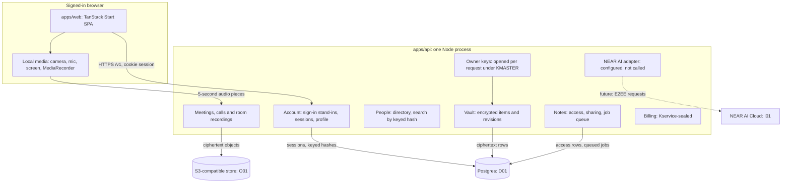

# System architecture

[Docs home](../README.md) · [Privacy, keys and sessions](privacy-keys-and-sessions.md) · [Data and storage](data-and-storage.md) · [Calls and recordings](calls-and-recordings.md) · [Notes and inference](notes-and-inference.md) · [Deployment and acceptance](deployment-and-acceptance.md)

This page describes what is built and how it maps onto the confidential design the product requires.
Where the local build differs from production requirements, the difference is stated explicitly.

## Components

| Path | Responsibility |
| --- | --- |
| `apps/web` | The app: welcome and sign-in, Home, the new-call composer, pre-join, the full-screen call, notes, the room recorder, account. Talks only to `@alcove/api` through `src/lib/api.ts`. |
| `apps/api` | The API (`@alcove/server`): Hono on Node, raw SQL via `pg` with zod-parsed rows, crypto via `@noble/ciphers` and `@noble/hashes`, objects via the S3 client, logs via pino. |
| `packages/api` | The contract: domain types as zod schemas, the `AlcoveApi` interface, live-session interfaces, wire shapes. |
| `packages/api-http` | The browser client: REST, NDJSON streams, raw audio uploads, live call and recording sessions. |
| `packages/ui` | The design system. |
| `infra`, `.github/workflows` | GCP bootstrap, deployment guide, CI and deploy pipelines. |

The API is one application with modules (account, people, meetings, calls, recordings, audio, notes,
billing), not separate services. Modules share one database pool and one object store, and receive the owner
context (the account's keys, opened for this request) explicitly. Billing is given only the owner ID and seals
its state under `Kservice`. `apps/api/src/demo.ts` holds the stand-ins for sign-in, the calendar and the
company directory until the real providers are connected.

## Request lifecycle

1. The browser sends `GET/POST/PATCH/DELETE /v1/...` with the HttpOnly session cookie. The first
   middleware assigns a request ID (or keeps a well-formed `x-request-id`), returns it as a header, and
   binds it to every log line for the request ([Logging and errors](logging-and-errors.md)).
2. CORS answers only `WEB_ORIGIN`. A state-changing request must come from `WEB_ORIGIN` with a JSON or
   audio body.
3. Public routes come first: `GET /healthz`, `GET /v1/session`, `POST /v1/auth/sign-in` and
   `POST /v1/telemetry`.
4. Auth middleware looks the session up in Postgres by the hash of the cookie. No session, or an ended one:
   `401 unauthenticated`, and the app returns to the welcome screen. Otherwise it opens the account's keys
   for this request (`openOwner`) and adds `ownerId` to the log context.
5. Mutations carry `x-alcove-operation` (a random Id128). The idempotency middleware stores an HMAC
   commitment of method, path and body plus the encrypted response; a retry returns the same response,
   and a different request under the same ID is `409 conflict`.
6. The handler reads and writes through the vault (encrypted manifests), the audio pipeline (encrypted
   objects), `note_access` (who else may read a note) or Kservice-sealed billing. Failures are `AppError`
   subclasses; `onError` logs each once at its level and answers `{ code, message, requestId }` with a
   stable code.

## Fixed limits in this build

| Resource | Limit |
| --- | --- |
| Session | 14 days idle, 30 days absolute; several per account; kept in Postgres, so they survive restarts |
| Sign-in | 30 attempts a minute per client address (browser reports: 60 a minute) |
| Audio piece | At most 2 MiB; WebM, MP4 or Ogg audio; 5-second timeslices |
| Meeting | 5 to 600 minutes, at most 100 people invited; a call started now is set to an hour |
| Call participants | One (the organizer); multi-party calls are on the [roadmap](../delivery/roadmap.md) |
| Note progress stream | One update a second, for at most two minutes |
| API instances | Any number: sessions and keys come from Postgres on every request, and only the rate-limit counters are per process. The prepared deploy runs one. |

## Local versus production

| Concern | Local build | Required for production |
| --- | --- | --- |
| Trusted compute | Plain Node process | Confidential VM (TEE) with remote attestation the client verifies before sending anything |
| Master key | `KMASTER` from `.env` | Released only to the attested VM, never to operators or the deploy pipeline |
| Sign-in | Stand-ins in `apps/api/src/demo.ts` | Google and Microsoft OAuth, OIDC single sign-on |
| Calendar and directory | A demo day placed at sign-in; a demo directory for `vandelay.industries` | The account's own calendar and company directory |
| Transport | HTTP on localhost behind the Vite proxy | TLS, plus an attested end-to-end channel (HPKE) so the edge sees only ciphertext |
| Call media | One participant, local only | End-to-end encrypted multi-party media (Proton Meet model: SFrame-style insertable streams, keys never on the media server); the notes service joins as an attested participant |
| Invitations | Not sent | Email (SMTP) |
| Object store | RustFS in Docker | Cloudflare R2 |
| Database | Postgres 17 in Docker | Cloud SQL Postgres 17 |
| Inference | NEAR AI key configured, unused | NEAR AI confidential inference for transcription and notes |
