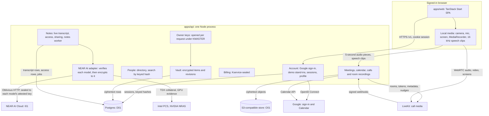

# System architecture

[Docs home](../README.md) · [Privacy, keys and sessions](privacy-keys-and-sessions.md) · [Data and storage](data-and-storage.md) · [Calls and recordings](calls-and-recordings.md) · [Notes and inference](notes-and-inference.md) · [Deployment and acceptance](deployment-and-acceptance.md)

This page describes what is built and how it maps onto the confidential design the product requires.
Where the local build differs from production requirements, the difference is stated explicitly.

## Components

| Path | Responsibility |
| --- | --- |
| `apps/web` | The app: welcome and sign-in, a new account's creation screen and the tour of Home (`src/features/onboarding`; whether the tour was seen is kept in this browser per account, `alcove.tour.<ownerId>`, parsed with `HomeTourSchema`), Home (Alcove's calls beside Google Calendar events), the new-call and change-call composer, pre-join, the full-screen call with its live transcript (your view of it is kept in this browser: preferences per account, `alcove.callView.<ownerId>` with `CallViewPrefsSchema`, and the arrangement of the call you're in per tab until you leave, `alcove.callLayout.<callId>` with `CallLayoutSchema`), notes, the room recorder, account. Talks only to `@alcove/api` through `src/lib/api.ts`. |
| `apps/api` | The API (`@alcove/server`): Hono on Node, raw SQL via `pg` with zod-parsed rows, crypto via `@noble/ciphers` and `@noble/hashes`, objects via the S3 client, Google ID tokens via `jose`, logs via pino. |
| `packages/api` | The contract: domain types as zod schemas, the `AlcoveApi` interface, live-session interfaces, wire shapes. |
| `packages/api-http` | The browser client: REST, NDJSON streams, raw audio and speech uploads, live call and recording sessions. |
| `packages/ui` | The design system. |
| `infra`, `.github/workflows` | GCP bootstrap, deployment guide, CI and deploy pipelines. |

The API is one application with modules (account, people, meetings, calendar, calls, recordings, audio,
transcripts, notes, drafting, writer, series, billing), not separate services. Modules share one database pool and
one object store, and receive the owner context (the account's keys, opened for this request) explicitly.
Billing is given only the owner ID and seals its state under `Kservice`. Google sign-in and Calendar live
in `apps/api/src/google.ts` and `modules/calendar.ts`; only `apps/api/src/inference.ts` and `apps/api/src/evidence.ts`
talk to NEAR AI, and only `inference.ts` sends it content.
`apps/api/src/demo.ts` holds the stand-ins for Microsoft and SSO sign-in, the sample calendar and the
company directory until the real providers are connected.

Two things run outside requests, in the same process: maintenance, at start and every 5 minutes, and the
notes worker, which starts when a recording stops ([Notes and inference](notes-and-inference.md)).

## Request lifecycle

1. The browser sends `GET/POST/PATCH/DELETE /v1/...` with the HttpOnly session cookie. The first
   middleware assigns a request ID (or keeps a well-formed `x-request-id`), returns it as a header, and
   binds it to every log line for the request ([Logging and errors](logging-and-errors.md)).
2. CORS answers only `WEB_ORIGIN`. A state-changing request must come from `WEB_ORIGIN` with a JSON or
   audio body.
3. Public routes come first: `GET /health` and `/healthz`, `GET /v1/session`, `POST /v1/auth/sign-in`
   (the demo providers), `GET /v1/auth/google` and `GET /v1/auth/google/callback`, `GET /v1/attestation`
   ([what's running](privacy-keys-and-sessions.md#moving-to-confidential-computing)) and `POST /v1/telemetry`.
4. Auth middleware looks the session up in Postgres by the hash of the cookie. No session, or an ended one:
   `401 unauthenticated`, and the app returns to the welcome screen. Otherwise it opens the account's keys
   for this request (`openOwner`) and adds `ownerId` to the log context.
5. Mutations carry `x-alcove-operation` (a random Id128). The idempotency middleware stores an HMAC
   commitment of method, path and body plus the encrypted response; a retry returns the same response,
   and a different request under the same ID is `409 conflict`. Note search, asking, catching up, caption
   translations, audio pieces, transcript clips, changes to a note's decisions, open questions and
   follow-ups, and sharing a note keep no receipt.
6. The handler reads and writes through the vault (encrypted manifests), the audio pipeline (encrypted
   objects), transcript rows, `note_access` (who else may read a note) or Kservice-sealed billing, and calls
   Google or NEAR AI where a feature needs them. Failures are `AppError` subclasses; `onError` logs each
   once at its level and answers `{ code, message, requestId }` with a stable code.

## Fixed limits in this build

| Resource | Limit |
| --- | --- |
| Session | 14 days idle, 30 days absolute; several per account; kept in Postgres, so they survive restarts |
| Sign-in | 30 attempts a minute per client address, demo and Google together (browser reports: 60 a minute) |
| Attestation | 30 requests a minute per client address |
| Google sign-in attempt | 10 minutes from leaving for Google to coming back |
| Audio piece | At most 2 MiB (a larger `content-length` is refused before the body is read); WebM, MP4 or Ogg audio; 5-second timeslices |
| Transcript clip | 16 kHz mono 16-bit WAV, at most 30 seconds (960,044 bytes); 120 a minute per account |
| Live transcript | The latest 200 lines in a call's or room recording's state |
| Asking | Questions of 1 to 500 characters; 20 a minute per account |
| Notes job | Three attempts, a 180-second lease, retries 20 and 90 seconds after a failure; at most 120,000 characters of transcript sent |
| Calendar | Events from an hour ago to a week ahead, at most 100 |
| Meeting | 5 to 600 minutes, at most 100 people invited; a call started now is set to an hour |
| Call participants | No limit; the organizer, people invited and guests by name. Join tokens last 120 seconds, call passes 12 hours |
| Note progress stream | One update a second, for at most two minutes |
| API instances | Any number: sessions and keys come from Postgres on every request, and notes jobs are claimed with leases. The rate-limit counters, Google access tokens and the timers that retry notes are per process. The prepared deploy runs one. |

## Local versus production

| Concern | Local build | Required for production |
| --- | --- | --- |
| Trusted compute | Plain Node process | Confidential VM (TEE) with remote attestation the client verifies before sending anything |
| Master key | `KMASTER` from `.env` | Released only to the attested VM, never to operators or the deploy pipeline |
| Sign-in | Google OpenID Connect when `GOOGLE_CLIENT_ID` and `GOOGLE_CLIENT_SECRET` are set; stand-ins for Microsoft and SSO in `apps/api/src/demo.ts` | Google, Microsoft OAuth and OIDC single sign-on, all verified |
| Calendar and directory | Google Calendar for Google accounts; a sample day for demo accounts; a demo directory for `vandelay.industries` | Every provider's calendar and the company's own directory |
| Transport | HTTP on localhost behind the Vite proxy | TLS, plus an attested end-to-end channel (HPKE) so the edge sees only ciphertext |
| Call media | LiveKit in Docker (`infra/livekit/dev.yaml`); LiveKit Cloud in production. End-to-end encrypted: MLS keys made in browsers, frames encrypted before they leave ([Calls and recordings › End-to-end encryption](calls-and-recordings.md#end-to-end-encryption)) | The same, plus every speaker in the notes |
| Invitations | Sent by Google Calendar when the organizer's calendar is connected; otherwise none | Email (SMTP) as well |
| Object store | RustFS in Docker | Cloudflare R2 |
| Database | Postgres 17 in Docker | Cloud SQL Postgres 17 |
| Inference | NEAR AI Cloud when `NEAR_AI_API_KEY` is set: each model's attestation checked first (its OS image pinned), then everything by Oblivious HTTP sealed to its attested key | The same, with the model code pinned to published provenance |
