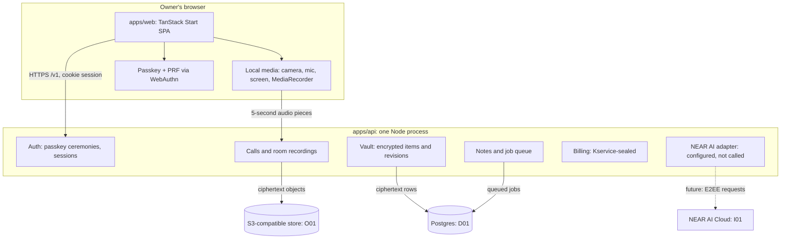

# System architecture

[Docs home](../README.md) · [Privacy, keys and sessions](privacy-keys-and-sessions.md) · [Data and storage](data-and-storage.md) · [Calls and recordings](calls-and-recordings.md) · [Notes and inference](notes-and-inference.md) · [Deployment and acceptance](deployment-and-acceptance.md)

This page describes what is built and how it maps onto the confidential design the product requires.
Where the local build differs from production requirements, the difference is stated explicitly.

## Components

| Path | Responsibility |
| --- | --- |
| `apps/web` | The app: onboarding, home, meetings, pre-join, the full-screen call, notes, recorder, account. Talks only to `@alcove/api` through `src/lib/api.ts`. |
| `apps/api` | The API (`@alcove/server`): Hono on Node, raw SQL via `pg` with zod-parsed rows, WebAuthn via `@simplewebauthn/server`, crypto via `@noble/ciphers` and `@noble/hashes`, objects via the S3 client. |
| `packages/api` | The contract: domain types as zod schemas, the `AlcoveApi` interface, live-session interfaces, wire shapes. |
| `packages/api-http` | The browser client: REST, NDJSON streams, raw audio uploads, WebAuthn with PRF, live call and recording sessions. |
| `packages/ui` | The design system. |
| `infra`, `.github/workflows` | GCP bootstrap, deployment guide, CI and deploy pipelines. |

The API is one application with modules (account, meetings, calls, recordings, notes, billing, stats),
not separate services. Modules share one database pool and one object store, and receive the unlocked
owner context explicitly; billing never receives owner keys.

## Request lifecycle

1. The browser sends `GET/POST/PATCH/DELETE /v1/...` with the HttpOnly session cookie.
2. Auth middleware resolves the in-memory session. No session: `401 unauthenticated`. Expired session:
   `423 locked`, and the app returns to the unlock screen.
3. Mutations carry `x-alcove-operation` (a random Id128). The idempotency middleware stores an HMAC
   commitment of method, path and body plus the encrypted response; a retry returns the same response,
   and a different request under the same ID is `409 conflict`.
4. The handler reads and writes through the vault (encrypted manifests), the audio pipeline (encrypted
   objects) or Kservice-sealed billing. Errors are `{ code, message }` with stable codes.

## Fixed limits in this build

| Resource | Limit |
| --- | --- |
| Owner session | 15 minutes idle, 60 minutes absolute, one current session per owner; gone on restart |
| Passkey ceremony | Challenge single-use, 60 seconds |
| Audio piece | At most 2 MiB; WebM, MP4 or Ogg audio; 5-second timeslices |
| Call participants | One (the owner); multi-party is the next milestone |
| API instances | One (owner roots live in process memory) |

## Local versus production

| Concern | Local build | Required for production |
| --- | --- | --- |
| Trusted compute | Plain Node process | Confidential VM (TEE) with remote attestation the client verifies before releasing keys |
| Transport | HTTP on localhost behind the Vite proxy | TLS, plus an attested end-to-end channel (HPKE) so the edge sees only ciphertext |
| Call media | One participant, local only | End-to-end encrypted multi-party media (Proton Meet model: SFrame-style insertable streams, keys never on the media server); the notes service joins as an attested participant |
| Object store | RustFS in Docker | Cloudflare R2 |
| Database | Postgres 17 in Docker | Cloud SQL Postgres 17 |
| Inference | NEAR AI key configured, unused | NEAR AI confidential inference for transcription and notes |
