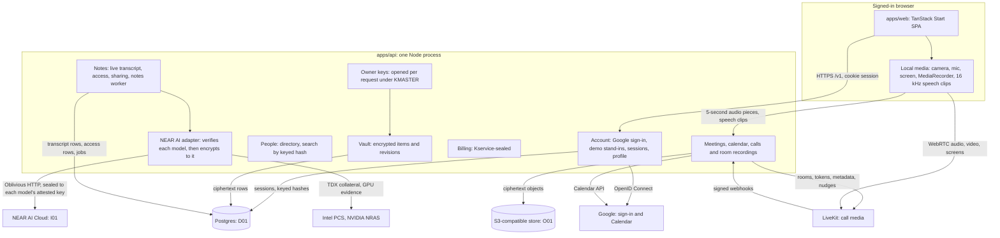

# System architecture

[Docs home](../README.md) · [Privacy, keys and sessions](privacy-keys-and-sessions.md) · [Data and storage](data-and-storage.md) · [Calls and recordings](calls-and-recordings.md) · [Notes and inference](notes-and-inference.md) · [Deployment and acceptance](deployment-and-acceptance.md)

This page describes what is built and how it maps onto the confidential design the product requires.
Where the local build differs from production requirements, the difference is stated explicitly.

## Source ownership

[Folder ownership](folder-ownership.md) is the map and rulebook for source and integration coverage.
Server feature registrars compose in `apps/api/src/app.ts`; the call route delegates to its session page;
`packages/api-http/src/index.ts` composes transport and feature clients. Shared infrastructure and deployment
entry paths stay stable. [The move map](folder-move-map.md) records the reorganization.

## Components

| Path | Responsibility |
| --- | --- |
| `apps/web` | The app: welcome and sign-in, a new account's creation screen and the tour of Home (`src/features/onboarding`; whether the tour was seen is kept in this browser per account, `alcove.tour.<ownerId>`, parsed with `HomeTourSchema`); the frame around its pages (`src/features/shell`: the side panel, the palette that finds notes and asks them, and on phones a top bar and a tab bar); browser notifications while a tab is open (`src/features/shell/notify.ts`, mounted at the root for whoever is signed in, so they carry on in a call: made from the calls, notes and inbox the app loads, nothing pushed or sent; one tab per browser reads and shows them, the holder of the Web Lock `alcove.notify`, through the service worker, which handles a click and hands the window where to go; what's been shown is kept for a day in localStorage per account by kind, IDs and time, `alcove.notified.<ownerId>`, parsed with `NotifiedStoredSchema`); Home (Alcove's calls beside Google Calendar events), starting and scheduling calls and a call's card (`src/features/calls`), pre-join, the full-screen call with its live transcript (your view of it is kept in this browser: preferences per account, `alcove.callView.<ownerId>` with `CallViewPrefsSchema`, and the arrangement of the call you're in per tab until you leave, `alcove.callLayout.<callId>` with `CallLayoutSchema`), notes, the Drive (every workspace you're in, newest first, at `/drive`, each opening at `/drive/<id>`: `src/features/drive`), the room recorder, Team (who at your company uses Alcove, with invitations that open in your own email, and your groups, kept in your preferences: `src/features/team`), and Settings (`src/features/settings`; device choices are this browser's, as pre-join's are). Talks only to `@alcove/api` through `src/lib/api.ts`. |
| `apps/web/src/features/workspace` | The list and document pair, `<Workspace mode="page" \| "call" />`, with Find (`Find.tsx`, over `words.ts`), History (`History.tsx`), Ask (`Ask.tsx`) and the keyboard list (`Keys.tsx`), driven by `api.workspaces.live`: it takes where it is (`at`) and says where to go (`onGo`), so a route or a call keeps the address, and it has no theme of its own (in a call the `.stage` makes the whole document night). A change to the tree shows at once (`changes.ts`) and reaches everyone on the stream. The editor (`editor/`, loaded through `editor/lazy.ts`) mounts after the document's first sync. `keep.ts` is what a session keeps until Alcove has it, sealed in IndexedDB; `sendKept.ts` sends it even if the document isn't opened again, and says so once if it can't get there. `Rescue.tsx` offers what didn't reach Alcove (copy it, save it as a new document, or discard it) wherever it may not get there by itself. `live/` is a call's notes, follow-ups and transcript on its pages and in documents, from a `LiveCall` the call hands it. |
| `apps/api` | The API (`@alcove/server`): Hono on Node, raw SQL via `pg` with zod-parsed rows, crypto via `@noble/ciphers` and `@noble/hashes`, objects via the S3 client, Google ID tokens via `jose`, logs via pino. |
| `packages/api` | The contract: domain types as zod schemas, the `AlcoveApi` interface, live-session interfaces, wire shapes. |
| `packages/api-http` | The browser client: REST, NDJSON streams, raw audio, speech and file uploads, live call and recording sessions, documents being worked on. |
| `packages/board` | A whiteboard's Y.Doc and the logic the app and the API share: its shape and its own settings, reading and writing it, connector routes, templates, its text, landing rooms' boards, where something new lands clear of the rest, stickies from outside it and keeping apart what two people put there at once, a table's cells made with its rows and columns, mind maps, and what a download of a board says for its reader. Pure TypeScript on plain `Y.Doc`s. `apps/web/src/features/board` draws a board with it (More's items in `more/`, the phone's + in `phone.tsx`), on a board's own page in the workspace (`src/features/workspace/BoardPane.tsx`) and in a call (`features/call/boards/BoardStage.tsx`), each loading the board's code the first time a board opens, so a page or a call without one pays nothing for it. The API reads a board's words, puts its template on, and checks what a vote is on with it, in the workers that open documents (`documentText.ts`, `documentOps.ts`). |
| `packages/ui` | The design system. |
| `infra`, `.github/workflows` | GCP bootstrap, deployment guide, CI and deploy pipelines. |

The API is one application with modules (account, people, meetings, calendar, calls, moves, rings, recordings, audio,
transcripts, notes, drafting, writer, series, repeats, billing, workspaces, media, workspaceAccess, workspaceDocuments, documentFirewall, documentWork, documentOps, documentText), not separate services. Modules share one database pool and
one object store, and receive the owner context (the account's keys, opened for this request) explicitly. A transaction
reads on its own connection, never through the pool: ten at once each waiting for a second one would wait for ever. Nothing
waits for a connection longer than 10 seconds, and comes back as an error if it would.
Billing is given only the owner ID and seals its state under `Kservice`. Google sign-in and Calendar live
in `apps/api/src/google.ts` and `features/meetings/calendar.ts`; only `apps/api/src/inference.ts` and `apps/api/src/evidence.ts`
talk to NEAR AI, and only `inference.ts` sends it content.
`apps/api/src/demo.ts` holds the stand-ins for Microsoft and SSO sign-in, the sample calendar and the
company directory until the real providers are connected.

Four things run outside requests, in the same process: maintenance, at start and every 5 minutes; the
notes worker, which starts when a recording stops ([Notes and inference](notes-and-inference.md)); while anyone
has a stream of rings open, a ticker that reads what's ringing once a second ([Calls and recordings › Ringing](calls-and-recordings.md#ringing)); and the hub
(`apps/api/src/live/hub.ts`), one `LISTEN` connection through which API instances tell each other what changed in a
workspace ([Data and storage › Live traffic](data-and-storage.md#live-traffic)). What hears it on each instance is a room,
one for each workspace and one for each document people have open (`live/room.ts`, `features/workspaces/documents.ts`), which
reads each change once for its streams (`live/stream.ts`). Documents are opened in worker threads (`live/docPool.ts`), the only
place that runs Yjs on the server, so what's in one can't stop the event loop. A workspace is an owner of its own, and
`features/workspaces/access.ts` alone decides who can open what in one
([Who can open a workspace](privacy-keys-and-sessions.md#who-can-open-a-workspace)). What a document holds is a Yjs document,
which browsers edit together through the API ([Data and storage › Documents](data-and-storage.md#documents)).

## Request lifecycle

1. The browser sends `GET/POST/PATCH/DELETE /v1/...` with the HttpOnly session cookie. The first
   middleware assigns a request ID (or keeps a well-formed `x-request-id`), returns it as a header, and
   binds it to every log line for the request ([Logging and errors](logging-and-errors.md)).
2. CORS answers only `WEB_ORIGIN`. A state-changing request must come from `WEB_ORIGIN` with a JSON or
   audio body, or on its own route, a shared-screen frame or a piece of a file.
3. Public routes come first: `GET /health` and `/healthz`, `GET /v1/session`, `POST /v1/auth/sign-in`
   (the demo providers), `GET /v1/auth/google` and `GET /v1/auth/google/callback`, `GET /v1/attestation`
   ([what's running](privacy-keys-and-sessions.md#moving-to-confidential-computing)) and `POST /v1/telemetry`.
4. Calls and workspaces come next, each by what it takes: a call pass, or for a workspace a session or a call pass
   (`features/workspaces/access.ts`), since guests have no session, or for reading a file, the token in its URL and the browser's cookie
   ([Privacy › Files](privacy-keys-and-sessions.md#files)). Auth middleware looks the session up in Postgres by the hash of the cookie. No session, or an ended one:
   `401 unauthenticated`, and the app returns to the welcome screen. Otherwise it opens the account's keys
   for this request (`openOwner`) and adds `ownerId` to the log context.
5. Mutations carry `x-alcove-operation` (a random Id128). The idempotency middleware stores an HMAC
   commitment of method, path and body plus the encrypted response; a retry returns the same response, except
   that a call comes back with `documents` empty, because a receipt can't hold a document's name
   ([Requests](privacy-keys-and-sessions.md#requests)), and a different request under the same ID is
   `409 conflict`. Note search, asking, reading who's busy, catching up, caption
   translations, audio pieces, transcript clips, proposals and changes to a note's decisions, open questions,
   follow-ups and transcript lines, having its notes written again, sharing a note, answering an invitation and
   answering a ring keep no receipt.
6. The handler reads and writes through the vault (encrypted manifests), the audio pipeline (encrypted
   objects), transcript rows, `note_access` (who else may read a note), `meeting_access` (who's invited to a call)
   or Kservice-sealed billing, and calls
   Google or NEAR AI where a feature needs them. Failures are `AppError` subclasses; `onError` logs each
   once at its level and answers `{ code, message, requestId }` with a stable code.

## Fixed limits in this build

| Resource | Limit |
| --- | --- |
| Session | 14 days idle, 30 days absolute; several per account; kept in Postgres, so they survive restarts |
| Sign-in | 30 attempts a minute per client address, demo and Google together (browser reports: 60 a minute) |
| Attestation | 30 requests a minute per client address |
| Google sign-in attempt | 10 minutes from leaving for Google to coming back |
| Audio piece | At most 2 MiB (a larger `content-length` is refused before the body is read); WebM, MP4 or Ogg audio; 5-second timeslices |
| Transcript clip | 16 kHz mono 16-bit WAV, at most 30 seconds (960,044 bytes); 240 a minute per account, 40 for each voice in a call |
| Live transcript | The latest 200 lines in a call's or room recording's state |
| Asking | Questions of 1 to 500 characters; 20 a minute per account, about one note or across notes. Across notes, at most 12 notes and 120,000 characters of them are sent, and an answer cites at most six places |
| Notes job | Three attempts, a 180-second lease, retries 20 and 90 seconds after a failure; at most 120,000 characters of transcript sent |
| Calendar | Events from an hour ago to a week ahead, at most 100 |
| Meeting | 5 to 600 minutes, at most 300 people invited and 12 documents brought; a call started now is set to an hour; two or three times offered; picking one: 30 a minute per client address |
| Call participants | No limit; the organizer, people invited and guests by name. Join tokens last 120 seconds, call passes 12 hours |
| Note progress stream | One update a second, for at most two minutes |
| Busy times | At most 31 days and 300 people, 60 reads a minute per account; other people's calendars 50 at a time |
| Rings | A ring lasts 45 seconds, and 20 people can be rung at once. Each browser tab holds one stream, which delivers within about a second, repeats itself every 20 seconds and ends after 210 to 240 seconds. An account holds at most 8, a process 300. |
| Workspace | A name of up to 120 characters; at most 5,000 items in its tree, each named in up to 200, and folders 32 deep; 1,000 people; 30 days in Trash; 100 made per account, 20 a minute; the list and the library read 120 times a minute together |
| Sharing a document | Up to 500 people in all, 100 at a time |
| Workspace and document streams | 500 open together on each instance, for everyone, and 64 from one client address |
| Workspace stream | 8 open per person on each instance; a ping every 25 seconds; opened again after 280 seconds; 120 opened a minute per person; 600 changes a minute per person |
| Document stream | 8 open per person on each instance; opened again after 280 seconds; 240 opened a minute per person; let go of when more than 256 updates or 1 MiB behind |
| Document | An update as big as a document can be, 1,200 a minute and 64 MiB a minute per person; at 16 MiB or 150,000 items on the page only what doesn't add to it goes in, anything but deletes stops at twice that or 450,000 structs in all; types nest at most 1,024 deep; compacts past 200 updates or 1 MiB; a version at most every 10 minutes of editing, the newest 200 and at most 64 MiB of them, 60 reads a minute per person and 8 at once on an instance |
| Document workers | 2 on an instance, 20 seconds a job; 640 MiB for the one that takes big documents, 96 MiB for the others; people take turns, 32 jobs waiting for one person; a document that won't open in that stays closed for 5 minutes; 64 MiB on its way to browsers, a quarter for one person or address, and slower than 128 KiB a second is let go of |
| A call's workspace | 12 documents brought; 100 documents and 50 people on each remembered as worked on; asks to see it 10 a minute per person; anything else that goes on in it 240 a minute per person; its follow-ups read 30 times a minute per connection and ticked 60 times a minute per person, from the 20 documents most recently worked on, 25 from each and 100 in all, each cut at 300 characters |
| Presenter notes | 20,000 characters on each document, and 4,000 beside each of 500 frames of a board, saved 120 times a minute per person |
| Asking about a selection | At most 8,000 characters, 20 a minute per person; a checklist of at most 40 lines |
| Carets and presence | A caret of at most 4 KiB, 1,800 a minute per person; presence 600 a minute per person, said every 10 seconds and forgotten after 30 |
| File in a workspace | At most 512 MiB, in pieces of 4 MiB; a workspace 100 GiB and 20 GiB a day per person, guests included, all of which change without a deploy (`limits.ts`); 600 pieces a minute per person; 240 reads a minute per person, each URL and each piece opened; a URL lasts 12 hours; an answer to a range sends at most 16 MiB; in a process, 16 pieces arriving (4 per person), 32 reads open (8 per person) with 48 waiting up to 10 seconds, and 4 pieces sealed or opened at once; an unfinished upload goes after a day |
| Tags | 240 a minute per person; 200 waiting for one person in one workspace, the newest, for at most 30 days |
| API instances | Any number: sessions and keys come from Postgres on every request, and notes jobs are claimed with leases. Rings go through Postgres, read by each instance's own ticker, and workspace streams hear of changes from other instances the same way. The rate-limit counters, Google access tokens and the timers that retry notes are per process. The prepared deploy runs one, taking 500 requests at once: an open tab holds one for its stream of rings, and a process holds at most 300 of those, 8 for any one account. |

## Local versus production

| Concern | Local build | Required for production |
| --- | --- | --- |
| Trusted compute | Plain Node process | Confidential VM (TEE) with remote attestation the client verifies before sending anything |
| Master key | `KMASTER` from `.env` | Released only to the attested VM, never to operators or the deploy pipeline |
| Sign-in | Google OpenID Connect when `GOOGLE_CLIENT_ID` and `GOOGLE_CLIENT_SECRET` are set; stand-ins for Microsoft and SSO in `apps/api/src/demo.ts` | Google, Microsoft OAuth and OIDC single sign-on, all verified |
| Calendar and directory | Google Calendar for Google accounts; a sample day and week of busy times for demo accounts; a demo directory for `vandelay.industries` | Every provider's calendar and the company's own directory |
| Transport | HTTP on localhost behind the Vite proxy | TLS, plus an attested end-to-end channel (HPKE) so the edge sees only ciphertext |
| Call media | LiveKit in Docker (`infra/livekit/dev.yaml`); LiveKit Cloud in production. End-to-end encrypted: MLS keys made in browsers, frames encrypted before they leave ([Calls and recordings › End-to-end encryption](calls-and-recordings.md#end-to-end-encryption)) | The same |
| Invitations | Sent by Google Calendar when the organizer's calendar is connected; otherwise none | Email (SMTP) as well |
| Object store | RustFS in Docker | Cloudflare R2 |
| Database | Postgres 17 in Docker | Cloud SQL Postgres 17 |
| Inference | NEAR AI Cloud when `NEAR_AI_API_KEY` is set: each model's attestation checked first (its OS image pinned), then everything by Oblivious HTTP sealed to its attested key | The same, with the model code pinned to published provenance |
